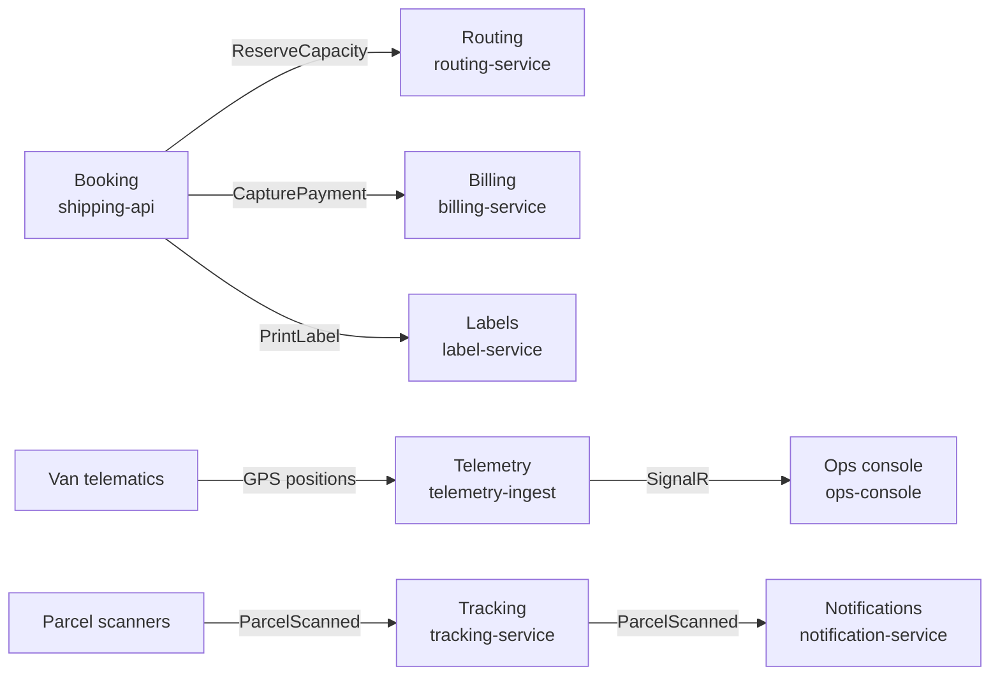

# Modular Monolith vs. Microservices

> **_NOTE:_** Duration: about 9 minutes.

Grey Logistics faces a question that every team asks early: should booking, routing, billing and labels be separate services from the first day? Each function looks like it needs its own team, scale and release cycle, so splitting feels safe. The answer depends on facts about the team and the system, and this topic gives you the criteria to check those facts.

A split also adds cost that a single process never pays. This topic shows that cost, explains why a modular monolith is often the right first step, and places the Grey boundaries.

## Decision Criteria for a Split

Microservices let each service deploy and scale on its own. The Azure Architecture Center describes the gain as agility, where a team updates one service without redeploying the whole application, and scalability, where you add capacity only to the subsystem under load. Four criteria decide whether you collect that gain.

Team size comes first. A service should be small enough for one feature team to build, test and deploy, because large teams slow down under communication and management overhead.

Independent deployability is the second test. If two candidate services must ship together, they form one service with a network call between them.

Scaling is the third. Routing grows with the number of vans, while the tracking page grows with the number of viewers. If two components always need the same capacity, splitting them buys nothing.

Data ownership is the fourth. Two services shouldn't share a data store, because a shared schema couples their release cycles. If Billing reads the Shipment tables directly, the two services still behave as one.

## A Modular Monolith as the Starting Point

A modular monolith deploys as one unit, but its code is organized into modules with the same boundaries a service would have. Each module owns its tables and exposes a small public interface, and other modules call that interface without reading its tables. This is a design choice taught in this class, not a named Azure pattern.

The Azure Architecture Center also asks teams to assess readiness before they decompose a monolith, so the first step is a check of team and infrastructure maturity. For Grey, the first version can host booking, routing, billing and labels in one process. Each module keeps its own schema, so the seams show up in the code and in the database.

When one module needs its own scaling, release train or team, you move it out. The interface you already wrote becomes the contract of the new service, so the change stays small.

## The Cost of Distribution

Each split adds costs that a single process avoids. The Azure Architecture Center lists complexity, testing across service dependencies, network latency along call chains, data integrity, management and versioning among the challenges of microservices. Data integrity hurts most in a parcel business, because a booking that captures a payment and then fails to reserve a van can't roll back as one ACID transaction across two services.

Guidance for that case is to embrace eventual consistency where possible. The table names the other costs that Grey meets once the services exist.

| Cost | What it means for Grey |
| --- | --- |
| Eventual consistency | A booking can be confirmed before its van is assigned. |
| Network calls | Booking calls routing and billing, and each call can fail on its own. |
| Operations | Every service needs its own pipeline, dashboards and rollback path. |
| Versioning | A new field on ShipmentBooked must not break consumers that read the old shape. |

## Grey Logistics Boundaries

Grey draws its boundaries where the business language changes. Booking owns the Shipment aggregate and its event store, and it changes when booking rules change. Routing owns van assignment and reroutes, and it changes when dispatch rules change.

Billing, labels and notifications each change for their own reasons, and each owns its data. Before a split, write the owner, the deployment path and the data store for each candidate on one page. If two candidates share an owner, a pipeline and a table, the split can wait.

Each arrow in the diagram is a call that can fail, so each arrow is a place where the boundary costs something. The Azure Architecture Center adds a test for every boundary: a service should do one job, avoid chatty calls and deploy without its neighbors. The [event storming topic](../03-event-storming/readme.md) derives the full service list from a workshop, using these same tests.

## Key Topics

- [Microservices architecture style](https://learn.microsoft.com/azure/architecture/guide/architecture-styles/microservices)
- [Architecture styles](https://learn.microsoft.com/azure/architecture/guide/architecture-styles/)
- [Identify microservice boundaries](https://learn.microsoft.com/azure/architecture/microservices/model/microservice-boundaries)
- [Data considerations for microservices](https://learn.microsoft.com/azure/architecture/microservices/design/data-considerations)
- [Microservices assessment and readiness](https://learn.microsoft.com/azure/architecture/guide/technology-choices/microservices-assessment)
