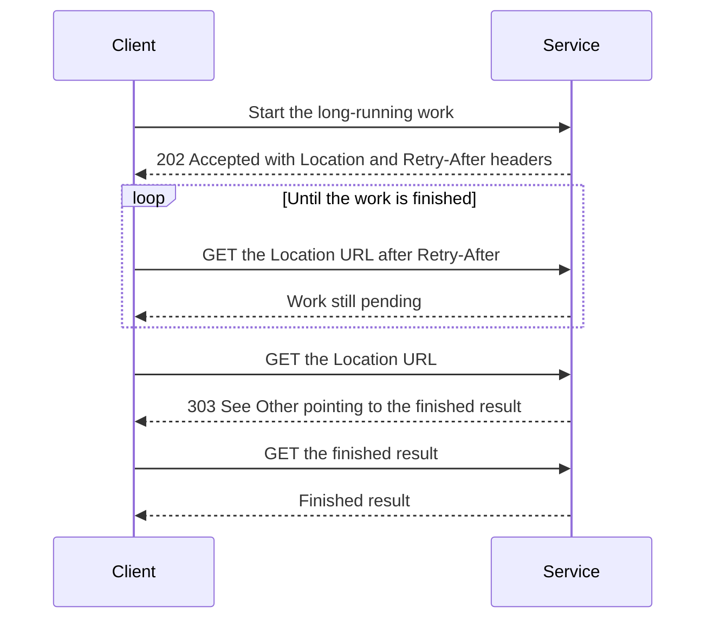

# Sync vs. Async: Commands & Events

> **_NOTE:_** Duration: about 8 minutes.

Grey Logistics has a booking flow that must answer the customer now, and a scan flow that must never lose a parcel. A customer who books a shipment expects the answer in the same request, because the app has to show a shipment ID or a validation error. A scanner sends a parcel update that nobody waits on, and that update must survive a restart of the service that processes it.

This topic separates commands, events and queries, and explains when HTTP is the right transport. It also shows how asynchronous messages reduce temporal coupling, and why they still need a clear answer when a user is waiting.

## Commands, Events and Queries

A command asks a service to act, and the sender expects an action or a failure. BookShipment, ReserveCapacity, CapturePayment and PrintLabel are commands. The sender names the receiver, so the sender knows what it asked for.

An event reports a fact that already happened. ShipmentBooked and ParcelScanned are events, and the publisher doesn't know who listens. Any number of services can react without the publisher changing.

The Microsoft Learn comparison of Azure messaging services makes the same split: an event is a notification whose publisher has no expectation about how it is handled, while a message carries data under a contract between publisher and consumer.

A query asks for data and changes nothing. The tracking page is a query served from a read model. Queries suit HTTP GET because repeating a query is harmless.

| Kind | Name pattern | What the sender expects | Grey example |
| --- | --- | --- | --- |
| Command | Imperative verb | An action, or a failure | ReserveCapacity from Booking to Routing |
| Event | Past-tense fact | Nothing from the consumers | ParcelScanned from a parcel scanner |
| Query | Read request | The current data | Tracking page lookup |

## Request/Reply and Fire-and-Forget

Request/reply means the caller waits for an answer. HTTP is the default transport for it. The BookShipment call waits until shipping-api validates the request and returns the shipment ID, and the caller holds the connection while that happens.

Fire-and-forget means the sender publishes a message and continues. The broker stores the message until a consumer is ready, so a crashed consumer doesn't lose it. The producer stays unblocked unless it loses its connection to the broker, and the consumer retrieves the message after communication resumes.

The Grey scan flow works this way, because a scanner in a warehouse keeps sending while the scan service restarts.

Both styles appear in one booking. The reservation is a synchronous call that Booking waits for, while the ShipmentBooked event travels through the broker to tracking-service.

A request/reply call also needs a timeout, because the caller can't wait forever for a slow or failed service. Set the timeout from how long the customer will wait, so the app can show an error before the customer gives up. Timeouts also release the caller's threads and connections, which otherwise accumulate during an outage.

## Temporal Coupling and When HTTP Is Right

Temporal coupling means that two services must be available at the same moment for a call to succeed. With HTTP, if routing is down while a customer books, the booking fails unless you add a retry or a queue. A broker removes that dependency for commands and events, so the booking succeeds while routing recovers.

HTTP stays the right choice in three cases. The first is when the caller needs the answer to decide its next step, such as a validation error or a shipment ID. The second is a query for current data.

The third is long-running work that the caller polls. The Asynchronous Request-Reply pattern returns 202 Accepted with a Location header and a Retry-After header, and a 303 See Other response points the client to the finished result.

When you are unsure, start with the question the caller asks. If the caller needs the answer to continue, use HTTP. If the caller only needs the work to happen, publish a command or an event.

Asynchronous messaging brings its own costs, including eventual consistency, duplicate deliveries and out-of-order processing. The [reliability patterns topic](../05-reliability-patterns/readme.md) covers how to handle those costs.

## Key Topics

- [Asynchronous Request-Reply pattern](https://learn.microsoft.com/azure/architecture/patterns/asynchronous-request-reply)
- [Asynchronous messaging options](https://learn.microsoft.com/azure/architecture/guide/technology-choices/messaging)
- [Event-driven architecture style](https://learn.microsoft.com/azure/architecture/guide/architecture-styles/event-driven)
- [Microservices architecture style](https://learn.microsoft.com/azure/architecture/guide/architecture-styles/microservices)
