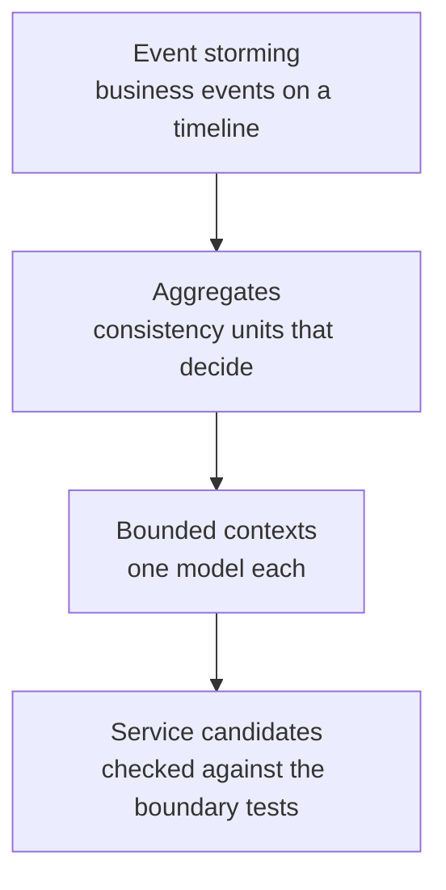

# Event Storming: Find Service Boundaries

Contoso Logistics has a vocabulary problem before it has a code problem. Booking calls a parcel a shipment, Tracking calls it a tracking number, and Billing calls it a charge. Each word hides a different model, and a service boundary belongs where the words change meaning.

Event storming is a workshop method that finds those boundaries with the domain experts in the room. The team places business events on a wall, adds the commands and actors that cause them, and the clusters that appear become bounded contexts. This topic shows the sticky-note grammar and how the Contoso service list follows from it.

## The Sticky-Note Grammar

Event storming uses sticky notes as a small grammar. Events are orange notes written in the past tense, such as ShipmentBooked or ParcelScanned. Commands are blue notes written as imperatives, such as BookShipment or PrintLabel.

Published color conventions differ for the other notes, so this topic names the roles and leaves the colors to the workshop. Actors are the people or systems that issue a command, such as a customer, a dispatcher or a parcel scanner. Policies are rules of the form "whenever this event happens, issue that command", such as "whenever ParcelScanned reports AtHub, notify the customer".

Aggregates are the consistency units that accept a command and emit events, such as the Shipment that accepts BookShipment. Hotspots mark open questions, such as who approves a refund when a van is late. Each hotspot needs an owner and a date for an answer, so the open question doesn't become a hidden dependency.

| Note | Question it answers | Contoso example |
| --- | --- | --- |
| Event | What happened? | ShipmentBooked |
| Command | What asked for it? | CapturePayment |
| Actor | Who or what issued the command? | Parcel scanner |
| Policy | What happens next, automatically? | Whenever ShipmentBooked, reserve capacity |
| Aggregate | Which consistency unit decides? | Shipment |
| Hotspot | What is still unclear? | Who approves a reroute |

## Big Picture, Then Process Level

The big-picture session maps every event on one long timeline, with no commands and no services yet. It finds the business stages, such as booking, pickup, transit, delivery and billing, and it shows where the hotspots cluster. Participants add events quickly, and they postpone arguments about services.

The process level zooms into one flow, such as booking through delivery. The team adds commands, actors, policies and aggregates to each event, and it checks each policy for the component that must react.

The booking flow reads as follows: a customer issues BookShipment, the Shipment aggregate emits ShipmentBooked, and a policy issues ReserveCapacity and CapturePayment. Each step names one aggregate that makes a decision, and that aggregate becomes the unit of ownership. Invite the people who answer for each step, such as a dispatcher for routing and an accountant for refunds, because they use the words the contexts need.

## From Contexts to the Contoso Service List

Once aggregates cluster by language, the team draws a bounded context around each cluster. The Azure Architecture Center states that a microservice shouldn't span more than one bounded context. Between contexts, a context map names the relationship, such as customer-supplier, open host service or anti-corruption layer.

The Contoso contexts come out of the storm as follows. Booking owns the Shipment aggregate and its event store. Routing owns van assignment, with one Dapr actor per van.

Billing owns payments and refunds. Labels owns printed labels and proof-of-delivery photos, and Tracking owns the read model behind the tracking page. Notifications sends customer email, SMS and live browser updates, and Telemetry ingests van positions.

The exception agent reacts to delivery exceptions, and the ops console is a client that reads from these contexts.

| Context | Service | Owns |
| --- | --- | --- |
| Booking | shipping-api | Shipment aggregate, event store in Cosmos DB |
| Tracking | tracking-service | Tracking read model and Redis cache |
| Routing | routing-service | One Dapr actor per van (VanActor) |
| Billing | billing-service | Payments |
| Labels | label-service | Shipping labels and proof-of-delivery photos in Blob Storage |
| Notifications | notification-service | Customer email, SMS and SignalR push |
| Telemetry | telemetry-ingest | Van GPS positions in Event Hubs |
| Exceptions | exception-agent | Delivery exception handling and delivery-note embeddings |

Each candidate then passes the tests from the first topic: one responsibility, no chatty calls, a team that can own it, deployment without its neighbors, and loose coupling. A candidate that fails a test goes back to the storm for another round of discussion. The [modular monolith topic](../01-monolith-vs-microservices/readme.md) explains how to host the contexts in one process first.

## Key Topics

- [Use domain analysis to model microservices](https://learn.microsoft.com/azure/architecture/microservices/model/domain-analysis)
- [Identify microservice boundaries](https://learn.microsoft.com/azure/architecture/microservices/model/microservice-boundaries)
- [Use tactical DDD to design microservices](https://learn.microsoft.com/azure/architecture/microservices/model/tactical-domain-driven-design)
- [Microservices architecture style](https://learn.microsoft.com/azure/architecture/guide/architecture-styles/microservices)
