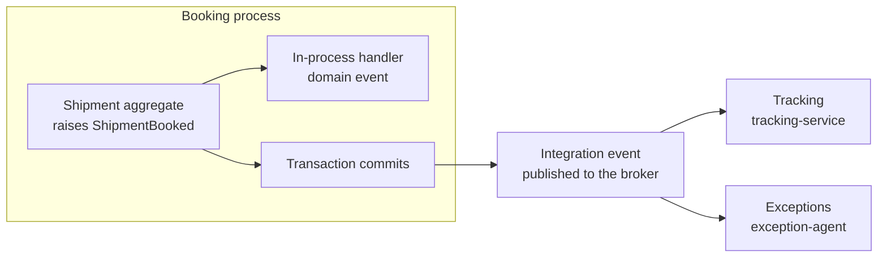

# Event Types: Domain, Integration, CloudEvents

> **_NOTE:_** Duration: about 10 minutes.

When Booking confirms a shipment, three things happen. The Shipment aggregate records the change, the booking module reacts in process, and Tracking and the exception agent learn about it through a broker. Each step carries the same fact in a different form, and the event types you choose decide what each consumer can rely on and how often it must ask back.

This topic separates domain events from integration events, compares notifications with state transfer, and shows the CloudEvents 1.0 envelope that carries Grey messages between services. It ends with C# records for the Grey events.

## Domain Events and Integration Events

A domain event is a fact raised inside one bounded context and handled in the same process. When a shipment is booked, the Shipment aggregate raises ShipmentBooked, and a handler in the booking module updates the customer account. The eShop reference application follows the same split, sending domain events to an in-process dispatcher while integration events go out over an event bus.

An integration event crosses a boundary, so it travels through a broker to other services.

The .NET architecture guidance on domain events says integration events should occur only after the entity is persisted, because otherwise the operation never happened from the consumers' point of view. For Grey, ShipmentBooked leaves Booking only after the Shipment commits. The [reliability patterns topic](../05-reliability-patterns/readme.md) names the pattern that guarantees this.



Integration event contracts belong to the service that publishes them. The labs keep every record in one `Grey.Contracts` project that each service references, so a record change reaches every consumer at once.

## Notifications versus State Transfer

A notification carries the fact and its identifiers. The consumer that needs more details calls the owner, so the flow contains a second request.

A state transfer event carries the new state of the entity, so the consumer updates its own copy without calling anyone.

The Azure Architecture Center describes this as a message that carries the resulting absolute state, which the consumer applies as an upsert to its own copy.

| Style | What the payload holds | Consumer behavior | Grey example |
| --- | --- | --- | --- |
| Notification | The fact, the identifiers and the time | Calls the owner for more detail | ParcelScanned with the parcel ID and scan type |
| State transfer | The new state of the entity | Upserts its own copy | ParcelDelivered with the final delivery facts |

Name events after business facts. The Azure Architecture Center lists two antipatterns to avoid: publishing database rows as events, which leaks internal structure, and publishing generic events that every consumer must interpret. A name such as ParcelDelivered tells the consumer what happened, while a generic name such as RecordChanged forces it to inspect the payload.

## The CloudEvents 1.0 Envelope

Brokers and routing services need a common envelope, so that a consumer can read the type, source and ID without knowing the producer's internal format. CloudEvents is a CNCF graduated project, and specification version 1.0.2 defines four required attributes: id, source, specversion and type. Optional attributes include datacontenttype, subject and time, and data carries the payload.

Event Grid namespace topics accept CloudEvents 1.0 over HTTP with the JSON format, and Dapr wraps each message published through its pub/sub API in a CloudEvents envelope. The Event Grid and Dapr paths in the labs therefore carry this envelope, while the Service Bus messages carry plain JSON with a subject. The example below is a ParcelScanned notification.

```json
{
  "specversion": "1.0",
  "type": "com.grey.logistics.ParcelScanned",
  "source": "/grey/logistics/scanners/hub-ams-01",
  "id": "5f0c2a7e-3b1d-4c8a-9e62-7d41b8a0c913",
  "time": "2026-10-18T09:14:22Z",
  "subject": "parcels/CL-2026-000142",
  "datacontenttype": "application/json",
  "data": {
    "parcelId": "3f6b1c2e-8a4d-4f7e-9b21-5d0c7e9a1b34",
    "shipmentId": "a9d4e1f0-2c7b-4e8a-8f35-6b1d9c0e7a42",
    "trackingNumber": "CL-2026-000142",
    "scanType": "AtHub",
    "scanLocation": "Vienna Hub",
    "scannedAt": "2026-10-18T09:14:22Z"
  }
}
```

The id must be unique per event, and it is the attribute that a consumer uses to detect a duplicate. The subject names the parcel, so routing and filtering can work without parsing data. The source identifies the producer, and the type names the business fact.

Brokers that route by attribute can match on type and subject, so a subscriber can select ParcelScanned events for one parcel without reading the payload.

## C# Records for Grey Events

The records below carry the data objects. The labs keep them in one `Grey.Contracts` project that each service references, so a change to one record is a contract change for every consumer.

```csharp
public enum ScanType
{
    PickedUp,
    AtHub,
    OutForDelivery
}

public sealed record ParcelScanned(
    Guid ParcelId,
    Guid ShipmentId,
    string TrackingNumber,
    ScanType ScanType,
    string ScanLocation,
    DateTimeOffset ScannedAt);

public sealed record ParcelDelivered(
    Guid ShipmentId,
    string TrackingNumber,
    string FinalStatus,
    string RecipientName,
    DateTimeOffset DeliveredAt);

public sealed record Address(string Street, string City, string PostalCode, string Country);

public sealed record ShipmentBooked(
    Guid ShipmentId,
    string TrackingNumber,
    string Sender,
    Address RecipientAddress,
    string ParcelSize,
    decimal ParcelWeight,
    string ServiceLevel,
    DateTimeOffset BookedAt);
```

ParcelScanned is a notification: it records the scan, and Tracking appends it to its own read model without calling Booking. DeliveryDelayed is a notification with a follow-up request: it carries the shipment, the delay reason and the new arrival time, but a consumer that decides on a reroute also needs the delivery attempts, which Delivery owns, so the exception agent calls Delivery for them. The lab's exception agent only logs DeliveryDelayed, so that call exists only in the design. ParcelDelivered is a state transfer: it carries the final facts, so Billing and Notifications can close their own records without a follow-up request. ShipmentBooked carries the booking state that Tracking and the exception agent consume.


## Key Topics

- [CloudEvents support in Event Grid namespaces](https://learn.microsoft.com/azure/event-grid/namespaces-cloud-events)
- [Domain events: Design and implementation](https://learn.microsoft.com/dotnet/architecture/microservices/microservice-ddd-cqrs-patterns/domain-events-design-implementation)
- [Integration events in microservice communication](https://learn.microsoft.com/dotnet/architecture/microservices/multi-container-microservice-net-applications/integration-event-based-microservice-communications)
- [Idempotent Consumer pattern](https://learn.microsoft.com/azure/architecture/patterns/idempotent-consumer)
- [CloudEvents specification](https://cloudevents.io/)
