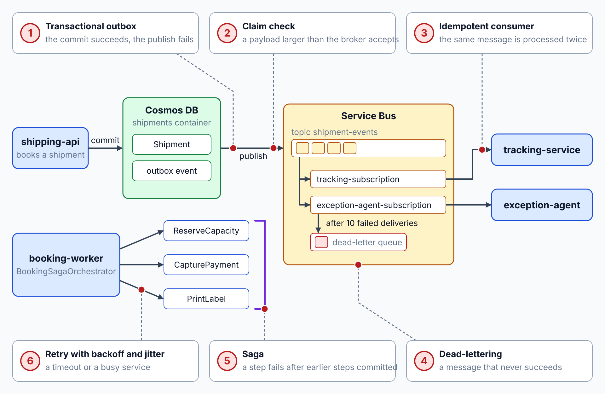

# Reliability Patterns: Outbox, Saga, Idempotency

> **_NOTE:_** Duration: about 10 minutes.

A booking in Contoso Logistics touches several services. It saves a shipment, reserves a van, captures a payment and prints a label, and any step can fail after an earlier step has already committed. Event-driven systems don't fail as one unit, so the design has to say what happens to work that already succeeded.

This topic is a catalog. It names the patterns the class implements, the failure each one prevents, and the topic that teaches the implementation. Nothing here shows code for those patterns, because the linked topics build them step by step.

## Failures That Break Event Flows

Four failures appear in almost every event-driven flow. The first is a dual write: a service commits its database change and then fails to publish the event, so consumers never hear about the change. The reverse also happens when the publish succeeds and the commit rolls back.

The Azure Architecture Center's choreography guidance describes a service that updates its store and publishes an event in separate operations, so one can commit while the other fails.

The second failure is a duplicate. Brokers guarantee at-least-once delivery, so a producer retry, a lost acknowledgment or a consumer crash can deliver the same message twice.

The third is a poison message, one that never succeeds and blocks the queue behind it. The fourth is a transient fault, such as a momentary loss of network connectivity or a busy service, which usually clears if the operation runs again later.

The table maps each failure to the pattern that prevents it and the topic where that pattern is taught.

| Failure | Pattern that prevents it | Taught in |
| --- | --- | --- |
| The commit succeeds and the publish fails, or the reverse | Transactional outbox | [Transactional Outbox: Atomic Publishing](../../06-event-sourcing-cqrs/01-outbox/readme.md) |
| The same message is processed twice | Idempotent consumer | [Idempotent Consumers: Duplicate Detection](../../04-service-bus/06-idempotent-consumers/readme.md) |
| A multi-service step fails after earlier steps committed | Saga with choreography or orchestration | [Saga Orchestration: Compensating Activities](../../08-durable-execution/07-saga/readme.md) |
| A transient fault such as a timeout or a busy service | Retry with exponential backoff and jitter | [Resiliency Policies: Retries & Breakers](../../07-dapr/05-resiliency/readme.md) |
| A message that never succeeds | Dead-lettering after the maximum delivery count | [Dead-Letter Queues: Poison Messages](../../04-service-bus/05-dead-letter/readme.md) |
| A payload larger than the broker accepts | Claim check | [Module 5: Events & Streams](../../05-event-grid-hubs/readme.md) |

## Keeping State and Messages Consistent

The transactional outbox writes the state change and the event in one local transaction. A separate relay publishes the stored event later, so a failed publish is retried from stored data, and a rolled-back transaction leaves no event behind. The Azure Architecture Center says the pattern prevents event loss when a service creates or modifies business objects.

The idempotent consumer records the messages it has processed, using a stable key that survives redelivery. The Azure Architecture Center advises a producer-assigned message ID or a business-level idempotency key, and it warns against the correlation ID, because one correlation ID covers several related messages. Broker duplicate detection reduces duplicate sends within its window, but it doesn't replace idempotent processing on the receiving side.

A saga replaces one distributed transaction with a sequence of local transactions. Each step commits in its own service, and when a later step fails, compensating transactions undo the earlier steps. The Contoso booking saga reserves capacity, captures payment and prints the label, and its compensations release the capacity, refund the payment and void the label.

| Approach | How the steps coordinate | Strength | Weakness |
| --- | --- | --- | --- |
| Choreography | Each service reacts to the events of the others | No central coordinator to fail | Hard to follow as steps grow, and integration tests need every service |
| Orchestration | One orchestrator sends commands and tracks each step | Clear flow and one place for compensations | The orchestrator is a single point of failure to design around |

Choose choreography for a short flow with few services, and orchestration when the flow grows or when someone must see its state at any moment. The Azure Architecture Center presents both as valid saga implementations, so the choice depends on the flow.

## Retries and Dead-Letters

A retry suits a transient fault, because the fault clears on its own. The Azure Architecture Center recommends exponential backoff with jitter, which adds a random delay so that many clients don't retry in the same instant. It also advises a finite retry count, a retry budget per dependency, and never more than one immediate retry.

Retries multiply latency, so every outbound call also needs a timeout. Retries that have no limit keep a struggling service down, which is why the retry count and the backoff must be bounded.

When retries and the maximum delivery count run out, the message moves aside so the rest of the queue keeps moving. Service Bus dead-letters a message after ten failed deliveries by default, and it records the reason, such as MaxDeliveryCountExceeded. Event Grid sends undelivered events to a storage account after its retry policy finishes, once you configure dead-lettering on the subscription, because it doesn't turn dead-lettering on by default.

The dead-letter queue holds the evidence for an operator to inspect, replay or discard.

The claim check pattern covers the last failure in the table. A sender writes a large payload to external storage and sends only a reference through the broker, so the broker never carries the large body. The receiver fetches the payload from storage when it needs it.

## Key Topics

- [Saga distributed transactions pattern](https://learn.microsoft.com/azure/architecture/patterns/saga)
- [Idempotent Consumer pattern](https://learn.microsoft.com/azure/architecture/patterns/idempotent-consumer)
- [Implement the Transactional Outbox pattern by using Azure Cosmos DB](https://learn.microsoft.com/azure/architecture/databases/guide/transactional-out-box-cosmos)
- [Claim-Check pattern](https://learn.microsoft.com/azure/architecture/patterns/claim-check)
- [Best practices for transient fault handling](https://learn.microsoft.com/azure/architecture/best-practices/transient-faults)
- [Overview of Service Bus dead-letter queues](https://learn.microsoft.com/azure/service-bus-messaging/service-bus-dead-letter-queues)
