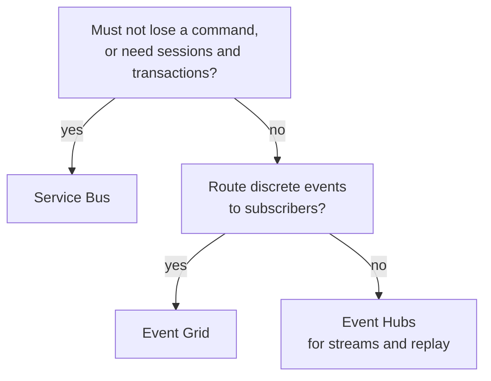

# Azure Messaging: Pick the Broker

> **_NOTE:_** Duration: about 8 minutes.

Contoso Logistics carries four kinds of traffic. Booking sends commands that must not be lost, scanners send ordered parcel updates, vans send a steady stream of GPS positions, and partners want to hear when a parcel is delivered. Azure has a messaging service for each shape, and a wrong choice costs you ordering, retention or replay later.

This topic compares Service Bus, Event Grid, Event Hubs and Dapr pub/sub using the terms that Microsoft Learn uses: messages, events and streams. It finishes with the Contoso traffic that each service carries.

## Messages, Events and Streams

A message carries data under a contract, and the publisher expects a consumer to act on it. Service Bus fits this shape because it offers transactions, sessions, duplicate detection and dead-lettering for high-value payloads in enterprise workflows.

An event is a lightweight notification of a state change, and the publisher doesn't expect a particular reaction. Event Grid fits this shape: it routes discrete events to subscribers, filters them, and retries delivery on a schedule.

A stream is a time-ordered series that many consumers read at their own pace. Event Hubs fits this shape: it keeps events in partitions for a configured retention period, and each consumer group keeps its own position. Telemetry, log aggregation and real-time analytics are its main scenarios.

Dapr pub/sub is a portability layer that sits on top of brokers. Services publish to the Dapr API, and a component decides which broker carries the message. Dapr also wraps each message in a CloudEvents envelope, so consumers read the same attributes whichever component carries it.

The Dapr component index lists Service Bus topics, Service Bus queues and Event Hubs as Azure components, and it lists no Event Grid component.

## Comparison by Delivery, Ordering and Retention

The table compares the four options on the criteria that change a design most. Dapr delegates several of these criteria to its component, so the table marks those cells as component-dependent.

| Criterion | Service Bus | Event Grid | Event Hubs | Dapr pub/sub |
| --- | --- | --- | --- | --- |
| Unit | Message | Event | Event in a stream | Message through a component |
| Delivery | At least once; duplicate detection drops resends within its window | At least once, with retries that can produce duplicates | At least once; one active reader per partition in each consumer group | At least once |
| Ordering | FIFO within a session | No guarantee | Per partition | Component-dependent |
| Retention | Until the message time to live expires | Custom topic TTL of 1 to 1440 minutes; namespace topic up to 7 days | 1 to 90 days, depending on tier | Component-dependent |
| Dead-letter | Dead-letter sub-queue | Storage account, when configured | None built in | Component-dependent |
| Consumption | Receivers pull messages; Azure Functions can also trigger on a queue or topic | Pushed to endpoints; namespace topics also support pull | Consumers read partitions and checkpoint their position | Pushed to the app endpoint |
| Protocols | AMQP, HTTP | MQTT, HTTP | AMQP, Kafka, HTTP | Dapr API |
| Transactions | Yes | No | No | Component-dependent |

Read the table by column when you choose a service, and by row when you compare two services. The rows that decide most designs are ordering, retention and dead-lettering, because a missing feature in any of them is expensive to build around later.

## Contoso Traffic on Each Service

![Animated lanes for the Contoso traffic: ParcelScanned messages of one session leave Service Bus in order and are removed once scan-processor consumes them, while an unreadable label scan that keeps failing moves to the dead-letter queue; VanPositionReported entries stay in an Event Hubs partition keyed by van ID while telemetry-ingest and the ops console map read them at different speeds; Event Grid pushes ParcelDelivered to every partner at once; Dapr pub/sub carries DeliveryDelayed to notification-service](_images/contoso-traffic.svg)

Service Bus carries the booking commands. ReserveCapacity and PrintLabel travel as messages, and each scan of a parcel is a ParcelScanned message with the tracking number as its session ID, so scans of one parcel are processed in order. An unreadable label scan that keeps failing ends in the dead-letter queue, where an operator can inspect it.

Event Hubs carries van telemetry. The van simulator publishes VanPositionReported positions over the Kafka endpoint with the van ID as the message key, which keeps each van's positions in order. telemetry-ingest reads the stream with EventProcessorClient and pushes each position to the ops console map through SignalR.

Event Grid carries proof of delivery. A driver's photo uploaded to Blob Storage raises a system event, and partners receive ParcelDelivered through a custom topic or by pulling from a namespace. Event Grid suits this shape because the publisher is an Azure resource and the consumers are reactive.

Dapr pub/sub carries delivery exceptions to the notification service. The publishing service calls the Dapr API with DeliveryDelayed, and notification-service subscribes without a dependency on a broker SDK. Swapping Service Bus topics for Event Hubs then becomes a component change, and the service code stays the same.

Check ordering first, because it is the hardest property to add later, and check retention second, because replay depends on it. The Contoso system therefore runs three Azure brokers side by side, with Dapr pub/sub as the portable layer on the notification path.

## Key Topics

- [Choose between Azure Event Grid, Event Hubs, and Service Bus](https://learn.microsoft.com/azure/service-bus-messaging/compare-messaging-services)
- [What is Azure Service Bus?](https://learn.microsoft.com/azure/service-bus-messaging/service-bus-messaging-overview)
- [What is Azure Event Hubs?](https://learn.microsoft.com/azure/event-hubs/event-hubs-about)
- [What is Azure Event Grid?](https://learn.microsoft.com/azure/event-grid/overview)
- [Pub/sub overview in Dapr](https://docs.dapr.io/developing-applications/building-blocks/pubsub/pubsub-overview/)
