# Aspire AppHost: Model the System

> **_NOTE:_** Duration: about 8 minutes.

Grey Logistics runs several services, a message bus and a database, and each one needs the others' addresses before it starts.
This topic shows how an AppHost describes that system in C#, so one command starts every resource in the right order.

## The AppHost Declares Resources

An Aspire AppHost is a .NET project that builds a model of the whole application. Each call on the builder adds a resource to that model, and `Build().Run()` starts them. A resource can be a .NET project, a container, an executable, or a cloud service that Aspire emulates on the developer machine.

The model is typed, so a wrong project reference fails at compile time. The `Projects` type is generated from the AppHost's project references, and `Projects.ShippingApi` refers to the `ShippingApi` project. The string argument names the resource, and the dashboard and other resources use that name too.

Pick resource names that read well in a URL, such as `shipping-api`, because service discovery resolves other services by the same name. The name also labels the resource in the dashboard, so one name appears in the logs, traces and metrics of that service.

```csharp
var builder = DistributedApplication.CreateBuilder(args);

builder.AddProject<Projects.ShippingApi>("shipping-api");
builder.AddProject<Projects.TrackingService>("tracking-service");

builder.Build().Run();
```

Each `AddProject` call returns a resource builder. The chained calls that follow describe how that resource connects to the rest of the system.

Because the model is C# code, a change to the topology goes through review like any other change. A new dependency appears as a diff in the AppHost, so a reviewer sees which service gains a connection before it ships. Reviewers can also read the wiring without running anything.

| Call | What it adds to the model |
| --- | --- |
| `DistributedApplication.CreateBuilder(args)` | The builder that collects every resource |
| `AddProject<T>(name)` | A .NET project, referenced through the generated `Projects` type |
| `AddAzureServiceBus(name)` | A Service Bus namespace, provisioned in Azure or emulated with `RunAsEmulator` |
| `AddAzureCosmosDB(name)` | A Cosmos DB account, provisioned in Azure or emulated with `RunAsEmulator` |
| `AddParameter(name)` | A configuration value that Aspire reads at startup |

## Wiring Dependencies with WithReference and WaitFor

`WithReference` gives a dependent resource the connection details of another resource. Aspire passes them as environment variables, so the service reads them through its client package and keeps connection strings out of source.

`WaitFor` delays a dependent resource until the resource it names reaches the Running state. Without it, the tracking service can start before the bus is ready. The wait orders the startup, and it does not replace retries in the client code.

```csharp
var builder = DistributedApplication.CreateBuilder(args);

var messaging = builder.AddAzureServiceBus("messaging")
    .RunAsEmulator();
var shipmentEvents = messaging.AddServiceBusTopic("shipment-events");
shipmentEvents.AddServiceBusSubscription("tracking-subscription", "tracking");

var cosmos = builder.AddAzureCosmosDB("cosmos")
    .RunAsEmulator();
var logistics = cosmos.AddCosmosDatabase("logistics");
logistics.AddContainer("shipments", "/shipmentId");
logistics.AddContainer("tracking-container", "/trackingNumber", "tracking");

var shippingApi = builder.AddProject<Projects.ShippingApi>("shipping-api")
    .WithReference(cosmos)
    .WithReference(messaging)
    .WaitFor(cosmos)
    .WaitFor(messaging);

var trackingService = builder.AddProject<Projects.TrackingService>("tracking-service")
    .WithReference(cosmos)
    .WithReference(messaging)
    .WaitFor(cosmos)
    .WaitFor(messaging);

builder.Build().Run();
```

The shipping API owns the `shipments` container, and its partition key is `/shipmentId`. The tracking service reads the `tracking` read model, keyed by `/trackingNumber`, and subscribes to the `shipment-events` topic through the namespace reference.

The diagram shows the same model as dashboard tiles. The AppHost frame holds every resource and service, and each WithReference arrow runs from a resource up into the service that references it, carrying a connection-string chip. WaitFor rows sit inside each service tile.



## Parameters for Secrets and Settings

`AddParameter` declares a value that the AppHost needs but does not hard-code. The `secret` flag marks the value as sensitive, so the routing service receives an API key without the key appearing in source.

```csharp
var routingApiKey = builder.AddParameter("routing-api-key", secret: true);

var routingService = builder.AddProject<Projects.RoutingService>("routing-service")
    .WithReference(messaging)
    .WaitFor(messaging)
    .WithEnvironment("ROUTING_API_KEY", routingApiKey);
```

Aspire looks for the value in environment variables first, then in configuration files and user secrets. It asks the developer when no source holds the value. An environment variable uses the form `Parameters__routing_api_key`, with dashes replaced by underscores.

A parameter keeps the value out of the AppHost source, so the same model runs on every developer machine with that developer's own key. A parameter with no value prompts the developer on the first run, so a new team member sees exactly which settings the system needs.

## Running the Model with the Aspire CLI

The Aspire CLI runs the AppHost. `aspire run` builds the project, starts every resource, starts the dashboard, and prints the endpoints. It also records the selected AppHost in `aspire.config.json`.

```bash
aspire run
```

The run output includes the dashboard URL with a login token, so the developer opens the dashboard without searching the terminal output. Press Ctrl+C to stop the AppHost. The `--isolated` option randomizes the ports and separates user secrets, so a second copy of the Grey system can run beside the first.

| Command | Use it for |
| --- | --- |
| `aspire add azure-service-bus` | Add the Service Bus hosting package and record its version |
| `aspire run` | Start the AppHost, its resources and the dashboard |
| `aspire run --isolated` | Run a second copy with randomized ports and separate user secrets |
| `aspire start --apphost <path>` | Start the AppHost in the background and return, so a script can continue |
| `aspire describe --format Json` | List each resource with its state and health, as JSON |
| `aspire wait <resource>` | Block until the named resource is healthy, bounded by `--timeout` |
| `aspire ps` | List the AppHosts that are running |
| `aspire stop --apphost <path>` | Stop the AppHost that `aspire start` launched |

## Key Topics

- [Aspire external parameters](https://aspire.dev/fundamentals/external-parameters/)
- [aspire run command reference](https://aspire.dev/reference/cli/commands/aspire-run/)
- [Set up Azure Service Bus in the AppHost](https://aspire.dev/integrations/cloud/azure/azure-service-bus/azure-service-bus-host/)
- [Aspire integrations overview](https://aspire.dev/integrations/overview/)
