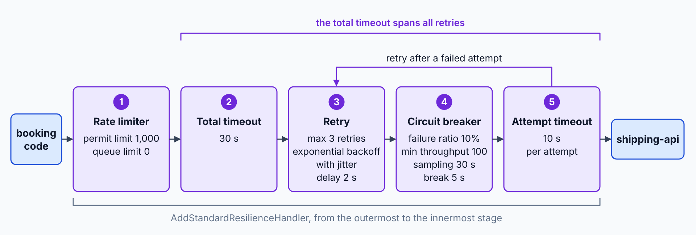

# ServiceDefaults: Telemetry, Resilience, Discovery

> **_NOTE:_** Duration: about 8 minutes.

Every Grey service needs the same telemetry, retry and discovery behavior, and services that each configure it on their own drift apart.
The ServiceDefaults project that the Aspire template generates holds that behavior once, and each service opts in with one method call.

## One Call Opts a Service In

The template adds a ServiceDefaults project to the solution, and each service references it. The `AddServiceDefaults` extension method extends `IHostApplicationBuilder`, so web apps and worker services use the same call.

```csharp
var builder = WebApplication.CreateBuilder(args);

builder.AddServiceDefaults();

var app = builder.Build();

app.MapDefaultEndpoints();

app.Run();
```

`AddServiceDefaults` sets the `Azure.Experimental.EnableActivitySource` switch and configures OpenTelemetry, health checks, the HTTP client defaults and service discovery. `MapDefaultEndpoints` maps the health endpoints, and it maps them only in the Development environment.

## OpenTelemetry Signals for Every Service

`ConfigureOpenTelemetry` runs inside `AddServiceDefaults` and wires logs, metrics and traces to OpenTelemetry. The exporter endpoint comes from configuration, so the code stays the same in every environment. `UseOtlpExporter` runs only when the standard `OTEL_EXPORTER_OTLP_ENDPOINT` setting is present, so setting that variable redirects every signal of the service without a code change.

| Signal | Instrumentation the defaults add |
| --- | --- |
| Logs | `builder.Logging.AddOpenTelemetry`, so `ILogger` output becomes OpenTelemetry log records |
| Metrics | ASP.NET Core, `HttpClient` and runtime instrumentation |
| Traces | ASP.NET Core and `HttpClient` instrumentation, plus the application's activity source and the `Azure.*` sources, with health endpoint requests filtered out |

The defaults register the application name as a trace source. A domain area such as shipment booking needs its own source, so the service adds one with `AddSource`.

```csharp
builder.Services.AddOpenTelemetry()
    .WithTracing(tracing => tracing.AddSource("Grey.Shipping"));
```

The `ActivitySource` in the booking code must use the same name, or its spans never reach the exporter. A custom source adds spans only where the code starts an activity, so a booking step that runs in memory needs its own span to appear in the trace waterfall.

The logs and traces share one identifier. A log line written inside a request carries the trace and span identifiers of that request, so a developer moves from a slow span to the log lines it produced.

## Standard Resilience on Every HTTP Client

Calls between Grey services fail for ordinary reasons, such as a restarting container or a slow database. The standard resilience handler adds retries, timeouts and a circuit breaker to every `HttpClient` that the factory creates.



Retries replay requests, so a booking call to the shipping API must be idempotent. Retries also wait between attempts, so a recovering service does not receive a burst of requests the moment it returns. The [reliability patterns topic](../../01-distributed-design/05-reliability-patterns/readme.md) in Module 1 covers that design rule.

```csharp
builder.Services.ConfigureHttpClientDefaults(http =>
{
    http.AddStandardResilienceHandler();
    http.AddServiceDiscovery();
});
```

The handler applies to clients that the factory creates. A bare `new HttpClient()` outside the factory gets no retries, so the booking code requests its client through `IHttpClientFactory` or a typed client. Timeouts stop a slow dependency from holding a request open indefinitely.

## Service Discovery with https+http

Services address each other by resource name, not by host and port. The `https+http` scheme tells the resolver to prefer HTTPS and fall back to HTTP, so the client code works whichever scheme the target exposes.

```csharp
builder.Services.AddHttpClient<ShippingClient>(client =>
{
    client.BaseAddress = new Uri("https+http://shipping-api");
});
```

| Base address | Resolves to |
| --- | --- |
| `https://shipping-api` | The HTTPS endpoint only |
| `http://shipping-api` | The HTTP endpoint only |
| `https+http://shipping-api` | HTTPS when available, HTTP otherwise |

The name after the scheme must match the resource name in the AppHost, such as `shipping-api` from the [AppHost topic](../01-apphost/readme.md). The `AddServiceDiscovery` call in the defaults registers the resolver for every `HttpClient`.

The resolver looks up the names that the AppHost registered. The same client code therefore runs under `aspire run` without a host name in configuration.

## Health Endpoints for Probes and Checks

The defaults expose two endpoints. `/health` reports every registered check, and `/alive` reports only checks tagged `live`, so a liveness probe does not depend on downstream services. During development, `/health` is the endpoint to open in a browser, because it lists every check that the service registered.

| Endpoint | Reports | Mapped |
| --- | --- | --- |
| `/health` | All health checks | Development only, through `MapDefaultEndpoints` |
| `/alive` | Checks tagged `live` | Development only |

A platform probe can point at `/alive` for liveness and at `/health` for the full check, so a slow database does not trigger a restart of a process that is still alive. Mapping these endpoints outside Development is a deliberate decision. Exposing them has security implications, so a production service maps them only when its platform probes need them.

## Key Topics

- [Aspire service defaults](https://aspire.dev/get-started/csharp-service-defaults/)
- [Aspire service discovery](https://aspire.dev/fundamentals/service-discovery/)
- [Distributed tracing in .NET](https://learn.microsoft.com/dotnet/fundamentals/networking/telemetry/tracing)
- [Distributed tracing and correlation through Service Bus messaging](https://learn.microsoft.com/azure/service-bus-messaging/service-bus-end-to-end-tracing)
