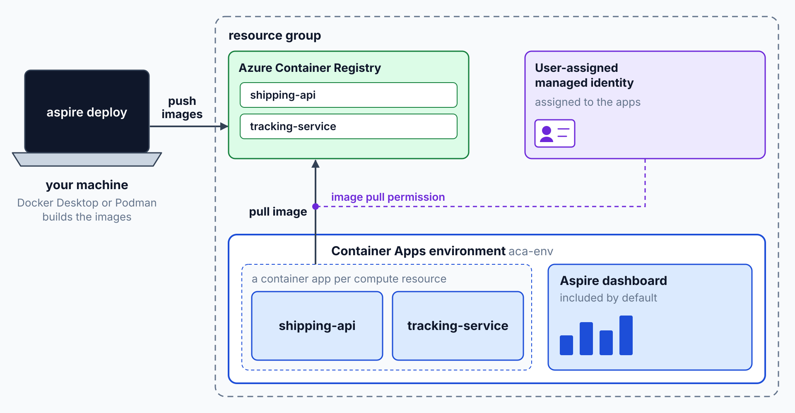
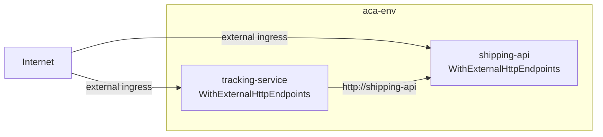

# Aspire Deploy: ACR & Container Apps

> **_NOTE:_** Duration: about 7 minutes.

Contoso Logistics has nine components. Each one needs a container image, a registry to hold it, an environment to run in, and an identity that lets it pull the image. Building that by hand for every service makes the first deploy slow and every later change risky.

This topic shows how the AppHost declares the Azure Container Apps environment as a resource and how `aspire deploy` provisions the registry, the environment, and the apps. It then covers how ingress decides which services other apps can call, and it ends with ACR Tasks for image builds in a CI pipeline.

## Declare the environment and deploy it

The environment is a resource in the AppHost. Aspire 9.4 removed the hybrid mode in which azd created the environment, so an app that targets Container Apps must declare the environment explicitly. Without that call, the deployment has no target for the containers. The AppHost project needs the `Aspire.Hosting.Azure.AppContainers` package for this call.

```csharp
var builder = DistributedApplication.CreateBuilder(args);

builder.AddAzureContainerAppEnvironment("aca-env");

var tracking = builder.AddProject<Projects.TrackingService>("tracking-service");

builder.AddProject<Projects.ShippingApi>("shipping-api")
    .WithExternalHttpEndpoints()
    .WithReference(tracking);

builder.Build().Run();
```

The environment includes the Aspire dashboard by default. Chain `WithDashboard(false)` on the environment call to omit it. The dashboard can't use a custom domain, so it runs on the default Container Apps domain name.

Run `az login` once, then run `aspire deploy` from the solution folder that contains the AppHost. The first run prompts for a subscription, a resource group, and a location unless `Azure__SubscriptionId`, `Azure__Location` and `Azure__ResourceGroup` are set, and `--non-interactive` skips the prompts. The command provisions the infrastructure, builds and pushes the images, deploys the apps, and prints the dashboard URL.

```bash
az login
aspire deploy
```

The deployment creates these resources.



| Resource | Purpose |
| --- | --- |
| Container Apps environment | Hosts the apps and includes the Aspire dashboard by default |
| Azure Container Registry | Stores the images, either provisioned for the environment or attached with `WithAzureContainerRegistry` |
| User-assigned managed identity | Gives the apps an identity that can pull images from the registry |
| Image pull permission | Lets the apps pull images without registry credentials in the deployment |
| Container app per compute resource | Runs each service from the AppHost |
| Azure Files shares | Created only when the model declares a volume or bind mount, to back it |

Because the deployment creates the registry and the identity, you don't pass registry credentials. Run `aspire destroy --yes` when you finish, because it deletes the entire resource group. The Aspire CLI reference labels `aspire deploy` as preview, so confirm its current status before you depend on it in a production pipeline.

## Ingress and calls by app name

Ingress decides whether a service receives traffic from outside its environment. `WithExternalHttpEndpoints` publishes an endpoint. A service without that call stays internal, so only apps in the same environment can reach it.

Use the external call only for endpoints that clients outside the environment must reach.

The shared service defaults map `/health` in every environment, not only Development, so an external endpoint can be probed from outside your machine.

The lab's AppHost calls `WithExternalHttpEndpoints` on `shipping-api` and `tracking-service`, the two services that clients reach from outside. Other apps in the environment call an app by its name, so `tracking-service` reaches `shipping-api` at `http://shipping-api`, and that traffic never leaves the environment.

`ops-console` and `exception-agent` run only in local runs. Each one calls `ExcludeFromManifest()`, so `aspire deploy` leaves them out of the deployment.



```csharp
var response = await httpClient.GetAsync("http://shipping-api/");
response.EnsureSuccessStatusCode();
```

Container Apps app names must be 2 to 32 characters long. They use lowercase letters, numbers, and hyphens, start with a letter, and end with an alphanumeric character. The names `shipping-api` and `tracking-service` meet those rules.

## Build images with ACR Tasks

`aspire deploy` builds the images on your machine, so Docker Desktop or Podman must be running. A CI job can skip the local container runtime by building in the registry with ACR Tasks. The `az acr build` command builds the image in the registry without pulling or pushing it locally.

```bash
az acr build --registry <REGISTRY_NAME> --image tracking-service:<TAG> --file Dockerfile .
```

Registry names must be unique in Azure and contain 5 to 50 lowercase alphanumeric characters. After the build, point the app at the new image with `az containerapp update --image`, which creates a new revision. The revisions topic explains how traffic moves during that change.

## Key Topics

- [Deploy to Azure Container Apps with Aspire](https://aspire.dev/deployment/azure/container-apps/)
- [Aspire deployment overview](https://aspire.dev/deployment/deploy-with-aspire/)
- [Communicate between container apps in Azure Container Apps](https://learn.microsoft.com/azure/container-apps/connect-apps)
- [Ingress in Azure Container Apps](https://learn.microsoft.com/azure/container-apps/ingress-overview)
- [az acr build](https://learn.microsoft.com/cli/azure/acr#az-acr-build)
