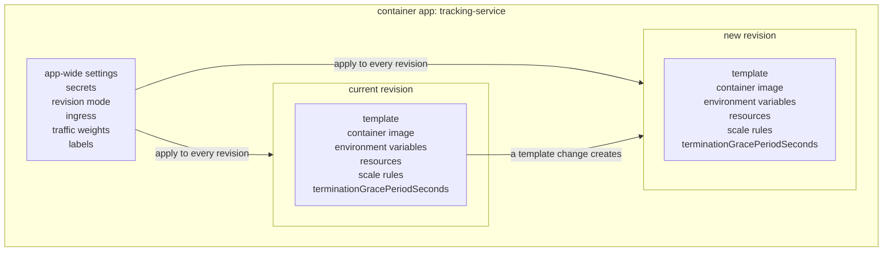
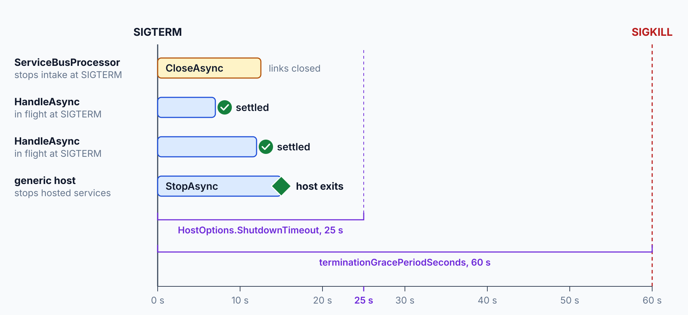

# Revisions: Traffic Splitting & Draining

> **_NOTE:_** Duration: about 7 minutes.

A new tracking-service release must not reach every parcel at once, so a bad release needs a way to stay small. Container Apps keeps each version of an app as a revision, and you decide how much traffic each revision receives. The same revisions give you a way back when a release misbehaves.

This topic covers the three revision modes, traffic weights and rollback, the changes that create a revision, and graceful shutdown for message consumers. The consumer section ties shutdown to Service Bus, where an unsettled message returns to the queue when its lock expires.

## Choose a revision mode

Single mode is the default. A new revision replaces the old one after its replicas pass their probes, and the old revision deactivates on its own. Multiple mode keeps several revisions active and lets you set the traffic weights.

Labels are a preview mode that gives named revisions a stable URL.

| Mode | Behavior | Use it for |
| --- | --- | --- |
| Single | The new revision takes over after its replicas are ready, and old revisions deactivate automatically | Most services in the class |
| Multiple | Several revisions stay active, and you set the traffic weight of each | Blue-green and canary releases |
| Labels (preview) | Named revisions, such as `dev`, `staging`, and `prod`, each get a stable URL | Testers who need a fixed address |

Switch an app to multiple mode with the Azure CLI. Enable it only on apps that need weighted traffic. A later `aspire deploy` returns the app to single mode, so run this command again after each deploy.

```bash
az containerapp revision set-mode --resource-group <RESOURCE_GROUP> --name tracking-service --mode multiple
```

## Split traffic and roll back

Traffic weights across revisions must add up to 100. Set the weights by revision name or by label with `az containerapp ingress traffic set`. The command below sends 90 percent of requests to the current revision and 10 percent to the new one.



```bash
az containerapp ingress traffic set --resource-group <RESOURCE_GROUP> --name tracking-service --revision-weight <OLD_REVISION>=90 <NEW_REVISION>=10
```

Rolling back uses the same command with the previous revision at 100. Keep the previous revision active until the new one proves itself, and the rollback then needs only a traffic change.

A label gives a revision its own URL. Move the label to another revision to promote it, and the URL stays the same. Labels are useful for a canary group that must reach one revision directly.

```bash
az containerapp revision label add --resource-group <RESOURCE_GROUP> --name tracking-service --revision <NEW_REVISION> --label canary
```

## What creates a revision and how consumers drain

A change to the template creates a revision. The template holds the container image, the environment variables, the resources, and the scale rules. Changes to secrets, the revision mode, ingress, traffic weights, and labels apply to every revision and don't create one.



When a replica scales in, when the app is deleted, or when a revision deactivates, the platform sends SIGTERM to the container. The container has a termination grace period to exit. The default is 30 seconds, and after that the platform sends SIGKILL.

The property is `terminationGracePeriodSeconds` on the template, so a change to it creates a revision.

```json
{
  "properties": {
    "template": {
      "terminationGracePeriodSeconds": 60
    }
  }
}
```

The .NET generic host handles SIGTERM by stopping its hosted services. `HostOptions.ShutdownTimeout` sets how long `StopAsync` waits, and the default is 30 seconds. Set the Container Apps grace period longer than the host timeout, so the host can finish before the platform kills the replica.



```csharp
using Microsoft.Extensions.Hosting;

var builder = Host.CreateApplicationBuilder(args);

builder.Services.Configure<HostOptions>(options =>
{
    options.ShutdownTimeout = TimeSpan.FromSeconds(25);
});

builder.Services.AddHostedService<DeliveryConsumer>();

var host = builder.Build();
await host.RunAsync();
```

The consumer stops intake and lets in-flight handlers finish. `StopProcessingAsync` waits for the in-flight message handlers to complete, so handlers that are already running finish first.

```csharp
using Azure.Messaging.ServiceBus;
using Microsoft.Extensions.Hosting;

public sealed class DeliveryConsumer(ServiceBusClient client) : BackgroundService
{
    private ServiceBusProcessor? _processor;

    protected override async Task ExecuteAsync(CancellationToken stoppingToken)
    {
        _processor = client.CreateProcessor("parcel-scans", new ServiceBusProcessorOptions());
        _processor.ProcessMessageAsync += HandleAsync;
        _processor.ProcessErrorAsync += args => Console.Error.WriteLineAsync(args.Exception.Message);
        await _processor.StartProcessingAsync(stoppingToken);
    }

    private async Task HandleAsync(ProcessMessageEventArgs args)
    {
        await args.CompleteMessageAsync(args.Message);
    }

    public override async Task StopAsync(CancellationToken cancellationToken)
    {
        if (_processor is not null)
        {
            await _processor.StopProcessingAsync(cancellationToken);
        }

        await base.StopAsync(cancellationToken);
    }
}
```

Settle each message before the handler returns. An unsettled message returns to the queue when its lock expires, and its delivery count goes up. Call `AbandonMessageAsync` for a message the handler can't finish, so the message becomes available at once for the next receiver.

## Key Topics

- [Update and deploy changes in Azure Container Apps](https://learn.microsoft.com/azure/container-apps/revisions)
- [Traffic splitting in Azure Container Apps](https://learn.microsoft.com/azure/container-apps/traffic-splitting)
- [Application lifecycle management in Azure Container Apps](https://learn.microsoft.com/azure/container-apps/application-lifecycle-management)
- [.NET Generic Host](https://learn.microsoft.com/dotnet/core/extensions/generic-host)
- [Message transfers, locks, and settlement in Azure Service Bus](https://learn.microsoft.com/azure/service-bus-messaging/message-transfers-locks-settlement)
