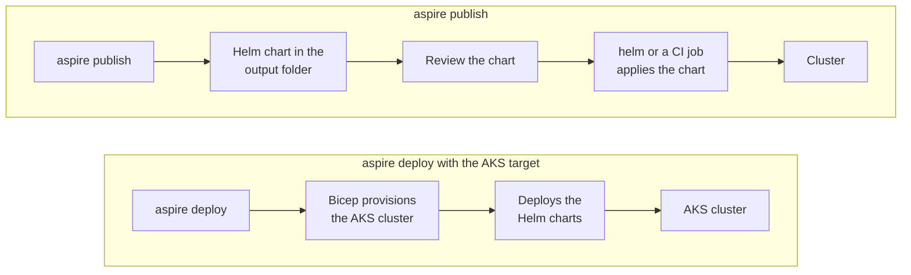

# AKS: Aspire-Generated Kubernetes Manifests

> **_NOTE:_** Duration: about 7 minutes.

Most Contoso Logistics services run on Container Apps, but the routing service keeps one Dapr actor per van. Container Apps managed Dapr doesn't support the actor SDK package, so that service needs a host where you control the Dapr extension. Aspire can generate the Kubernetes deployment from the same AppHost, so the service graph stays in one place.

This topic explains what Aspire 13.6 publishes for Kubernetes, how the AKS environment and `aspire deploy` work together, what the ingress preview adds, and how the Dapr extension installs the runtime on the cluster.

## Publish Helm charts and deploy with the AKS target

For the Kubernetes target, `aspire publish` writes a Helm chart that you apply with `helm` or a CI job. The default output folder is `aspire-output` beside the AppHost, and the `-o` option changes it. The Aspire CLI reference labels `aspire publish` as preview.

```bash
aspire publish -o ./k8s-output
```

The two targets differ in what they do with the output. The table lists what each command produces and what it changes.

| Target | `aspire publish` output | `aspire deploy` action |
| --- | --- | --- |
| Kubernetes | Helm charts you apply with `helm` or CI | Deploys to the current `kubectl` context with `helm install` |
| AKS | Helm charts and Bicep infrastructure | Provisions Azure resources and deploys in a single command |

Use `aspire publish` when a pipeline applies the chart and `aspire deploy` when Aspire should provision and deploy in one step. The publish step doesn't change the cluster, so you can review the chart before it reaches an environment. Learn's Orleans Kubernetes guide describes plain YAML files in the same output, so open the folder before you apply anything.



## Declare the AKS environment in the AppHost

The AKS integration lives in the `Aspire.Hosting.Azure.Kubernetes` package. `AddAzureKubernetesEnvironment` declares the cluster as a compute environment, and the methods on the returned builder configure its system node pool, user node pools, registry, and workload identity.

```csharp
var builder = DistributedApplication.CreateBuilder(args);

var aks = builder.AddAzureKubernetesEnvironment("aks")
    .WithSystemNodePool();

aks.AddNodePool("routing", vmSize: "Standard_D2s_v5", minCount: 1, maxCount: 3);

builder.AddProject<Projects.RoutingService>("routing-service");

builder.Build().Run();
```

The `WithSystemNodePool` call uses the default VM size and node counts, and `AddNodePool` adds a second pool named `routing` for the routing workload. The AKS environment is an Azure resource, so `aspire deploy` creates the cluster the first time it runs, and the cluster bills until you delete its resource group.

The other builder methods shape the cluster around the existing network and registry. `WithContainerRegistry` attaches the registry that holds the images, and `WithWorkloadIdentity` turns workload identity on or off for the cluster. `WithSubnet` takes an Azure subnet resource, so the cluster can join a subnet that you already defined.

## Ingress preview and the Dapr extension on AKS

Ingress on AKS and Gateway API on AKS are preview features in the Aspire documentation. Use them when routing-service must be reachable through a cluster ingress, and check the Aspire reference for the current API before you depend on it.

The Dapr extension installs the Dapr runtime on the cluster as a managed cluster extension, so you don't install or upgrade the runtime yourself. Learn documents the install with the Azure CLI, and the extension accepts `--configuration-settings` for Dapr options such as high availability.

```bash
az k8s-extension create --cluster-type managedClusters --cluster-name <AKS_CLUSTER_NAME> --resource-group <RESOURCE_GROUP> --name dapr --extension-type Microsoft.Dapr
```

Container Apps managed Dapr has limits that matter for the routing service. The Learn page says the Dapr server extensions, actor, and workflow SDK packages aren't compatible with Azure Container Apps. Actor reminders also need at least one replica, and Dapr isn't supported for jobs.

Learn's Dapr Workflow guide runs its sample on AKS with this extension, and Module 7 compares the two hosts for actors.

## Key Topics

- [Kubernetes hosting with Aspire](https://aspire.dev/deployment/kubernetes/)
- [Aspire deployment overview](https://aspire.dev/deployment/deploy-with-aspire/)
- [Dapr extension for Azure Kubernetes Service](https://learn.microsoft.com/azure/aks/dapr-overview)
- [Deploy and run workflows with the Dapr extension for AKS](https://learn.microsoft.com/azure/aks/dapr-workflow)
- [Microservice APIs powered by Dapr in Azure Container Apps](https://learn.microsoft.com/azure/container-apps/dapr-overview)
