# Topic Subscriptions: SQL Filters

> **_NOTE:_** Duration: about 9 minutes.

Contoso Logistics publishes every parcel event to one Service Bus topic. The tracking service needs scans, the notification service needs delivery updates, and the exception agent needs only delays. A subscription per consumer, with rules that select its events, keeps each consumer's messages out of the others' queues.

This topic covers topics and subscriptions, the filter types that select messages, the actions that annotate them, and how to create rules with `ServiceBusAdministrationClient` and Bicep. Every example uses the `parcel-events` topic.

## Topics, Subscriptions, and Filters

A topic accepts messages from publishers. Each subscription receives a copy of every message that matches its rules, so one scan can reach several consumers. Each subscription also has its own dead-letter queue, which later topics in this module use.

Each new subscription on Azure starts with a default rule. The default rule uses a true filter, so every message matches it, and the Service Bus emulator doesn't add one. Rules on one subscription combine with a logical OR, which means the default rule keeps selecting everything until you delete it.

The module uses three subscriptions on the topic:

| Subscription | Rule | Consumer |
| --- | --- | --- |
| `tracking` | Correlation filter: `Subject` is `ParcelScanned` | `tracking-service` |
| `customer-messages` | Correlation filter: `Subject` is `ParcelDelivered` or `DeliveryDelayed` | `notification-service` |
| `exceptions` | Correlation filter: `Subject` is `DeliveryDelayed` | `exception-agent` |

Each subscription holds its own copy of the messages it selects. A slow consumer builds a backlog on its own subscription and doesn't hold up the others.



Three filter types select messages: correlation filters compare fixed properties for equality, SQL filters evaluate an expression, and the true filter selects every message.

| Filter | .NET type | Bicep `filterType` | Use it for |
| --- | --- | --- | --- |
| Correlation | `CorrelationRuleFilter` | `CorrelationFilter` | Exact matches on `CorrelationId`, `Subject`, `SessionId`, `MessageId`, `To`, `ReplyTo`, `ContentType`, or user properties |
| SQL | `SqlRuleFilter` | `SqlFilter` | Expressions with `AND`, `OR`, `NOT`, `LIKE`, `IS NULL`, and arithmetic |
| True | `TrueRuleFilter` | `SqlFilter` with `1=1` | Selecting every message |

Correlation filters match values exactly, and the comparison is case-sensitive. When one filter sets several properties, all of them must match. Microsoft Learn recommends correlation filters whenever they fit, because SQL filters reduce throughput at the subscription, topic, and namespace level.

A correlation filter that sets `Subject` and a user property behaves like an SQL expression that combines the same comparisons with `AND`. Choose the SQL form only when the rule needs an operator that a correlation filter can't express, such as `LIKE` or `IS NULL`.

SQL filters evaluate expressions over system and user properties. System properties need the `sys.` prefix, so `sys.Label` addresses the `Subject` of a message. User properties use the `user.` prefix or no prefix at all.

The SQL subset tests for property existence with `EXISTS`, tests for null values with `IS NULL`, and matches text with `LIKE`. Filters evaluate only message properties and never the message body, so every value that a rule needs must sit in a property.

## Rule Actions

An action changes the message that a rule selects. The action runs after the filter matches and before the message reaches the subscription. It uses a SQL-like syntax with `SET` and `REMOVE` statements.

| Statement | Effect |
| --- | --- |
| `SET user.escalated = 'true';` | Adds the user property `escalated`, or updates it when it exists |
| `REMOVE user.escalated;` | Removes a user property; system properties can't be removed |

A rule with an action produces a copy of the message, and the copy carries a `RuleName` property that names the rule. Rules without actions combine into a single message, even when several of them match. Microsoft Learn advises against changing system properties in actions, because the subscription ignores some of them, such as `ScheduledEnqueueTime`.

When a string literal can't convert to the type of an existing property, the rule action fails and the message is dead-lettered. Actions change only the copy that the subscription receives, so the stored message on the topic keeps its original properties.

## Creating Rules in Code and Bicep

`ServiceBusAdministrationClient` manages rules in code. Create it with the fully qualified namespace and a `TokenCredential`, such as `DefaultAzureCredential`. The identity needs full access to the namespace, which the Azure Service Bus Data Owner role grants.

`CreateRuleAsync` takes the topic name, the subscription name, and a `CreateRuleOptions` object. A rule name must be unique within its subscription, and a duplicate name fails with `MessagingEntityAlreadyExists`. The code below is an example, not Contoso Logistics code: it removes the default rule and creates an escalation rule on the `exceptions` subscription.

```csharp
using Azure.Identity;
using Azure.Messaging.ServiceBus.Administration;

var admin = new ServiceBusAdministrationClient("<NAMESPACE>.servicebus.windows.net", new DefaultAzureCredential());

await admin.DeleteRuleAsync("parcel-events", "exceptions", RuleProperties.DefaultRuleName);

await admin.CreateRuleAsync("parcel-events", "exceptions", new CreateRuleOptions
{
    Name = "delayed-deliveries",
    Filter = new SqlRuleFilter("sys.Label = 'DeliveryDelayed'"),
    Action = new SqlRuleAction("SET user.escalated = 'true';")
});
```

The Contoso Logistics AppHost declares its rules with `AzureServiceBusRule` in `src/AppHost/Program.cs` instead, and Aspire generates the Bicep for them. Those rules are correlation filters on `Subject` with no actions, so the rule action above is an example only.

The Bicep resource `Microsoft.ServiceBus/namespaces/topics/subscriptions/rules` takes the same filter and action in its `properties`. The 2026-01-01 version is the newest version in the Bicep reference that isn't a preview. Set `filterType` to `SqlFilter` or `CorrelationFilter`, fill only the matching filter object, and keep rule names within 50 characters.

```bicep
resource namespace 'Microsoft.ServiceBus/namespaces@2026-01-01' existing = {
  name: '<NAMESPACE>'
}

resource topic 'Microsoft.ServiceBus/namespaces/topics@2026-01-01' existing = {
  parent: namespace
  name: 'parcel-events'
}

resource exceptions 'Microsoft.ServiceBus/namespaces/topics/subscriptions@2026-01-01' existing = {
  parent: topic
  name: 'exceptions'
}

resource delayedDeliveries 'Microsoft.ServiceBus/namespaces/topics/subscriptions/rules@2026-01-01' = {
  parent: exceptions
  name: 'delayed-deliveries'
  properties: {
    filterType: 'SqlFilter'
    sqlFilter: {
      sqlExpression: 'sys.Label = \'DeliveryDelayed\''
    }
    action: {
      sqlExpression: 'SET user.escalated = \'true\';'
    }
  }
}
```

## Key Topics

- [Topic filters and actions](https://learn.microsoft.com/azure/service-bus-messaging/topic-filters)
- [Subscription rule SQL filter syntax](https://learn.microsoft.com/azure/service-bus-messaging/service-bus-messaging-sql-filter)
- [Subscription rule SQL action syntax](https://learn.microsoft.com/azure/service-bus-messaging/service-bus-messaging-sql-rule-action)
- [Set subscription filters](https://learn.microsoft.com/azure/service-bus-messaging/service-bus-filter-examples)
- [Microsoft.ServiceBus namespaces/topics/subscriptions/rules Bicep reference](https://learn.microsoft.com/azure/templates/microsoft.servicebus/2026-01-01/namespaces/topics/subscriptions/rules)
- [ServiceBusAdministrationClient.CreateRuleAsync](https://learn.microsoft.com/dotnet/api/azure.messaging.servicebus.administration.servicebusadministrationclient.createruleasync)
