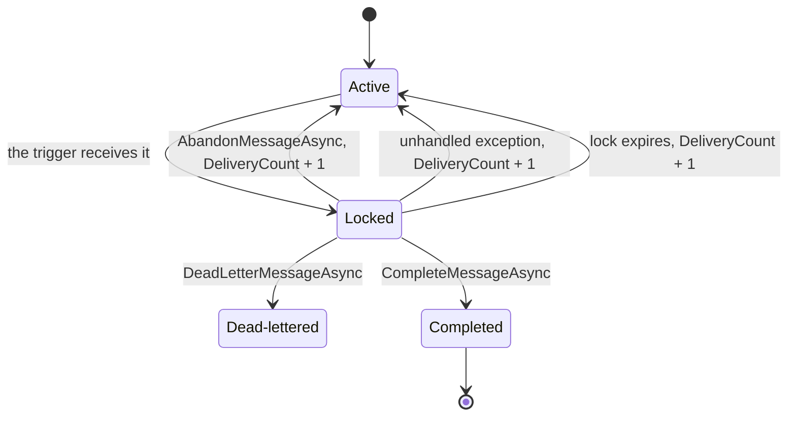

# Azure Functions: Service Bus Triggers

> **_NOTE:_** Duration: about 7 minutes.

Grey Logistics runs the scan processor as an Azure Functions app. Each scan message on the `parcel-events` topic, through the `tracking` subscription, starts one function invocation that updates the tracking read model. The function settles each message only after its work succeeds, so a crash leaves the message for another attempt.

This topic covers the isolated worker trigger, the `ServiceBusReceivedMessage` binding, explicit settlement with `ServiceBusMessageActions`, `host.json` concurrency, identity-based connections, and deployment on Container Apps.

## Isolated Worker Trigger and Message Binding

The isolated worker model runs your code in a process separate from the Functions host. The Service Bus extension for this model is `Microsoft.Azure.Functions.Worker.Extensions.ServiceBus`, and version 5.14.1 or later provides `ServiceBusReceivedMessage` and `ServiceBusMessageActions`. 

The in-process model reaches end of support on November 10, 2026, so new C# work uses the isolated model. Flex Consumption doesn't run in-process C# apps.

Bind the parameter to `ServiceBusReceivedMessage` to read message metadata, such as `MessageId`, `Subject`, `DeliveryCount`, and `ApplicationProperties`. Add a `ServiceBusMessageActions` parameter to settle the message yourself. The trigger attribute takes the topic name and subscription name in its constructor.

The trigger can also bind to a `string`, a `byte[]`, a JSON-serializable type, or an array of messages for batch processing. Bind to `ServiceBusReceivedMessage` when the function needs the metadata or the settlement methods that the other types can't provide.

```csharp
using Azure.Messaging.ServiceBus;
using Microsoft.Azure.Functions.Worker;
using Microsoft.Azure.Functions.Worker.Extensions.ServiceBus;
using Microsoft.Extensions.Logging;

public class ScanFunctions(ILogger<ScanFunctions> logger)
{
    [Function(nameof(ProcessScan))]
    public async Task ProcessScan(
        [ServiceBusTrigger("parcel-events", "tracking", Connection = "ServiceBusConnection", AutoCompleteMessages = false)]
        ServiceBusReceivedMessage message,
        ServiceBusMessageActions messageActions)
    {
        logger.LogInformation("Scan {MessageId} with subject {Subject}", message.MessageId, message.Subject);

        await messageActions.CompleteMessageAsync(message);
    }
}
```

## Settlement and Redelivery

Settlement tells Service Bus what happened to a message. Each settlement method maps to one outcome.

| Outcome | Method | Result |
| --- | --- | --- |
| Success | `CompleteMessageAsync` | Removes the message from the subscription |
| Retry later | `AbandonMessageAsync` | Returns the message to the subscription and increases its delivery count |
| Poison | `DeadLetterMessageAsync(message, propertiesToModify, reason, description)` | Moves the message to the dead-letter subqueue with a reason and description |

`AutoCompleteMessages` controls who settles the message. When it's `true`, the runtime completes the message after a successful run and abandons it after an exception. The Functions documentation requires `false` when the function binds `ServiceBusMessageActions`, because otherwise the runtime completes the message before your code can decide.

When the function throws an unhandled exception and hasn't settled the message, the extension abandons the message, so it becomes available for receiving again immediately.

Settle the message before the function returns. A message that stays unsettled when its lock expires returns to the subscription with a higher delivery count. Topic 05 covers what happens after repeated redeliveries.



## Concurrency, Connections, and Container Apps Hosting

The `extensions.serviceBus` section of `host.json` controls how one instance processes messages. `maxConcurrentCalls` limits the callbacks that run at once per instance, and its default is 16.

`prefetchCount` sets how many messages the receiver holds locally, and its default is 0. `maxAutoLockRenewalDuration` sets how long the runtime renews the lock on a single message, and its default is five minutes.

```json
{
  "version": "2.0",
  "extensions": {
    "serviceBus": {
      "maxConcurrentCalls": 8,
      "maxConcurrentSessions": 8,
      "prefetchCount": 0,
      "maxAutoLockRenewalDuration": "00:05:00"
    }
  }
}
```

The `tracking` trigger uses sessions, so the host also reads `maxConcurrentSessions`, which the Grey Logistics `host.json` sets to 8 (`src/ScanProcessor/host.json:6`). That limit caps how many parcel sessions one instance works on at once.

The runtime multiplies `maxConcurrentCalls` by the number of cores on an instance, so set it with that multiplication in mind. Lower the value when handlers call a database with a fixed connection limit.

The `maxAutoLockRenewalDuration` setting applies to functions that receive one message at a time. For batches, the lock duration comes from the subscription itself.

Identity-based connections replace the connection string. Define the connection with settings that share the `ServiceBusConnection` prefix, and grant the function app's managed identity a role on the subscription.

| Application setting | Value |
| --- | --- |
| `ServiceBusConnection__fullyQualifiedNamespace` | `<NAMESPACE>.servicebus.windows.net` |
| `ServiceBusConnection__credential` | `managedidentity` |

| Role | Needed for |
| --- | --- |
| Azure Service Bus Data Receiver | Receiving messages from the subscription |
| Azure Service Bus Data Owner | Scale decisions, because the extension reads runtime properties through the Administration API |

The role assignment must reach the subscription itself. An assignment scoped only to the topic fails when the trigger starts.

The Grey Logistics scan processor doesn't run on Flex Consumption. `AddAzureFunctionsProject` in `src/AppHost/Program.cs:56` registers the app in the `aca-env` Container Apps environment, and `aspire deploy` publishes it there.

Functions on Container Apps generates scale rules from the triggers and rejects custom rules until `allowScalingRuleOverride` is true. The `infra/scan-consumer.azcli` script sets that flag and adds the `scan-backlog` rule, which the [KEDA section](../03-competing-consumers/readme.md#scale-rules-with-keda-in-container-apps) explains.

## Key Topics

- [Azure Service Bus trigger for Azure Functions](https://learn.microsoft.com/azure/azure-functions/functions-bindings-service-bus-trigger)
- [Azure Service Bus bindings for Azure Functions](https://learn.microsoft.com/azure/azure-functions/functions-bindings-service-bus)
- [Configure connections to remote services in Azure Functions](https://learn.microsoft.com/azure/azure-functions/manage-connections)
- [Azure Functions on Azure Container Apps overview](https://learn.microsoft.com/azure/container-apps/functions-overview)
- [Guide for running C# Azure Functions in the isolated worker model](https://learn.microsoft.com/azure/azure-functions/dotnet-isolated-process-guide)
