# Competing Consumers: KEDA Scale Rules

> **_NOTE:_** Duration: about 8 minutes.

A depot scan burst can fill the `tracking` subscription faster than one consumer drains it. Contoso Logistics adds consumer instances that share the subscription, so each scan reaches exactly one of them. The number of instances follows the backlog, and the app scales to zero when no scans wait.

This topic covers the competing consumers pattern, `ServiceBusProcessor` concurrency with `MaxConcurrentCalls` and `PrefetchCount`, a Container Apps KEDA scale rule that authenticates with managed identity, scale to zero, and the ordering trade-off that parallel consumers introduce.

## Competing Consumers and Their Trade-Offs

In the competing consumers pattern, several instances receive from one queue or subscription, and the broker delivers each message to one of them. Adding instances raises throughput. A failed instance doesn't block the others, because the remaining instances keep receiving messages.

The pattern gives up ordering. The Architecture Center notes that the order in which instances receive messages isn't guaranteed, so handlers should process messages idempotently. Topic 04 shows how sessions restore order for the scans of one parcel, and the Contoso Logistics `tracking` subscription requires sessions, so its replicas keep each parcel's scans in order (`src/AppHost/Program.cs:18`).



Consumer throughput depends on the namespace tier. Standard uses shared capacity billed per operation, and Premium provides dedicated messaging units with predictable latency and throughput. Microsoft Learn recommends Premium for production workloads with varied throughput, and it notes that Premium namespaces can be auto scaled.

A poison message can also stall a pool of consumers. When a message exceeds the subscription's `MaxDeliveryCount`, the broker moves it to the dead-letter queue, so it leaves the pool. Topic 05 covers that path.

## ServiceBusProcessor Concurrency

`ServiceBusProcessor` runs a message handler on a pool of callbacks inside one process. `MaxConcurrentCalls` sets how many handlers run at once, and its default is 1. `PrefetchCount` sets how many messages the processor holds in a local buffer, and its default is 0.

```csharp
using Azure.Identity;
using Azure.Messaging.ServiceBus;

var client = new ServiceBusClient("<NAMESPACE>.servicebus.windows.net", new DefaultAzureCredential());

var options = new ServiceBusProcessorOptions
{
    MaxConcurrentCalls = 8,
    PrefetchCount = 8,
    AutoCompleteMessages = true,
    ReceiveMode = ServiceBusReceiveMode.PeekLock
};

await using var processor = client.CreateProcessor("parcel-events", "tracking", options);

processor.ProcessMessageAsync += args =>
{
    Console.WriteLine($"Processing {args.Message.MessageId}");
    return Task.CompletedTask;
};

processor.ProcessErrorAsync += args =>
{
    Console.WriteLine(args.Exception.Message);
    return Task.CompletedTask;
};

await processor.StartProcessingAsync();
```

Each processor instance keeps its own buffer, so the total number of buffered messages grows with the number of replicas.

`PrefetchCount` is a strict upper limit on the messages in the local buffer, so it also caps concurrency. Set it at least as high as `MaxConcurrentCalls`, or some handlers never receive work. Microsoft Learn also warns that prefetched messages can lose their locks while they wait in the buffer, so keep the buffer small when handlers are slow.

`AutoCompleteMessages` defaults to `true`, which completes each message after its handler returns. When a handler throws and doesn't settle the message, the processor abandons it. Keep handlers idempotent anyway, because an abandoned message returns to the subscription and reaches a handler again, possibly on another instance.

## Scale Rules with KEDA in Container Apps

Container Apps scales replicas with KEDA, and a custom rule of type `azure-servicebus` reads the depth of a subscription and adds replicas as the backlog grows. Each replica handles `messageCount` messages, and the default value is 5. The rule below uses managed identity, so the template holds no connection string.

The scaler reads a queue through `queueName`, or a topic subscription through `topicName` and `subscriptionName`. Set `maxReplicas` to cap how far the app scales out, because each added replica also adds cost.

```bicep
scale: {
  minReplicas: 0
  maxReplicas: 10
  rules: [
    {
      name: 'scan-backlog'
      custom: {
        type: 'azure-servicebus'
        metadata: {
          namespace: '<NAMESPACE>'
          topicName: 'parcel-events'
          subscriptionName: 'tracking'
          messageCount: '10'
        }
        identity: 'system'
      }
    }
  ]
}
```

The `identity` property sits inside the `custom` rule. Set it to `system` for the app's system-assigned identity, or to the resource ID of a user-assigned identity.

The identity needs a role that can read the subscription's runtime properties. The Functions guidance names Azure Service Bus Data Owner, or a custom role with `Microsoft.ServiceBus/namespaces/*/read`, for the same kind of read.

Set `minReplicas` to `0` to scale to zero when no scans wait. The cooldown period of 300 seconds applies only when the app scales in from its last replica to zero. The polling interval defaults to 30 seconds.

Without ingress, an app that scales to zero needs a custom rule to start again, because no HTTP request can wake it.

## Key Topics

- [Competing Consumers pattern](https://learn.microsoft.com/azure/architecture/patterns/competing-consumers)
- [Set scaling rules in Azure Container Apps](https://learn.microsoft.com/azure/container-apps/scale-app)
- [Managed identities in Azure Container Apps](https://learn.microsoft.com/azure/container-apps/managed-identity)
- [Prefetch Azure Service Bus messages](https://learn.microsoft.com/azure/service-bus-messaging/service-bus-prefetch)
- [ServiceBusProcessorOptions class](https://learn.microsoft.com/dotnet/api/azure.messaging.servicebus.servicebusprocessoroptions?view=azure-dotnet)
