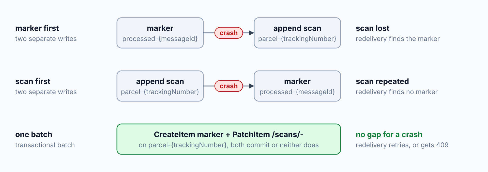

# Idempotent Consumers: Duplicate Detection

> **_NOTE:_** Duration: about 9 minutes.

Service Bus delivers each message at least once. A lock can expire during a slow write, a consumer can crash after it updates the tracking read model, and a producer can retry a send that already succeeded. The same scan can reach a handler twice, so the handler must produce the same result both times.

This topic covers at-least-once delivery, the broker's duplicate detection window and its limits, and a consumer-side idempotency store built on a Cosmos DB create that returns 409 for a repeated key.

## At-Least-Once Delivery and the Broker Window

Duplicate detection keeps a history of `MessageId` values for a time window. When a send carries a `MessageId` that appears in that window, the send succeeds, and the broker drops the new message. Duplicate detection needs the Standard or Premium tier, and you turn it on when you create the queue or topic.

The window defaults to 10 minutes, with a minimum of 20 seconds and a maximum of 7 days. A larger window keeps more IDs to match, which lowers throughput. Set `requiresDuplicateDetection` and `duplicateDetectionHistoryTimeWindow` on the topic or queue, as the Contoso Logistics `parcel-events` topic does with five minutes (`src/AppHost/Program.cs:16`).

Scheduled messages take part in duplicate detection too. A scheduled message and a regular message with the same `MessageId` collide, and the broker drops the second one. Duplicate detection also doesn't guarantee order, so combine it with sessions or sequence numbers when order matters.

```bicep
resource namespace 'Microsoft.ServiceBus/namespaces@2026-01-01' existing = {
  name: '<NAMESPACE>'
}

resource parcelEvents 'Microsoft.ServiceBus/namespaces/topics@2026-01-01' = {
  parent: namespace
  name: 'parcel-events'
  properties: {
    requiresDuplicateDetection: true
    duplicateDetectionHistoryTimeWindow: 'PT5M'
  }
}
```

The producer makes duplicate detection useful by setting a stable `MessageId` that identifies the business event. A composite of the parcel ID, the scan type, and a sequence number works well, because a retry of the same scan produces the same ID.

```csharp
using Azure.Identity;
using Azure.Messaging.ServiceBus;

var client = new ServiceBusClient("<NAMESPACE>.servicebus.windows.net", new DefaultAzureCredential());
await using var sender = client.CreateSender("parcel-events");

var scan = new ServiceBusMessage(BinaryData.FromString("{\"scanType\":\"AtHub\"}"))
{
    MessageId = "PKG-100482.AtHub.3",
    Subject = "ParcelScanned"
};

await sender.SendMessageAsync(scan);
```

Duplicate detection doesn't protect the consumer. The broker checks only sends, within the window. A redelivery of a message that the consumer already processed still reaches the handler, so the consumer must stay idempotent on its own.



## Consumer-Side Idempotency with Cosmos DB

The Architecture Center describes the Idempotent Consumer pattern. The consumer records each processed key in a store, and it treats a write that conflicts with an existing key as a duplicate. The store must enforce uniqueness itself, because two consumer instances can check the same key at the same moment.

Cosmos DB enforces uniqueness on item IDs within a partition. A create that reuses an existing ID fails with HTTP 409. The .NET SDK throws a `CosmosException` whose `StatusCode` is `HttpStatusCode.Conflict`, so the handler can treat that status as a duplicate.

Instrument the consumer as well. Emit the `MessageId` in structured logs and track a counter for detected duplicates. A rising duplicate rate can point to producer retries, a lock window that is too short, or an unhealthy consumer.

```csharp
using System.Net;
using Microsoft.Azure.Cosmos;

public sealed record ProcessedMessage(string id, string trackingNumber);

public sealed class ProcessedMessageStore(Container processed)
{
    public async Task<bool> TryMarkAsync(string messageId, string trackingNumber)
    {
        try
        {
            await processed.CreateItemAsync(
                new ProcessedMessage($"processed-{messageId}", trackingNumber),
                new PartitionKey(trackingNumber));
            return true;
        }
        catch (CosmosException ex) when (ex.StatusCode == HttpStatusCode.Conflict)
        {
            return false;
        }
    }
}
```

A check that runs as a separate step leaves a window. A crash after the side effect and before the marker repeats the side effect on redelivery, and a crash after the marker and before the side effect loses the work. The next section closes that window.



## Atomic Marker and Side Effect

Write the marker and the side effect in one transaction, so that both commit or neither does. A Cosmos DB transactional batch does this for items that share a partition key, and it allows up to 100 operations and 2 MB per batch. Store the marker in the same container and partition as the parcel document, which the `tracking` container keeps on `/trackingNumber`.

```csharp
using System.Net;
using Microsoft.Azure.Cosmos;

public class ParcelScanStore(Container container)
{
    public async Task<bool> TryAppendAsync(string trackingNumber, string scanType, string messageId)
    {
        var parcelId = $"parcel-{trackingNumber}";
        var key = new PartitionKey(trackingNumber);

        var response = await ExecuteBatchAsync(key, parcelId, trackingNumber, scanType, messageId);

        if (response.Count > 1 && response[1].StatusCode == HttpStatusCode.NotFound)
        {
            await EnsureParcelAsync(key, parcelId, trackingNumber);
            response = await ExecuteBatchAsync(key, parcelId, trackingNumber, scanType, messageId);
        }

        if (response.IsSuccessStatusCode)
        {
            return true;
        }

        if (response.Count > 0 && response[0].StatusCode == HttpStatusCode.Conflict)
        {
            return false;
        }

        throw new CosmosException(response.ErrorMessage, response.StatusCode, 0, response.ActivityId, response.RequestCharge);
    }

    private async Task<TransactionalBatchResponse> ExecuteBatchAsync(PartitionKey key, string parcelId, string trackingNumber, string scanType, string messageId)
    {
        var marker = new { id = $"processed-{messageId}", trackingNumber };

        return await container.CreateTransactionalBatch(key)
            .CreateItem(marker)
            .PatchItem(parcelId, [PatchOperation.Add("/scans/-", scanType)])
            .ExecuteAsync();
    }

    private async Task EnsureParcelAsync(PartitionKey key, string parcelId, string trackingNumber)
    {
        try
        {
            await container.CreateItemAsync(new { id = parcelId, trackingNumber, scans = Array.Empty<string>() }, key);
        }
        catch (CosmosException ex) when (ex.StatusCode == HttpStatusCode.Conflict)
        {
        }
    }
}
```

The first scan of a parcel patches a document that doesn't exist yet, so the store creates it with an empty `scans` array and runs the batch again (`src/ScanProcessor/ParcelScanStore.cs:15-19`).

When the marker already exists, the batch fails with 409 on that operation, and the scan operation returns 424 because nothing commits. `TryAppendAsync` returns `false`, and the consumer completes the message as a duplicate (`src/ScanProcessor/ScanFunctions.cs:28-33`). Any other failure throws, so Service Bus abandons the message and retries it.

Calls to other services can't join the batch, so propagate the idempotency key to each of them. Each downstream service then deduplicates its own work, and the outbox pattern that Module 6 teaches covers the producer side of the same guarantee.

## Key Topics

- [Duplicate detection in Azure Service Bus](https://learn.microsoft.com/azure/service-bus-messaging/duplicate-detection)
- [Idempotent Consumer pattern](https://learn.microsoft.com/azure/architecture/patterns/idempotent-consumer)
- [Create an item in Azure Cosmos DB for NoSQL using .NET](https://learn.microsoft.com/azure/cosmos-db/how-to-dotnet-create-item)
- [Transactional batch operations in Azure Cosmos DB](https://learn.microsoft.com/azure/cosmos-db/transactional-batch)
- [HTTP status codes for Azure Cosmos DB](https://learn.microsoft.com/rest/api/cosmos-db/http-status-codes-for-cosmosdb)
