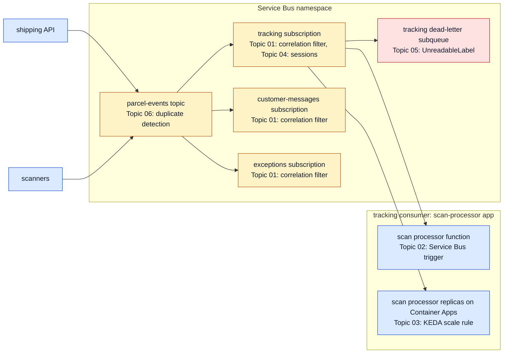

# Module 4: Reliable Messaging with Service Bus

Module 3 placed the services on Container Apps and AKS. This module connects them with Azure Service Bus, which carries parcel events from the shipping API and the scanners to the consumers that need them. All SDK calls use the `Azure.Messaging.ServiceBus` package, because the legacy `Microsoft.Azure.ServiceBus` and `WindowsAzure.ServiceBus` packages retired on September 30, 2026.

Each topic adds one reliability feature to the parcel event flow: filtered subscriptions, Functions triggers, competing consumers scaled by KEDA, ordered sessions for each parcel, dead-letter handling for unreadable label scans, and duplicate detection with idempotent consumers. The examples use Contoso Logistics names throughout, so each topic reads as a step in the same delivery system.

After this module, you can route events to the right subscriptions, run a Functions or Container Apps consumer that scales with its backlog, keep the scans of one parcel in order, and recover from poison messages without losing work.

## Topics

| Topic | Description |
| --- | --- |
| [Topic Subscriptions: SQL Filters](./01-subscriptions-filters/readme.md) | `ServiceBusAdministrationClient.CreateRuleAsync`, SQL and correlation filters, rule actions, and the 2026-01-01 Bicep rules resource |
| [Azure Functions: Service Bus Triggers](./02-functions-triggers/readme.md) | Isolated worker `ServiceBusTrigger`, `ServiceBusReceivedMessage`, `ServiceBusMessageActions`, `host.json` concurrency, and Container Apps hosting |
| [Competing Consumers: KEDA Scale Rules](./03-competing-consumers/readme.md) | `ServiceBusProcessor` with `MaxConcurrentCalls` and `PrefetchCount`, and the Container Apps `azure-servicebus` scale rule with managed identity |
| [Sessions: Ordered Message Processing](./04-sessions/readme.md) | Session-enabled entities, `ServiceBusSessionProcessor`, session state, and session locks |
| [Dead-Letter Queues: Poison Messages](./05-dead-letter/readme.md) | `MaxDeliveryCount`, dead-letter reasons, `DeadLetterMessageAsync`, and the `SubQueue.DeadLetter` receiver |
| [Idempotent Consumers: Duplicate Detection](./06-idempotent-consumers/readme.md) | Duplicate detection and its window, and a Cosmos DB processed-message store with `CosmosException` |

## Helpful Claude Slash Commands

| Command | What it does here |
| --- | --- |
| `/review` | Reviews the branch's consumer code for settlement order, lock handling, and dead-letter reasons before you merge a handler change. |
| `/security-review` | Audits the Service Bus connection setup for connection strings in settings files and for role assignments broader than the entity they protect. |
| `/update-config` | Edits `settings.json` through guided prompts, for example to allow the `az servicebus` and `az functionapp` commands that this module uses. |

## Key Topics covered in this module

- [Azure Service Bus overview](https://learn.microsoft.com/azure/service-bus-messaging/service-bus-messaging-overview)
- [Advanced features of Azure Service Bus](https://learn.microsoft.com/azure/service-bus-messaging/advanced-features-overview)
- [Compare Azure Event Grid, Event Hubs, and Service Bus](https://learn.microsoft.com/azure/service-bus-messaging/compare-messaging-services)
- [Azure.Messaging.ServiceBus client library for .NET](https://learn.microsoft.com/dotnet/api/overview/azure/messaging.servicebus-readme?view=azure-dotnet)
