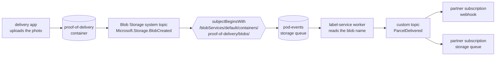
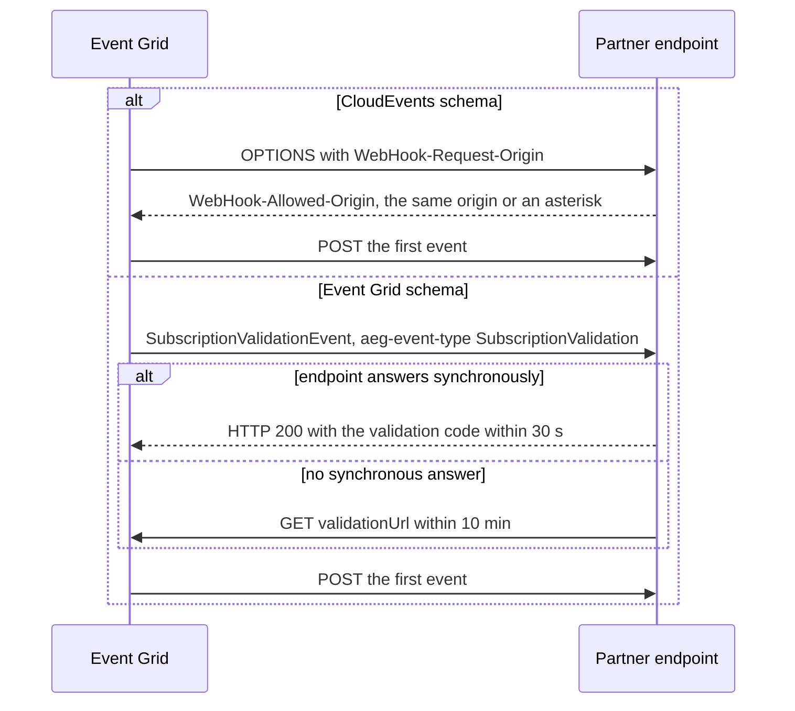

# Event Grid: Custom Topics & Subscriptions

> **_NOTE:_** Duration: about 10 minutes.

Contoso Logistics needs to tell customers and partners when a parcel reaches its destination. The label-service knows the moment a driver captures proof of delivery, but no partner can see that moment today. Event Grid gives the label-service one place to publish `ParcelDelivered`, and it gives each partner a subscription to that event.

This topic covers the two kinds of Event Grid topic, publishing CloudEvents with `EventGridPublisherClient`, the handlers a subscription can call, and the Blob Storage system topic that raises an event when a proof-of-delivery photo arrives. It also covers the endpoint validation handshake that Event Grid runs before it sends the first event.

## Custom Topics and System Topics

A custom topic is an endpoint that your application publishes to. You get a topic endpoint and access keys, and you choose the event schema when you create the topic. The label-service owns a custom topic, so it can publish `ParcelDelivered` with the CloudEvents 1.0 schema.

A system topic represents events that an Azure service publishes. Only Azure services can publish to a system topic, so it has no endpoint or keys. The Blob Storage system topic in this module represents the blob events of one storage account.

| Topic type | Publisher | Endpoint and keys | Contoso example |
| --- | --- | --- | --- |
| Custom topic | Your application | Yes | `ParcelDelivered` from the label-service |
| System topic | An Azure service | No | `Microsoft.Storage.BlobCreated` from the proof-of-delivery container |

Event Grid recommends that you create the system topic first and then create the subscription on it. A system topic that you create explicitly stays in place after its last subscription is deleted, so you control its lifecycle.

## Publishing CloudEvents with EventGridPublisherClient

The `Azure.Messaging.EventGrid` package contains `EventGridPublisherClient`. The client sends a single event with `SendEventAsync` and a batch with `SendEventsAsync`. When the topic uses the CloudEvents schema, both methods take `CloudEvent` objects.

The lab's label-service authenticates with Microsoft Entra ID through `DefaultAzureCredential`, and the identity must hold the EventGrid Data Sender role on the topic, because that role contains the permission to send events. Access keys also work for a quick test, but a key doesn't tell you which service sent an event.

```csharp
using Azure.Identity;
using Azure.Messaging;
using Azure.Messaging.EventGrid;

var topicEndpoint = new Uri(Environment.GetEnvironmentVariable("EVENTGRID_TOPIC_ENDPOINT"));
var publisher = new EventGridPublisherClient(
    topicEndpoint,
    new DefaultAzureCredential());

var delivered = new CloudEvent(
    "/label-service",
    "ParcelDelivered",
    new { ParcelId = "PKG-10482", DeliveredAt = DateTimeOffset.UtcNow });

await publisher.SendEventAsync(delivered);
```

The first argument of the `CloudEvent` constructor is the source, the second is the event type, and the third is the data, which the SDK serializes as JSON. Event type names are the contract between the publisher and every subscriber, so the label-service keeps them stable.

## Subscriptions to Webhooks, Functions and Service Bus

A subscription routes events from a topic to a handler. Event Grid supports webhooks, Azure Functions, Service Bus queues and topics, Event Hubs, and Storage queues as handlers. Webhook endpoints must use HTTPS.

Partners that run their own HTTPS endpoint use a webhook. Internal consumers usually use the Azure Functions Event Grid trigger, which runs the validation handshake for you. The isolated worker model binds the trigger parameter to `CloudEvent` when the subscription uses the CloudEvents schema.

```csharp
using Azure.Messaging;
using Microsoft.Azure.Functions.Worker;
using Microsoft.Extensions.Logging;

public class ParcelDeliveredHandler
{
    private readonly ILogger<ParcelDeliveredHandler> _logger;

    public ParcelDeliveredHandler(ILogger<ParcelDeliveredHandler> logger)
    {
        _logger = logger;
    }

    [Function(nameof(ParcelDeliveredHandler))]
    public void Run([EventGridTrigger] CloudEvent cloudEvent)
    {
        _logger.LogInformation("Event type: {type}, Event subject: {subject}", cloudEvent.Type, cloudEvent.Subject);
    }
}
```

The `CloudEvent` parameter type requires the `Microsoft.Azure.Functions.Worker.Extensions.EventGrid` package, version 3.3.0 or later. A Service Bus queue fits a partner-facing consumer that must keep messages while it is slow or offline. Module 4 covers Service Bus in depth, so this topic only names it as a handler.

## Blob Storage System Topic for Proof of Delivery

A delivery app uploads each proof-of-delivery photo to a container in Blob Storage. The storage account publishes `Microsoft.Storage.BlobCreated` when a block blob is completely committed, which means the upload has finished. A system topic on that storage account turns those storage events into Event Grid events that subscriptions can route.

The event carries the blob path in its subject, and the lab's handler reads the tracking number from the file name there without downloading the photo. A general purpose v1 account can't publish to Event Grid, so create the account as general purpose v2. The subscription below filters the stream to the proof-of-delivery container, so other blobs don't reach the handler.

```json
{
  "filter": {
    "includedEventTypes": [
      "Microsoft.Storage.BlobCreated"
    ],
    "subjectBeginsWith": "/blobServices/default/containers/proof-of-delivery/blobs/"
  }
}
```

The lab's worker reads each event from the `pod-events` storage queue, takes the tracking number from the blob name, and publishes `ParcelDelivered` to the custom topic. The partners then receive the delivery confirmation without any knowledge of how the photo was stored.



## Endpoint Validation

Event Grid proves that you own a webhook endpoint before it sends events, which stops a third party from flooding your endpoint. The handshake depends on the schema of the subscription. Azure Functions with the Event Grid trigger and Azure Logic Apps run the handshake automatically.



With the Event Grid schema, Event Grid sends a `SubscriptionValidationEvent` with the `aeg-event-type` header set to `SubscriptionValidation`. The endpoint returns HTTP 200 with the validation code in the body within 30 seconds, and HTTP 202 doesn't count as valid.

If the endpoint can't answer synchronously, the event data contains a `validationUrl` that you open with a GET request within 10 minutes. Self-signed certificates aren't supported for validation.

```json
{
  "validationResponse": "512d38b6-c7b8-40c8-89fe-f46f9e9622b6"
}
```

With the CloudEvents schema, Event Grid sends an HTTP OPTIONS request that carries a `WebHook-Request-Origin` header. The endpoint agrees by returning a `WebHook-Allowed-Origin` header that matches that origin or contains an asterisk. The label-service publishes CloudEvents, so every partner endpoint in this module must answer OPTIONS.

## Key Topics

- [System topics in Azure Event Grid](https://learn.microsoft.com/azure/event-grid/system-topics)
- [Azure Blob Storage as an Event Grid source](https://learn.microsoft.com/azure/event-grid/event-schema-blob-storage)
- [Endpoint validation by using CloudEvents schema](https://learn.microsoft.com/azure/event-grid/end-point-validation-cloud-events-schema)
- [Endpoint validation with Event Grid event schema](https://learn.microsoft.com/azure/event-grid/end-point-validation-event-grid-events-schema)
- [Azure Event Grid trigger for Azure Functions (C#)](https://learn.microsoft.com/azure/azure-functions/functions-bindings-event-grid-trigger)
- [Event handlers in Azure Event Grid](https://learn.microsoft.com/azure/event-grid/event-handlers)
