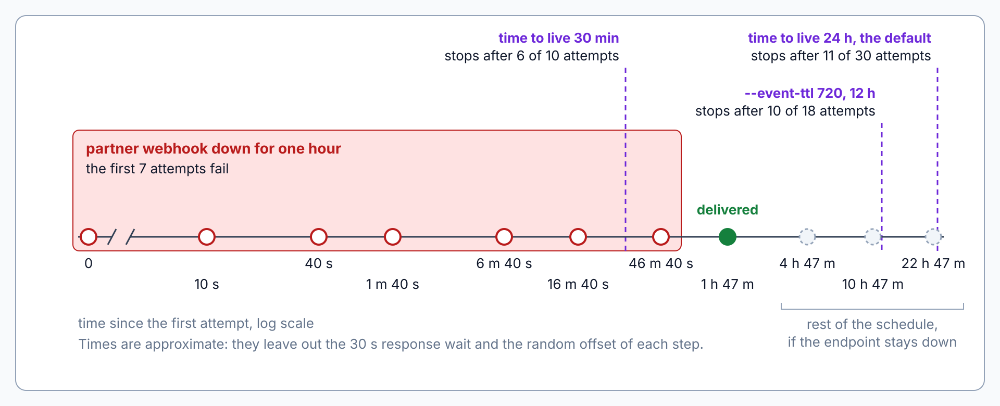
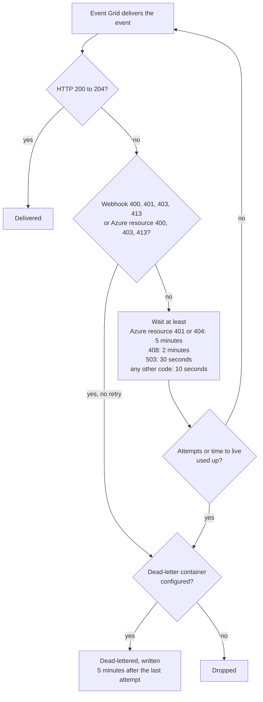

# Event Grid: Filters, Retries, Dead-Letter

> **_NOTE:_** Duration: about 10 minutes.

A partner's webhook goes down for an hour on the busiest day of the year. Event Grid keeps retrying, but a `ParcelDelivered` event must not disappear without a trace. Filters decide which events reach a subscription, the retry policy decides how long Event Grid keeps trying, and dead-lettering keeps the events that Event Grid gives up on.

This topic shows the three filter types, the retry policy and its schedule, the dead-letter destination in a storage account, and the errors that Event Grid never retries. The values come from Microsoft Learn and apply to Event Grid custom topics and system topics.

## Event Type, Subject and Advanced Filters

Filters run before delivery, so a subscription receives only the events it asks for. The event type filter takes a list of types. The subject filter checks the beginning or the end of the subject, and advanced filters compare a field in the event data with one or more values.

```json
{
  "filter": {
    "includedEventTypes": [
      "ParcelDelivered"
    ],
    "subjectBeginsWith": "/parcels/",
    "advancedFilters": [
      {
        "operatorType": "StringIn",
        "key": "data.region",
        "values": [
          "north",
          "south"
        ]
      }
    ]
  }
}
```

For events in the CloudEvents schema, the valid keys are `eventid`, `source`, `eventtype`, `eventtypeversion`, and any field under `data`, such as `data.region`. Keys use dot notation for nested fields. String comparisons ignore case, and an advanced filter on a key that the event doesn't contain fails to match for most operators.

Advanced filters can't look inside an array of objects. They do support arrays of strings, booleans and numbers. Use the `IsNullOrUndefined` operator when a subscriber needs to match events where a field is absent.

## Retry Policy: Maximum Attempts and Time to Live

The retry policy has two limits, and Event Grid drops or dead-letters an event as soon as the first limit is reached. The maximum number of attempts is an integer from 1 to 30, with a default of 30. The event time to live is an integer from 1 to 1440 minutes, with a default of 1440 minutes, which is 24 hours.

The time to live is checked only at the next scheduled attempt. With a 30-minute time to live, only six attempts fit on the schedule, so a maximum of 10 attempts has no effect. Set both values on the subscription with the Azure CLI, or on the Additional features tab of the portal.

```bash
az eventgrid event-subscription create \
  -g grey-logistics-rg \
  --topic-name grey-events \
  --name partner-delivered \
  --endpoint https://partner.example.com/api/events \
  --event-ttl 720 \
  --max-delivery-attempts 18
```

## The Retry Schedule

Event Grid waits 30 seconds for a response after each delivery. A failed attempt moves to the next step of an exponential schedule, and each step adds a small random offset. Event Grid can also skip retries for an endpoint that stays unhealthy, so the schedule is best effort.

| Retry | Wait before the retry |
| --- | --- |
| 1 | 10 seconds |
| 2 | 30 seconds |
| 3 | 1 minute |
| 4 | 5 minutes |
| 5 | 10 minutes |
| 6 | 30 minutes |
| 7 | 1 hour |
| 8 | 3 hours |
| 9 | 6 hours |
| 10 and later | Every 12 hours, up to 24 hours |



When an endpoint keeps failing, Event Grid delays the retries and the new deliveries to that endpoint. This protects the endpoint and Event Grid from each other. Event Grid also doesn't guarantee order, and a retry can produce a duplicate, so every partner handler must tolerate both out-of-order events and repeats.

## Dead-Letter to a Storage Account

Dead-lettering is off by default. To enable it, create a blob container in a storage account and give the subscription the container path in this form.

```text
/subscriptions/<subscription-id>/resourceGroups/<resource-group-name>/providers/Microsoft.Storage/storageAccounts/<storage-name>/blobServices/default/containers/<container-name>
```

Event Grid dead-letters an event when its time to live expires or when its attempts run out. It also dead-letters at once on HTTP 400 or 413, because those responses mean that delivery will never succeed. There is a five-minute delay between the last attempt and the write to the container, and the event is dropped if the container stays unavailable for four hours.

Each dead-letter blob holds an array of events, and each event carries the fields that explain the failure. These fields include `deadLetterReason`, which is usually `MaxDeliveryAttemptsExceeded`, `deliveryAttempts`, and `lastDeliveryOutcome`, with values such as `NotFound`, `Unauthorized`, `Forbidden`, `BadRequest`, `TimedOut`, and `Busy`.

Blob names contain the subscription name in upper case. If you use a managed identity for dead-lettering, grant it a write role on the storage account, and create an event subscription on the dead-letter container to react when undelivered events arrive.

## Errors That Event Grid Doesn't Retry

Event Grid treats only HTTP 200 through 204 as success. Some errors describe a problem that a retry can't fix, so Event Grid dead-letters the event at once, or drops it when no dead-letter location exists.

| Endpoint type | Status codes that are not retried |
| --- | --- |
| Webhook | 400, 401, 403, 413 |
| Azure resources | 400, 403, 413 |

The other codes follow their own waits. A 401 or 404 from an Azure resource retries after at least five minutes, a 408 retries after at least two minutes, and a 503 retries after at least 30 seconds. Every other failure code retries after at least 10 seconds.



When deliveries keep failing, Event Grid also puts the subscription on probation. During probation, an event can be dead-lettered or dropped without a delivery attempt, so check the dead-letter container when a partner reports missing events.

## Key Topics

- [Event Grid message delivery and retry](https://learn.microsoft.com/azure/event-grid/delivery-and-retry)
- [Set dead-letter location and retry policy](https://learn.microsoft.com/azure/event-grid/manage-event-delivery)
- [Understand event filtering for Event Grid subscriptions](https://learn.microsoft.com/azure/event-grid/event-filtering)
- [Filter events for Event Grid](https://learn.microsoft.com/azure/event-grid/how-to-filter-events)
- [Message push delivery and retry with namespace topics](https://learn.microsoft.com/azure/event-grid/namespace-delivery-retry)
