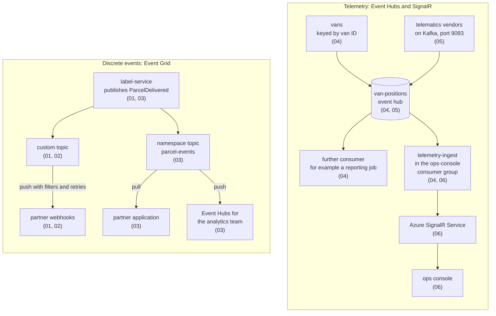

# Module 5: Events & Streams with Event Grid & Event Hubs

Module 5 connects the Grey Logistics services to each other and to the outside world with event streams. Module 4 taught the queues that carry commands and scans between services. This module adds the broadcast side: Event Grid for discrete events that partners and functions react to, Event Hubs for high-volume van telemetry, and SignalR for pushing both to the operations console in a browser.

After this module, you can publish `ParcelDelivered` as a CloudEvent, filter and retry its delivery, pull it from a namespace the way a partner would, stream van GPS positions over the Kafka endpoint of Event Hubs, and push the results to the live map. Every topic uses the same Grey Logistics events, so the pieces fit together by the end of the module.

## Topics

| Topic | Description |
| --- | --- |
| [Event Grid: Custom Topics & Subscriptions](./01-custom-topics/readme.md) | `EventGridPublisherClient`, CloudEvents, webhook and Functions handlers, Blob Storage system topics, endpoint validation |
| [Event Grid: Filters, Retries, Dead-Letter](./02-filters-retries/readme.md) | Event type, subject and advanced filters, retry policy, retry schedule, dead-letter storage, errors that are not retried |
| [Event Grid Namespaces: Pull Delivery](./03-namespaces-pull/readme.md) | `EventGridReceiverClient`, receive, acknowledge, release, reject, renew lock, push delivery to Event Hubs |
| [Event Hubs: Partitions & Checkpoints](./04-partitions-checkpoints/readme.md) | Partition keys, consumer groups, `EventProcessorClient`, `BlobContainerClient` checkpoints, ownership, Capture |
| [Event Hubs: Kafka-Compatible Streaming](./05-kafka/readme.md) | Kafka endpoint on port 9093 (9092 in the emulator), PLAIN and OAUTHBEARER, `Confluent.Kafka` producer, preview features |
| [SignalR Service: Push to Browsers](./06-signalr/readme.md) | Default and Serverless modes, SignalR input and output bindings, `AddAzureSignalR`, `@microsoft/signalr`, Web PubSub |

## Helpful Claude Slash Commands

| Command | What it does here |
| --- | --- |
| `/review` | Reviews the branch's publisher, subscriber and producer code for missing validation handshakes, unhandled lock tokens and missing dead-letter paths. |
| `/security-review` | Audits changes for SAS keys, Event Hubs connection strings and SignalR access keys that end up in source files or in a committed `local.settings.json`. |
| `/doctor` | Checks the Claude Code installation, MCP servers and hooks before you start the Event Grid, Event Hubs and Azure Functions tooling in this module. |
| `/cost` | Shows the token use of a session in which Claude Code drafts many event handlers, test payloads and consumer loops for the same event flow. |

## Key Topics covered in this module

- [What is Azure Event Grid?](https://learn.microsoft.com/azure/event-grid/overview)
- [What is Azure Event Hubs?](https://learn.microsoft.com/azure/event-hubs/event-hubs-about)
- [Event Grid namespace concepts](https://learn.microsoft.com/azure/event-grid/concepts-event-grid-namespaces)
- [What is Azure Event Hubs for Apache Kafka?](https://learn.microsoft.com/azure/event-hubs/azure-event-hubs-apache-kafka-overview)
- [What is Azure SignalR Service?](https://learn.microsoft.com/azure/azure-signalr/signalr-overview)
