# Change Feed Processor: Projections

> **_NOTE:_** Duration: about 11 minutes.

The tracking page shows every scan of a parcel. Something must turn `ParcelScanned` events in the `shipments` container into `ScanRecord` documents in the `tracking` read model, and that reader must survive restarts, share work across instances, and never skip a change. The change feed processor is the .NET SDK component that does this reading, scaling, and checkpointing for you.

This topic covers the builder, the lease container, instance names and scaling, at-least-once delivery with idempotent projections, the change feed estimator, the Azure Functions trigger as an alternative, and the choice between latest version and all versions and deletes modes.

## Builder, Delegate, and Lease Container

The processor starts from the monitored container. You call `GetChangeFeedProcessorBuilder<T>` with a processor name and a delegate, then call `Build` and `StartAsync`. The processor name describes the job, and the estimator later uses the same name to measure it.

```csharp
using Microsoft.Azure.Cosmos;

Container shipments = client.GetContainer("logistics", "shipments");
Container leases = client.GetContainer("logistics", "leases");

ChangeFeedProcessor projection = shipments
    .GetChangeFeedProcessorBuilder<ShipmentEventDocument>("tracking-projection", trackingProjection.HandleChangesAsync)
    .WithInstanceName(instanceName)
    .WithLeaseContainer(leases)
    .WithErrorNotification((leaseToken, error) =>
    {
        logger.LogError(error, "Projection failed for lease {LeaseToken}", leaseToken);
        return Task.CompletedTask;
    })
    .Build();

await projection.StartAsync();
```

The lease container stores the position of each partition range and the instance that owns it. Learn requires an `/id` partition key on a partitioned lease container, so create it with that path. Create the `CosmosClient` with the global endpoint and `ApplicationPreferredRegions`, never a regional endpoint, because lease documents are scoped to the endpoint that created them.

By default, a processor that starts for the first time reads only changes made after its start. Pass `WithStartTime(DateTime.MinValue.ToUniversalTime())` to read from the beginning of the container. Only the first run honors that setting, because the lease container stores the position after that.

## Instance Names and Scaling Out

Each running copy of the service becomes one instance of the processor. Instances share the lease container, and each lease belongs to one instance at a time. When you add an instance, the processor rebalances leases across the group.

Every instance needs a unique name, set with `WithInstanceName`. A GUID meets that rule, but a restarted instance then gets a new name and leaves its old leases behind until they expire. Stable names per replica avoid that churn.

```csharp
ChangeFeedProcessor projection = shipments
    .GetChangeFeedProcessorBuilder<ShipmentEventDocument>("tracking-projection", trackingProjection.HandleChangesAsync)
    .WithInstanceName(instanceName)
    .WithLeaseContainer(leases)
    .WithLeaseConfiguration(
        acquireInterval: TimeSpan.FromSeconds(13),
        expirationInterval: TimeSpan.FromSeconds(60),
        renewInterval: TimeSpan.FromSeconds(17))
    .Build();
```

The three intervals control how fast work moves. The acquire interval sets how often the processor checks whether leases are spread evenly. The expiration interval sets how long a lease stays with an instance that stops renewing it.

The renew interval sets how often a live instance renews its leases. The values above match the Azure Functions trigger defaults.



## At-Least-Once Delivery and Idempotent Projections

The processor guarantees at-least-once delivery. When a delegate throws, the processor reads the same batch again from the last saved position. The one exception is a failure on the very first delegate run, when no saved position exists yet.

A projection must therefore expect duplicates.

The safest projection writes each record under a key that a repeat can't change. The `tracking` document ID is the event ID, so a second upsert of the same event overwrites the record with identical content.

```csharp
using System.Linq;
using Microsoft.Azure.Cosmos;

public sealed record ScanRecord(string id, string trackingNumber, string scanType, DateTimeOffset occurredAt);

public sealed class TrackingProjection(Container tracking)
{
    public async Task HandleChangesAsync(ChangeFeedProcessorContext context, IReadOnlyCollection<ShipmentEventDocument> changes, CancellationToken cancellationToken)
    {
        foreach (ShipmentEventDocument change in changes.Where(item => item.documentType == "event" && item.eventType == "ParcelScanned"))
        {
            ScanRecord scan = new(change.id, change.trackingNumber, change.scanType!, change.occurredAt);

            await tracking.UpsertItemAsync(scan, new PartitionKey(scan.trackingNumber), cancellationToken: cancellationToken);
        }
    }
}
```

The delegate awaits each upsert, which follows the Learn guidance on asynchronous work. A batch that always throws blocks its partition range, because the processor keeps retrying it. Learn suggests writing the failed document to an errored-message store inside the handler, so the processor can move on.

`WithErrorNotification` reports lease and processing errors to your logs.

## Measuring Lag With the Change Feed Estimator

The estimator reports how many changes wait for the processor. It uses the same processor name and lease container, and it calls a delegate with the pending count at the interval you choose. Learn recommends running the estimator as its own deployment, separate from the processors, because one estimator can watch every instance.

```csharp
using Microsoft.Azure.Cosmos;

public static class LagReporter
{
    public static Task HandleEstimationAsync(long estimation, CancellationToken cancellationToken)
    {
        Console.WriteLine($"Pending changes: {estimation}");

        return Task.CompletedTask;
    }
}

ChangeFeedProcessor estimator = shipments
    .GetChangeFeedEstimatorBuilder("tracking-projection", LagReporter.HandleEstimationAsync, TimeSpan.FromMinutes(1))
    .WithLeaseContainer(leases)
    .Build();

await estimator.StartAsync();
```

Each estimation consumes request units from both containers, so a minute between measurements is a reasonable starting point. A growing pending count means the projection can't keep up with the write rate.

## Azure Functions Trigger as an Alternative

The Azure Functions trigger for Cosmos DB uses the same change feed processor machinery. The platform handles scaling and checkpoints, so the function only contains your logic. The trigger attribute names the database, the container, the app setting that holds the connection, and the lease container.

```csharp
using Microsoft.Azure.Functions.Worker;
using Microsoft.Extensions.Logging;

public sealed class TrackingFunction(ILogger<TrackingFunction> logger)
{
    [Function("TrackingProjection")]
    public void Run(
        [CosmosDBTrigger(
            DatabaseName = "logistics",
            ContainerName = "shipments",
            Connection = "CosmosConnection",
            LeaseContainerName = "leases",
            CreateLeaseContainerIfNotExists = true)]
        IReadOnlyList<ShipmentEventDocument> changes)
    {
        logger.LogInformation("Received {Count} changes", changes.Count);
    }
}
```

Choose the trigger when the platform should own scaling and you don't need the processor's life cycle callbacks. Choose the SDK processor when the host is already a long-running service, or when you need the builder options shown above.

## Latest Version or All Versions and Deletes

The latest version mode is the default. It returns the newest state of each changed item, has no fixed retention, and can start from the beginning of the container. It doesn't capture deletes, and it can skip intermediate updates that happened between two reads.

The all versions and deletes mode records each create, replace, and delete, including deletes caused by TTL. It requires continuous backup on the account and the all versions and deletes feature enabled. Its retention equals the continuous backup window, and it can start only from now or from a saved continuation token.


| Aspect | Latest version | All versions and deletes |
| --- | --- | --- |
| Captures deletes | No | Yes, including TTL expiry |
| Captures intermediate updates | Possibly missed | Every change |
| Retention | Life of the container | Continuous backup window |
| Start position | Beginning, a point in time, now, or a checkpoint | Now or a checkpoint |
| .NET builder method | `GetChangeFeedProcessorBuilder` | `GetChangeFeedProcessorBuilderWithAllVersionsAndDeletes` |
| Minimum .NET SDK | Any 3.x release | 3.60.0 |

The shipment audit needs deletes, so it uses the second mode.

```csharp
using Microsoft.Azure.Cosmos;

ChangeFeedProcessor audit = shipments
    .GetChangeFeedProcessorBuilderWithAllVersionsAndDeletes<ShipmentEventDocument>("shipment-audit", auditTrail.HandleChangesAsync)
    .WithInstanceName(instanceName)
    .WithLeaseContainer(leases)
    .Build();
```

```csharp
using Microsoft.Azure.Cosmos;

public sealed class AuditTrail
{
    public Task HandleChangesAsync(ChangeFeedProcessorContext context, IReadOnlyCollection<ChangeFeedItem<ShipmentEventDocument>> changes, CancellationToken cancellationToken)
    {
        foreach (ChangeFeedItem<ShipmentEventDocument> change in changes)
        {
            ChangeFeedOperationType operation = change.Metadata.OperationType;
            ShipmentEventDocument document = operation == ChangeFeedOperationType.Delete ? change.Previous : change.Current;

            Console.WriteLine($"{operation}: {document.Id}");
        }

        return Task.CompletedTask;
    }
}
```

## Key Topics

- [Change feed processor in Azure Cosmos DB](https://learn.microsoft.com/azure/cosmos-db/change-feed-processor)
- [Use the change feed estimator](https://learn.microsoft.com/azure/cosmos-db/how-to-use-change-feed-estimator)
- [Change feed modes in Azure Cosmos DB](https://learn.microsoft.com/azure/cosmos-db/change-feed-modes)
- [Serverless event-based architectures with Azure Cosmos DB and Azure Functions](https://learn.microsoft.com/azure/cosmos-db/change-feed-functions)
- [Azure Cosmos DB trigger for Azure Functions](https://learn.microsoft.com/azure/azure-functions/functions-bindings-cosmosdb-v2-trigger)
