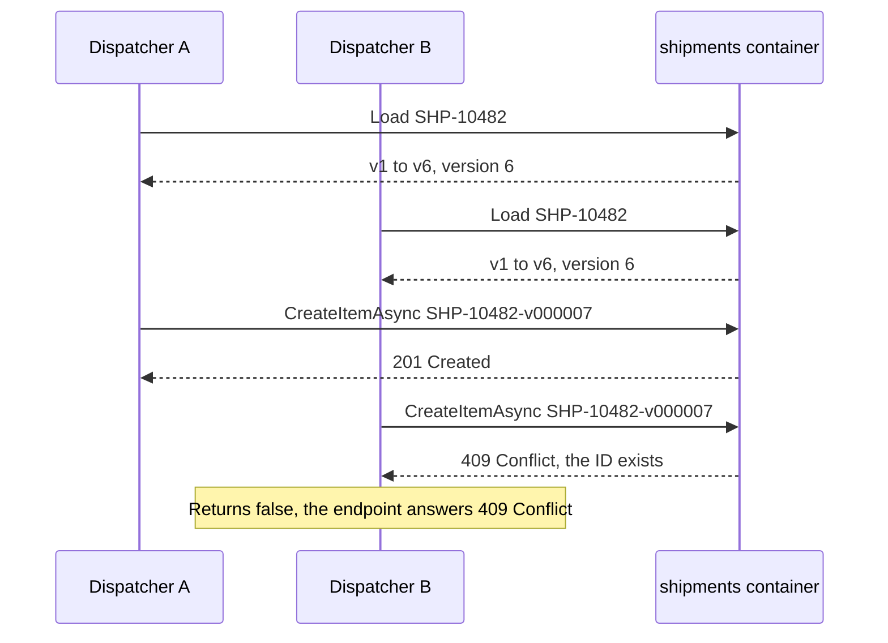

# Event Store: Aggregates & Snapshots

> **_NOTE:_** Duration: about 8 minutes.

The Shipment in `shipping-api` has no row that holds its current state. Each change is stored as an immutable event, such as `ShipmentBooked`, `CapacityReserved`, or `LabelPrinted`, and the current state is the result of replaying those events in order. The event store is the write side of the system, so it must reject two conflicting writes to the same shipment.

This topic stores one event document per change in the `shipments` container, guards appends with a version number and unique IDs, rebuilds the Shipment aggregate by replay, and explains snapshots every N events, which keep replay short when a stream grows long.

## Event Documents per Shipment

An event store keeps facts. Learn advises designing events that record business intent, because `ShipmentBooked` tells a reader what happened, while `status set to booked` tells the reader only the new value. Each event document holds the shipment ID, a version that counts events per shipment, the event type, the time, and the data of the change.

```json
{
  "id": "SHP-10482-v000003",
  "shipmentId": "SHP-10482",
  "trackingNumber": "TRK-4A7F2C9B01",
  "documentType": "event",
  "version": 3,
  "eventType": "CapacityReserved",
  "occurredAt": "2026-10-18T08:15:00Z",
  "scanType": null,
  "data": {
    "vanId": "VAN-07",
    "slotStart": "2026-10-19T09:00:00Z"
  }
}
```

The partition key is `/shipmentId`, so every event of one shipment lives in one logical partition. That placement makes replay a single-partition query, and it keeps the transactional batch from the first topic possible. Event documents never carry a `ttl`, so the history never expires.

A mistaken `PaymentCaptured` event is never edited. The `PaymentRefunded` event that follows records the reversal, and both events stay in the store.

## Optimistic Concurrency With Unique Version IDs

Two dispatchers can act on the same shipment at the same moment. Both read version 6, and both try to append version 7. The event store must accept one append and reject the other.

The ID encodes the shipment and the version, so the second append collides with the first. A create that finds an existing ID returns 409 Conflict, and the store returns false. The lab doesn't retry: `POST /shipments` answers 409 Conflict, and the caller decides what to do next.



```csharp
using System.Net;
using Microsoft.Azure.Cosmos;

public class ShipmentEventStore(Container container)
{
    public async Task<bool> AppendAsync(ShipmentDocument shipmentEvent, CancellationToken cancellationToken)
    {
        var document = shipmentEvent with { id = $"{shipmentEvent.shipmentId}-v{shipmentEvent.version:D6}" };

        try
        {
            await container.CreateItemAsync(document, new PartitionKey(document.shipmentId), cancellationToken: cancellationToken);

            return true;
        }
        catch (CosmosException exception) when (exception.StatusCode == HttpStatusCode.Conflict)
        {
            return false;
        }
    }
}
```

ETags solve a different problem: they protect a document that you replace. Cosmos DB sets an `_etag` on every write, and a replace that sends the last ETag it read succeeds only when the stored item still has that ETag. A stale replace returns 412 Precondition Failed.

Learn describes the same `if-match` check for items. Use an ETag for a document that a process rewrites, such as a current-state document that a projection maintains. Append-only events don't need one.

```csharp
using Microsoft.Azure.Cosmos;

ItemRequestOptions options = new()
{
    IfMatchEtag = etag
};

await shipments.ReplaceItemAsync(currentState, currentState.id, new PartitionKey(currentState.shipmentId), options);
```

## Rebuilding the Shipment Aggregate

The aggregate loads by replay. The repository queries the events of one shipment in version order, applies each event to an empty aggregate, and returns the result. The aggregate exposes an `Apply` method that switches on the event type, and it returns a new aggregate for each event.

```csharp
using Microsoft.Azure.Cosmos;

public class ShipmentRepository(Container container)
{
    public async Task<Shipment> LoadAsync(string shipmentId, CancellationToken cancellationToken)
    {
        var query = new QueryDefinition(
                "SELECT * FROM c WHERE c.shipmentId = @shipmentId AND c.documentType = @documentType ORDER BY c.version ASC")
            .WithParameter("@shipmentId", shipmentId)
            .WithParameter("@documentType", "event");

        var options = new QueryRequestOptions { PartitionKey = new PartitionKey(shipmentId) };
        var shipment = Shipment.Empty(shipmentId);

        using var iterator = container.GetItemQueryIterator<ShipmentDocument>(query, requestOptions: options);
        while (iterator.HasMoreResults)
        {
            foreach (ShipmentDocument document in await iterator.ReadNextAsync())
            {
                shipment = shipment.Apply(document);
            }
        }

        return shipment;
    }
}
```

The aggregate never reads the store for anything except its own events, so its behavior depends only on the events it replays. The replay cost grows with the number of events, so a stream that grows long can benefit from the snapshots described next.



## Snapshots Every N Events

A snapshot stores the aggregate state at one version. Where snapshots are used, loading starts from the newest snapshot and replays only the events that follow it. Learn calls a snapshot an optimization, because the event stream remains the source of truth and any snapshot can be rebuilt from it.

A snapshot document uses the same partition key and carries the version it represents.

```json
{
  "id": "SHP-10482-snapshot-000100",
  "shipmentId": "SHP-10482",
  "documentType": "snapshot",
  "version": 100,
  "state": {
    "status": "OutForDelivery",
    "vanId": "VAN-07",
    "promisedBy": "2026-10-22T17:00:00Z"
  }
}
```

The writer creates a snapshot each time the version reaches a multiple of N, such as 100. The snapshot ID encodes its version, so two writers that create the same snapshot collide with a 409 Conflict, and the second one can ignore the error. The replay query then adds a version filter after the snapshot:

```sql
SELECT * FROM c WHERE c.documentType = 'event' AND c.version > @snapshotVersion ORDER BY c.version ASC
```

Choosing N balances two costs. A small N stores more snapshots and keeps replay short. A large N stores fewer snapshots and makes replay longer.

## Key Topics

- [Event Sourcing pattern](https://learn.microsoft.com/azure/architecture/patterns/event-sourcing)
- [Transactions and optimistic concurrency control](https://learn.microsoft.com/azure/cosmos-db/database-transactions-optimistic-concurrency)
- [Modeling data in Azure Cosmos DB for NoSQL](https://learn.microsoft.com/azure/cosmos-db/modeling-data)
- [Transactional batch operations in Azure Cosmos DB](https://learn.microsoft.com/azure/cosmos-db/transactional-batch)
- [Change feed design patterns in Azure Cosmos DB for NoSQL](https://learn.microsoft.com/azure/cosmos-db/change-feed-design-patterns)
