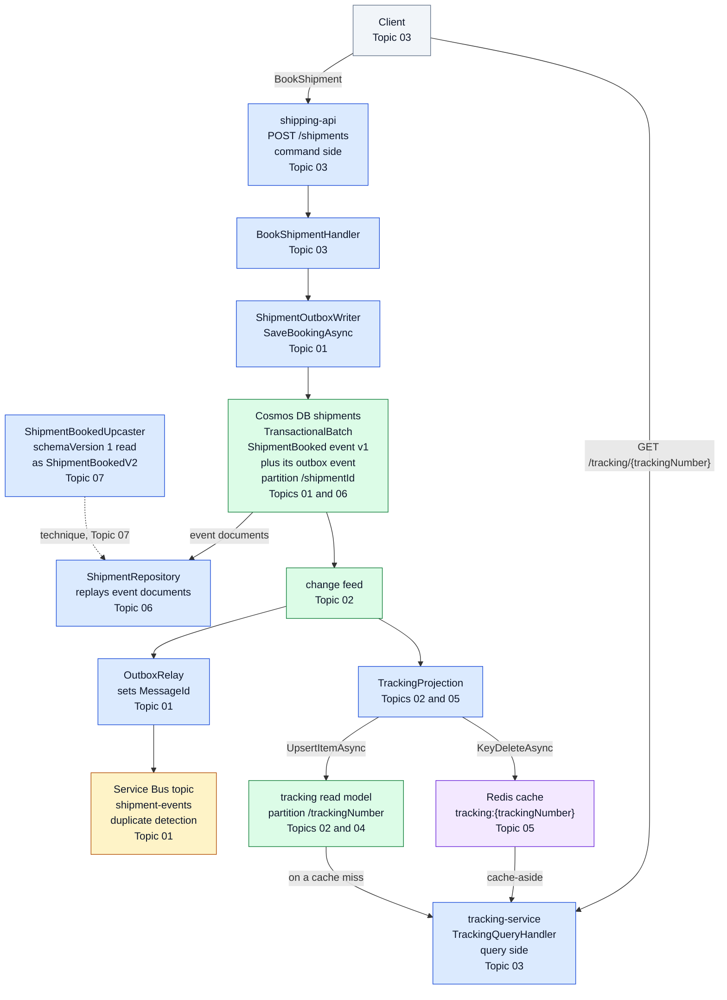

# Module 6: Event Sourcing & CQRS with Cosmos DB

Module 6 is where Contoso Logistics keeps its history. `shipping-api` stores every shipment change as an immutable event in Cosmos DB, and the tracking page reads from a separate model that a change feed processor builds from those events. The module follows the event streams of Module 5 and comes before the Dapr portability work of Module 7.

After this module you can save a booking and its events in one atomic batch, relay the events to Service Bus without losses, and project the change feed into a read model. You can serve tracking queries from Azure Managed Redis with invalidation from the change feed, and you can evolve event schemas without breaking the consumers that already run.

The topics use the Microsoft.Azure.Cosmos v3 SDK on .NET 10, with Aspire for the cache: a local Redis container in the labs and Azure Managed Redis in Azure. The outbox comes first because later topics reuse its batch writer and its relay.

## Topics

| Topic | Description |
| --- | --- |
| [Transactional Outbox: Atomic Publishing](./01-outbox/readme.md) | TransactionalBatch on one partition key, change feed relay to Service Bus with MessageId and duplicate detection, TTL cleanup |
| [Change Feed Processor: Projections](./02-change-feed-processor/readme.md) | GetChangeFeedProcessorBuilder, lease container, WithInstanceName, change feed estimator, CosmosDBTrigger, latest version and all versions and deletes modes |
| [CQRS: Separate Writes from Reads](./03-cqrs/readme.md) | Command and query handlers, separate containers and models, GetItemQueryIterator, eventual consistency in the UI |
| [Read Models: Indexing, RUs, Consistency](./04-read-models/readme.md) | IndexingPolicy paths and composite indexes, ItemResponse.RequestCharge, ReadItemAsync, session tokens |
| [Managed Redis: Change-Feed Cache Invalidation](./05-redis-cache/readme.md) | Azure Managed Redis, cache-aside with StringSetAsync and KeyDeleteAsync, Microsoft.Azure.StackExchangeRedis, AddAzureManagedRedis, AddRedis for the local lab container |
| [Event Store: Aggregates & Snapshots](./06-event-store/readme.md) | CreateItemAsync conflicts, IfMatchEtag, aggregate replay with GetItemQueryIterator, snapshot documents |
| [Event Versioning: Evolve Schemas Safely](./07-event-versioning/readme.md) | Additive changes, upcasting on read, CloudEvents type and dataschema attributes, consumer tolerance |

## Helpful Claude Slash Commands

| Command | What it does here |
| --- | --- |
| `/review` | Reviews the outbox relay and projection handlers for missing awaits, retries that could duplicate writes, and upserts that aren't idempotent. |
| `/security-review` | Audits connection settings, Entra role assignments on Cosmos DB and Redis, and any key or connection string that reached code or configuration. |
| `/cost` | Shows token usage and session cost for the current session, which helps when a long refactor of the read model code runs for hours. |
| `/update-config` | Edits `settings.json` through guided prompts, for example to allow the `dotnet test` and `az servicebus` commands that the labs run. |

## Key Topics covered in this module

- [Event Sourcing pattern](https://learn.microsoft.com/azure/architecture/patterns/event-sourcing)
- [Command Query Responsibility Segregation (CQRS) pattern](https://learn.microsoft.com/azure/architecture/patterns/cqrs)
- [Implement the Transactional Outbox pattern by using Azure Cosmos DB](https://learn.microsoft.com/azure/architecture/databases/guide/transactional-out-box-cosmos)
- [Change feed in Azure Cosmos DB](https://learn.microsoft.com/azure/cosmos-db/change-feed)
- [What is Azure Managed Redis?](https://learn.microsoft.com/azure/redis/overview)
- [CloudEvents core specification](https://github.com/cloudevents/spec/blob/main/cloudevents/spec.md)
