# Dapr Sidecar: Run with Aspire

> **_NOTE:_** Duration: about 8 minutes.

Contoso Logistics runs its booking, tracking, routing and billing services as separate processes. Each service needs to find the others, save its state, and publish events without importing the SDK of one cloud product. Dapr gives each service that portability through a sidecar process and a set of building blocks.

This topic introduces the sidecar model and the building blocks it exposes. It then shows how the Aspire AppHost starts Dapr beside a service, how to install the Dapr CLI, and how component files describe the stores and brokers behind each block.

## The Sidecar Model

Dapr runs as a separate process next to each application. The application calls the sidecar over HTTP or gRPC on localhost, and the sidecar handles the connection to the infrastructure. In Azure Container Apps, the sidecar serves HTTP on port 3500 and gRPC on port 50001.

The building blocks are the APIs the sidecar exposes. The blocks that are generally available in Container Apps are service invocation, state management, pub/sub, bindings, actors, secrets and configuration. Each block delegates to a component, so the same call reaches Cosmos DB, Service Bus or Redis depending on the component file that the sidecar loads.



| Building block | Contoso Logistics use |
| --- | --- |
| Service invocation | `shipping-api` asks `routing-service` to reserve a parcel on a van |
| State management | Parcel assignment saved with an ETag in `routing-service` |
| Pub/sub | `ParcelScanned` events delivered to `notification-service` |
| Actors | One `VanActor` per van |
| Secrets | Connection strings resolved from a secret store |

## Install the Dapr CLI and Initialize Dapr

The Dapr CLI installs the runtime binaries and a local development setup. On Windows, install the CLI with winget, then run `dapr init` to install the runtime. The verification command prints the CLI and runtime versions.

```bash
winget install Dapr.CLI
```

```bash
dapr init
```

```bash
dapr --version
```

A default self-hosted initialization starts Redis and Zipkin containers, along with the placement and scheduler services that actors need. It also writes default component files under the `.dapr` folder in your user profile. The `--slim` flag installs the CLI without those containers and default files, which suits teams that bring their own infrastructure.

## Wire Dapr into the AppHost

The Community Toolkit package `CommunityToolkit.Aspire.Hosting.Dapr` adds Dapr to the Aspire AppHost. `AddDapr` enables the integration, `AddDaprComponent` registers a component of any type, and `AddDaprStateStore` and `AddDaprPubSub` register the two most common kinds. `WithDaprSidecar` attaches a sidecar to a project, and `WithReference` on the sidecar gives the sidecar access to the component.

```bash
dotnet add package CommunityToolkit.Aspire.Hosting.Dapr
```

```csharp
var builder = DistributedApplication.CreateBuilder(args);

builder.AddDapr();

var stateStore = builder.AddDaprComponent("statestore", "state.azure.cosmosdb", new DaprComponentOptions
{
    LocalPath = "components/statestore.yaml"
});

builder.AddProject<Projects.ShippingApi>("shipping-api")
       .WithDaprSidecar(sidecar => sidecar.WithReference(stateStore));

builder.Build().Run();
```

`DaprComponentOptions.LocalPath` points at the component file that the sidecar reads at startup. Keep the component name in the AppHost identical to the `metadata.name` in that file, and use the same name in the service code.

Set `EnableTelemetry` in the `DaprOptions` passed to `AddDapr` when you want the sidecar to export its telemetry to the Aspire dashboard. The sidecar traces then appear beside the traces of the service it serves, which makes a slow state call easy to spot.

## Component YAML Basics

A component file declares one named component. The `name` is the store name or topic group that your code passes to the Dapr client, the `type` selects the implementation, and the `metadata` list supplies the settings. The following file describes a local Redis state store, which is the default that `dapr init` creates.

```yaml
apiVersion: dapr.io/v1alpha1
kind: Component
metadata:
  name: statestore
spec:
  type: state.redis
  version: v1
  metadata:
  - name: redisHost
    value: localhost:6379
```

Plain values are fine for local development. Production files should reference secrets from a secret store, because the component file is usually committed to source control and should not carry keys.

## Targeting Dapr 1.18

This class targets Dapr 1.18. The Dapr documentation site marks 1.18 as the latest release, and the CLI installation page shows CLI version 1.18.0.

Check the output of `dapr --version` after installation so that the CLI and the runtime both report 1.18.0. Run the same check after any CLI upgrade, because the CLI and the runtime can drift apart.

The Community Toolkit README still names Dapr runtime 1.15.3 and CLI 1.15.0, and it notes that Aspire is tested only against the most recent stable Dapr release. Treat the README as dated and follow the Dapr documentation for version numbers. The [managed Dapr topic](../07-managed-dapr/readme.md) explains why a Container Apps environment does not let you choose this version.

## Key Topics

- [Install the Dapr CLI](https://docs.dapr.io/getting-started/install-dapr-cli/)
- [Install Dapr in self-hosted mode](https://docs.dapr.io/getting-started/install-dapr-selfhost/)
- [Microservice APIs powered by Dapr](https://learn.microsoft.com/azure/container-apps/dapr-overview)
- [Community Toolkit Dapr integration for Aspire](https://github.com/CommunityToolkit/Aspire/tree/main/src/CommunityToolkit.Aspire.Hosting.Dapr)
