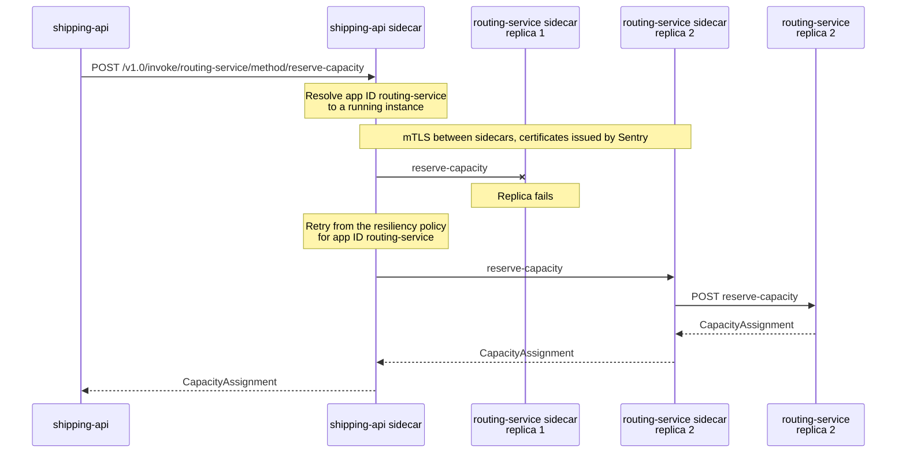

# Service Invocation: mTLS & Retries

> **_NOTE:_** Duration: about 8 minutes.

When `shipping-api` books a parcel, it needs to ask `routing-service` for van capacity and wait for an answer. That call must find the right service, reach it over an encrypted connection, and survive a brief outage of one replica. Without a platform helper, each service would carry its own discovery logic, certificates and retry loops.

This topic covers service invocation through the Dapr sidecar. It explains app IDs and name resolution, the `DaprClient` invocation API and the `HttpClient` helper, mutual TLS through Sentry, retries through resiliency policies, and when pub/sub is the better choice for a call.

## App IDs and Name Resolution

Every Dapr-enabled application has an app ID. Callers use that ID in place of a host name, and the sidecar resolves it to a running instance. The app ID is unique per application, not per instance, so every replica of `routing-service` answers to the same ID.

Name app IDs after the Grey services, such as `shipping-api` and `routing-service`, so the URLs in traces are easy to read.

Name resolution depends on the host. On Kubernetes, the sidecar uses Kubernetes DNS to locate the target, and on a self-hosted machine it uses mDNS. In Azure Container Apps you set the ID with the `--dapr-app-id` option, and callers reach the target through the sidecar URL shown in the following snippet.

```text
http://localhost:3500/v1.0/invoke/routing-service/method/reserve-capacity
```

The segment after `invoke` is the app ID, and the segment after `method` is the route on the callee.



## DaprClient and the HttpClient Helper

The .NET SDK offers two ways to invoke a method. The typed `InvokeMethodAsync` overload serializes the request, sends it through the sidecar, and deserializes the response. The `DaprClient.CreateInvokeHttpClient` helper returns an `HttpClient` whose calls go through the sidecar, so you can use familiar `HttpClient` extension methods.

```csharp
using Dapr.Client;

public record ReserveCapacity(string ParcelId, string VanId);

public record CapacityAssignment(string ParcelId, string VanId);

var client = new DaprClientBuilder().Build();

var request = new ReserveCapacity("PKG-778", "van-42");

var capacity = await client.InvokeMethodAsync<ReserveCapacity, CapacityAssignment>(
    "routing-service",
    "reserve-capacity",
    request,
    cancellationToken);
```

```csharp
using System.Net.Http.Json;
using Dapr.Client;

public record ReserveCapacity(string ParcelId, string VanId);

var request = new ReserveCapacity("PKG-778", "van-42");

var http = DaprClient.CreateInvokeHttpClient(appId: "routing-service");

var response = await http.PostAsJsonAsync("reserve-capacity", request, cancellationToken);
```

The overloads that take an `HttpRequestMessage` are marked obsolete in the current SDK, so the helper is the supported path for raw HTTP calls. The typed overload suits code that wants Dapr to own the serialization, and the helper suits code that already uses typed HTTP clients.

## Mutual TLS with Sentry

Dapr can secure every call between applications with mutual TLS. The Dapr Sentry service issues and rotates the certificates, so application code never handles them. On hosted platforms the documentation describes automatic certificate rollover as part of this feature.

The AKS Dapr extension enables mTLS by default, with a workload certificate lifetime of 24 hours and a clock skew allowance of 15 minutes. In Container Apps, invocation between Dapr-enabled apps is encrypted through the platform. Your code does not configure any of this, but your operations team should know which certificate settings apply to each environment.

## Retries Through Resiliency

Service invocation performs automatic retries with backoff. The retry behavior comes from the resiliency policies you define, not from code in the caller. A resiliency spec names a retry policy and a timeout, then targets the app ID `routing-service`, so every call to that service follows the same rules.

The [resiliency topic](../05-resiliency/readme.md) covers the spec in full. Two limits matter here: the policies skip streaming requests, and the Container Apps service discovery resiliency feature does not apply to requests that use the Dapr Service Invocation API. Plan retries for Dapr calls in the Dapr spec.

## When to Prefer Pub/Sub

Service invocation is a synchronous call. The caller waits for the callee, so a slow or failed callee slows or fails the caller. When `shipping-api` needs a van to be assigned, it can wait for the answer and show the customer a result.

When the caller does not need an answer, pub/sub is the better fit. A `ParcelScanned` event lets `tracking-service` update its read model later, and the scanner does not wait for it. The [pub/sub topic](../04-pub-sub/readme.md) shows how to publish and subscribe.

## Key Topics

- [Service invocation overview](https://docs.dapr.io/developing-applications/building-blocks/service-invocation/service-invocation-overview/)
- [Communicate between container apps](https://learn.microsoft.com/azure/container-apps/connect-apps)
- [Microservice APIs powered by Dapr](https://learn.microsoft.com/azure/container-apps/dapr-overview)
- [Install the Dapr extension for AKS](https://learn.microsoft.com/azure/aks/dapr)
