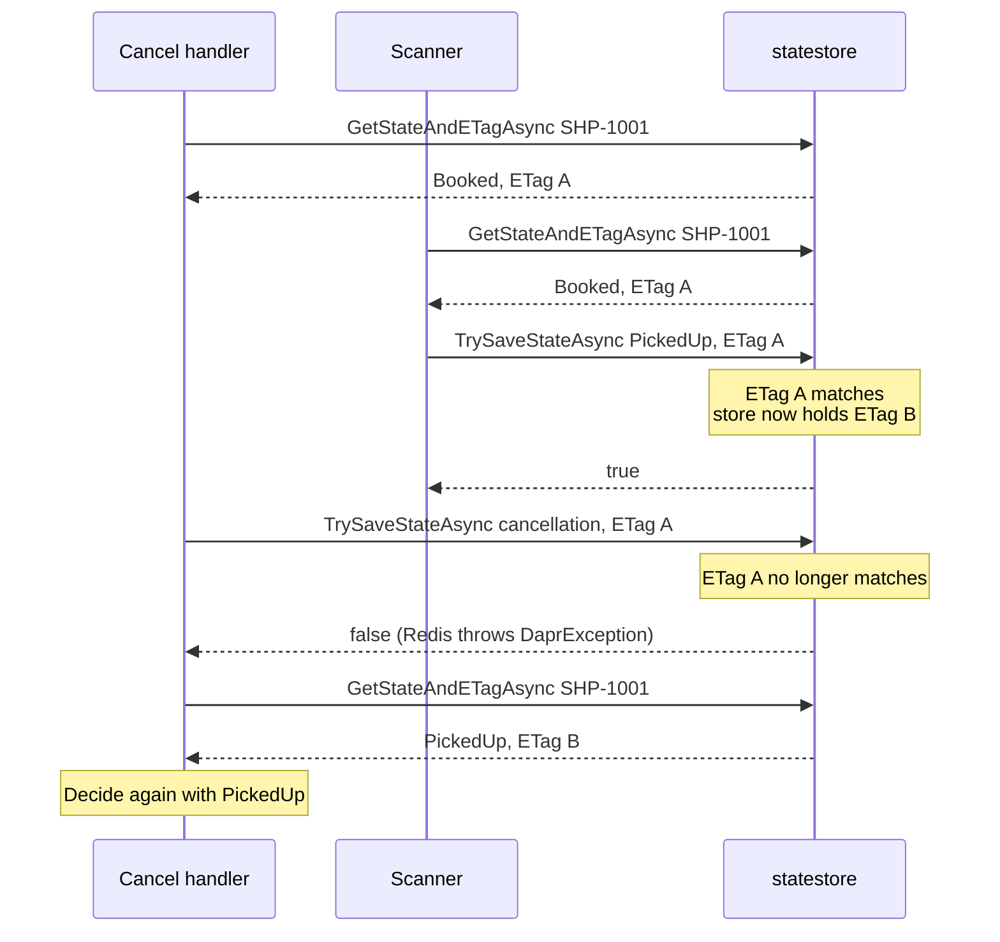

# State Stores: ETags & Concurrency

> **_NOTE:_** Duration: about 8 minutes.

A customer cancels a shipment while a scanner marks the same parcel as picked up. Both requests read the booking status, both compute a new status, and both write it back. Without a rule for conflicts, the last write silently replaces the first, and the shipment ends in a state that neither request intended.

This topic shows the Dapr state API through `DaprClient`, how ETags turn a read-modify-write into a safe update, the difference between first-write-wins and last-write-wins, atomic transactions across keys, and the Azure Cosmos DB state store component that backs the booking data.

## Save and Read State with DaprClient

The state API stores values under a key in a named store. The store name matches the `metadata.name` of a component file, so `statestore` in the code points at the file from the previous topic. Use the same store name in every service that shares the data, so the component file is the one place that names the store.

`SaveStateAsync` writes a value, and `GetStateAndETagAsync` returns the value together with its ETag.

```csharp
using Dapr.Client;

public record BookingStatus(string ShipmentId, string Status);

var client = new DaprClientBuilder().Build();

var booking = new BookingStatus("SHP-1001", "Booked");

await client.SaveStateAsync("statestore", booking.ShipmentId, booking);

var (current, etag) = await client.GetStateAndETagAsync<BookingStatus>("statestore", "SHP-1001");
```

The ETag is an opaque version token that the store issues on every write. Keep it with the value you read, because the store compares it when you write again.

## ETags and First-Write-Wins

Dapr supports optimistic concurrency with ETags. A write that carries an ETag succeeds only when the ETag still matches the stored one. `TrySaveStateAsync` takes the ETag and returns `false` when another writer got there first, while the Redis state store throws a `DaprException` for the same conflict, so the caller catches it and reads again.

```csharp
using Dapr.Client;

public record BookingStatus(string ShipmentId, string Status);

var client = new DaprClientBuilder().Build();

var (current, etag) = await client.GetStateAndETagAsync<BookingStatus>("statestore", "SHP-1001");

var updated = current with { Status = "PickedUp" };

var options = new StateOptions { Concurrency = ConcurrencyMode.FirstWrite };

var saved = await client.TrySaveStateAsync("statestore", "SHP-1001", updated, etag, options);
```

`StateOptions.Concurrency` accepts `ConcurrencyMode.FirstWrite` or `ConcurrencyMode.LastWrite`. The mode tells the store how to resolve concurrent writes, and the ETag tells it which version the caller saw.

A typical handler reads the value, computes the change, and calls `TrySaveStateAsync` in a short loop. When the call returns `false` or throws a `DaprException`, the handler reads again and recomputes. After a fixed number of attempts, it returns a conflict to the caller, so a customer request never loops forever.



## Last-Write-Wins or First-Write-Wins

Without an ETag, the state store applies last-write-wins: the newest write replaces the stored value. That is acceptable for data where the latest value is the only one that matters, such as a driver's free-text note. Use first-write-wins when two writers race for a transition that must happen once.

| Mode | Write rule | Grey Logistics example |
| --- | --- | --- |
| Last-write-wins | Newest write replaces the value | Driver note on a parcel |
| First-write-wins | Write succeeds only when the ETag matches | Booking status moves from Booked to PickedUp |

The consistency setting is a separate choice. `StateOptions.Consistency` selects strong or eventual consistency for a write.

Strong consistency waits for all replicas, or a designated quorum, before Dapr acknowledges the write. Eventual consistency acknowledges as soon as the data store accepts the write, and it is the default.

## Transactions Across Keys

When a change touches several keys, group the operations into one request. The store handles the group as an atomic transaction, so the request either succeeds for every key or fails for every key.

A booking that moves a shipment and clears its pending label record is a good fit, because a half-applied change would leave the two records disagreeing. `ExecuteStateTransactionAsync` takes a list of `StateTransactionRequest` objects, and each entry names a key and an operation type.

```csharp
using Dapr.Client;

var client = new DaprClientBuilder().Build();

var requests = new List<StateTransactionRequest>
{
    new StateTransactionRequest("SHP-1001", null, StateOperationType.Delete),
    new StateTransactionRequest("SHP-1002", null, StateOperationType.Delete)
};

await client.ExecuteStateTransactionAsync("statestore", requests);
```

Transactions cover the operations in one request. They do not replace the ETag check for a read-modify-write cycle that spans separate requests.

## Azure Cosmos DB State Store Component

The `state.azure.cosmosdb` component stores booking state in a Cosmos DB container. Container Apps supports it as a Tier 1 component. The file below uses plain values for local testing, and it needs only the URL, key, database and collection, and the collection must use the partition key path `/partitionKey`.

```yaml
apiVersion: dapr.io/v1alpha1
kind: Component
metadata:
  name: statestore
spec:
  type: state.azure.cosmosdb
  version: v1
  metadata:
  - name: url
    value: https://<account>.documents.azure.com:443/
  - name: masterKey
    value: <account-key>
  - name: database
    value: logistics
  - name: collection
    value: bookingstate
```

The `masterKey` entry is required only when the component does not use Microsoft Entra ID.

The Dapr documentation states that the component supports all Entra ID mechanisms, including managed identities. For a managed identity, grant the built-in role Cosmos DB Built-in Data Contributor, which has the role definition ID `00000000-0000-0000-0000-000000000002`. The same component file sets `actorStateStore` to `"true"` when the store also backs Dapr actors, a case that [topic 6](../06-actors/readme.md) covers.

## Key Topics

- [State management overview](https://docs.dapr.io/developing-applications/building-blocks/state-management/state-management-overview/)
- [Azure Cosmos DB state store component](https://docs.dapr.io/reference/components-reference/supported-state-stores/setup-azure-cosmosdb/)
- [Dapr components in Azure Container Apps](https://learn.microsoft.com/azure/container-apps/dapr-components)
- [Microservice APIs powered by Dapr](https://learn.microsoft.com/azure/container-apps/dapr-overview)
