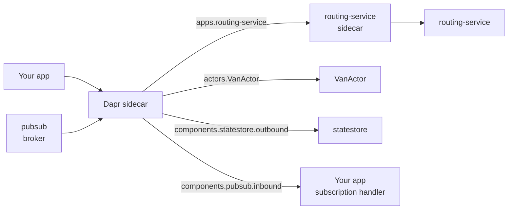

# Resiliency Policies: Retries & Breakers

> **_NOTE:_** Duration: about 9 minutes.

On a busy evening, `routing-service` takes longer to assign vans, and `shipping-api` keeps calling it. Each waiting request holds a connection and a thread, so the booking flow slows down for every customer, including those who never asked for a van. The fix is a small set of rules: give up after a fixed time, retry a few times with spacing, and stop calling a service that keeps failing.

This topic writes those rules as a Dapr resiliency spec. It covers timeouts, retries and circuit breakers, the targets that apply them to apps, actors and components, and the Container Apps component resiliency feature, which is in preview.

## The Resiliency Spec

A resiliency spec is a Kubernetes-style YAML resource with two parts. The `policies` section defines named timeouts, retry policies and circuit breakers. The `targets` section attaches those names to the things that Dapr calls.

The names are references, so you can change a policy in one place and every target that uses it follows.

```yaml
apiVersion: dapr.io/v1alpha1
kind: Resiliency
metadata:
  name: shipping-resiliency
spec:
  policies:
    timeouts:
      general: 5s
    retries:
      retryPolicy:
        policy: constant
        duration: 2s
        maxRetries: 3
        matching:
          httpStatusCodes: "500-599"
    circuitBreakers:
      cbPolicy:
        trip: consecutiveFailures >= 5
  targets:
    apps:
      routing-service:
        timeout: general
        retry: retryPolicy
        circuitBreaker: cbPolicy
```

The spec above applies to calls that `shipping-api` makes to `routing-service`. Each attempt waits at most five seconds, the policy retries a failed attempt up to three times with a constant two-second delay for HTTP status codes 500 to 599, and each attempt passes through a circuit breaker that trips after five consecutive failures. The sidecar loads the file only when the AppHost sets `ResourcesPaths` in the sidecar options to the folder that holds it.

## Timeouts, Retries and Circuit Breakers

Each policy type solves a different part of the failure. A timeout limits how long one attempt can run, and a retry repeats an attempt that failed.

A circuit breaker stops attempts entirely once a target has failed too often, which gives the target room to recover.

| Policy | Key fields | Effect on a failing target |
| --- | --- | --- |
| Timeout | A duration such as `general` | Ends the current attempt and returns an error |
| Retry | `policy` (`constant` or `exponential`), `duration`, `maxRetries` | Repeats the failed operation with backoff |
| Circuit breaker | `maxRequests`, `interval`, `timeout`, `trip` | Rejects calls after the trip condition holds |

The `trip` field holds a condition such as `consecutiveFailures >= 5`. The `timeout` in a circuit breaker controls how long the breaker stays open before it allows a probe request, and `maxRequests` limits how many requests pass while the breaker is probing. Dapr creates circuit breakers per component and per app instance, so one unhealthy replica does not block the whole service.

The lab's `cbPolicy` sets only `trip`, so the other fields keep their defaults. `maxRequests` stays at 1, `timeout` at 60s, and `interval` at 0s, which never clears the failure count while the breaker is closed.


Retries combine with timeouts, and the order matters. Each attempt gets its own timeout, so a timeout that fires ends only that attempt, and the retry policy then decides whether to try again. The full call can take up to the timeout multiplied by the number of attempts, plus the delays between them. Set the timeout for one attempt, then budget the total wait across all attempts.

## Targets: Apps, Actors and Components

A target decides where a policy applies. The `apps` section keys entries by app ID, the `actors` section keys them by actor type, and the `components` section keys them by component name. Component targets split into `outbound` for calls from the sidecar to the component, and `inbound` for calls from the component back to the app.



```yaml
spec:
  targets:
    components:
      statestore:
        outbound:
          timeout: general
          retry: retryPolicy
          circuitBreaker: cbPolicy
    actors:
      VanActor:
        timeout: general
        circuitBreaker: cbPolicy
```

The `actors` target protects the calls that reach an actor type, such as the `VanActor` in [topic 6](../06-actors/readme.md). A component target protects the store or broker itself. Outbound policies protect the state write, and inbound policies protect the delivery of a subscription message to your app.

## Container Apps Component Resiliency (Preview)

Container Apps offers the same policy model for the components of a managed Dapr environment through a preview feature called Dapr component resiliency. The feature supports timeouts, HTTP retries and circuit breakers. You attach a policy to a component that is already registered on the environment, and the policy covers outbound calls to the component or inbound calls from the component to your app.

The CLI attaches a timeout to the outbound direction of a component named `pubsub`. The command uses the flags from the Azure CLI resiliency reference, and the value is the response timeout in seconds.

```bash
az containerapp env dapr-component resiliency create --group <resource-group> --name <resiliency-name> --environment <environment-name> --dapr-component-name pubsub --out-timeout 20
```

Apply the policies, then restart the Dapr applications.

The portal page states that the portal supports only timeout and retry policies, while the CLI reference lists circuit breaker flags, so check the circuit breaker behavior against the CLI version that you use. Container Apps also has a separate service discovery resiliency feature for requests addressed by container app service name. That feature does not apply to calls made through the Dapr Service Invocation API, so Dapr calls use the Dapr spec or the component policy.

## Key Topics

- [Dapr resiliency overview](https://docs.dapr.io/operations/resiliency/resiliency-overview/)
- [Dapr component resiliency in Container Apps (preview)](https://learn.microsoft.com/azure/container-apps/dapr-component-resiliency)
- [Service discovery resiliency in Container Apps (preview)](https://learn.microsoft.com/azure/container-apps/service-discovery-resiliency)
- [az containerapp env dapr-component resiliency create](https://learn.microsoft.com/cli/azure/containerapp/env/dapr-component/resiliency?view=azure-cli-latest)
