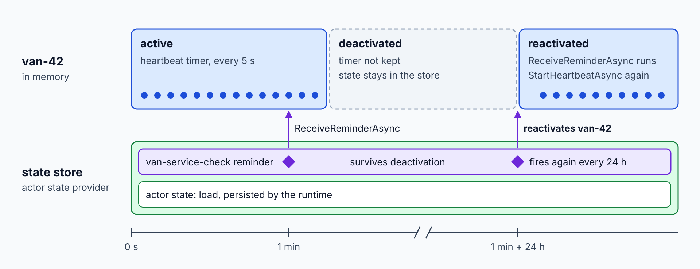

# Dapr Actors: Virtual Actor Model

> **_NOTE:_** Duration: about 9 minutes.

Grey Logistics gives each van one piece of state that changes all day: the parcels loaded on it and its last reported position. Two routing requests can arrive for the same van within the same second, and both must see the true load before they assign a parcel. A database row with a lock works, but it moves the concurrency rules into every handler.

This topic models each van as a Dapr actor named `VanActor`. It covers virtual actors and turn-based concurrency, the .NET Dapr.Actors API, timers and reminders, placement, and the constraint that the actor packages do not run on Container Apps managed Dapr.

## Virtual Actors and Turn-Based Concurrency

An actor is a unit of state and behavior with an identity. The runtime activates an actor the first time a request arrives for its ID, so you never create or destroy one explicitly. When an actor stays idle, the runtime garbage-collects the in-memory object but keeps the actor known, so the next request reactivates it with its saved state.

The runtime delivers calls to an actor one at a time. Dapr describes this as a simple turn-based access model: each method call or timer callback runs to completion before the next one starts. Your actor code does not need locks for its own data, which is why two assignment requests for `van-42` cannot both see the same free capacity.



Dapr also places actor instances across the cluster and moves them to healthy nodes when a node fails. The application code is the same in both cases, so a van actor can move from one replica to another without any change in its callers.

## The VanActor in .NET

An actor has an interface that derives from `IActor`, and a class that derives from `Actor`. Each method on the interface returns a `Task`, because the runtime calls every method asynchronously. The class receives an `ActorHost` through its constructor and passes it to the base class.

The class below also registers a timer and a reminder. The methods return fixed values to keep the example short. A production `AssignParcelAsync` reads the load from the actor state, adds the parcel, and returns `false` when the van is full.

```csharp
using Dapr.Actors;
using Dapr.Actors.Runtime;

public interface IVanActor : IActor
{
    Task<bool> AssignParcelAsync(string parcelId);

    Task ReportPositionAsync(double latitude, double longitude);

    Task StartHeartbeatAsync();

    Task StartServiceCheckAsync();
}

public class VanActor(ActorHost host) : Actor(host), IVanActor, IRemindable
{
    public Task<bool> AssignParcelAsync(string parcelId)
    {
        return Task.FromResult(true);
    }

    public Task ReportPositionAsync(double latitude, double longitude)
    {
        return Task.CompletedTask;
    }

    public Task StartHeartbeatAsync()
    {
        return this.RegisterTimerAsync("heartbeat", nameof(this.OnHeartbeat), null, TimeSpan.FromSeconds(5), TimeSpan.FromSeconds(5));
    }

    public Task StartServiceCheckAsync()
    {
        return this.RegisterReminderAsync("van-service-check", null, TimeSpan.FromMinutes(1), TimeSpan.FromHours(24));
    }

    public Task OnHeartbeat(byte[] state)
    {
        return Task.CompletedTask;
    }

    public Task ReceiveReminderAsync(string reminderName, byte[] state, TimeSpan dueTime, TimeSpan period)
    {
        return Task.CompletedTask;
    }
}
```

The actor state itself is persisted by the runtime in the state store, so the load survives deactivation and restarts. The callback named in `RegisterTimerAsync` must match a method on the same class, and the runtime invokes `ReceiveReminderAsync` for every reminder that fires.

## Timers Versus Reminders

A timer calls back into the actor on a schedule, and it lives only while the actor is active. The runtime does not keep timers after deactivation, so a timer suits work that can restart on the next activation, such as a heartbeat check on an active van.

A reminder is persisted through the actor state provider. It survives deactivation and restarts, so it suits work that must still fire after a van has been idle for hours, such as a daily service check. Reminders cost more than timers because the runtime writes them to storage, and the runtime requires at least one replica for them to fire reliably in Container Apps.



## Hosting and Calling Actors

The ASP.NET Core service registers the actor types and maps the actor endpoints. `AddActors` and `MapActorsHandlers` are extension methods that the `Dapr.Actors.AspNetCore` package supplies, in the `Microsoft.Extensions.DependencyInjection` and `Microsoft.AspNetCore.Builder` namespaces. The `Dapr.Actors` package carries the interfaces, and the client package carries the proxy.

```csharp
var builder = WebApplication.CreateBuilder(args);

builder.Services.AddActors(options =>
{
    options.Actors.RegisterActor<VanActor>();
});

var app = builder.Build();

app.MapActorsHandlers();

app.Run();
```

Callers create a proxy from the interface, the actor ID and the actor type name. The proxy turns each method call into a request for that van, and the runtime routes the request to the instance that holds the state.

```csharp
using Dapr.Actors;
using Dapr.Actors.Client;

var proxy = ActorProxy.Create<IVanActor>(new ActorId("van-42"), nameof(VanActor));

var accepted = await proxy.AssignParcelAsync("PKG-778");
```

All actor types in an application share one actor state store. The store must support transactions, and the Cosmos DB component marks itself as the actor store with `actorStateStore` set to `"true"`.

## Actors and Container Apps Managed Dapr

The Container Apps documentation states that "the Dapr server extensions, actor, and workflow SDK packages aren't compatible with Azure Container Apps." Managed Dapr there supports the building block APIs and components, but the actor packages in this topic do not run on it. Reminders also need at least one replica to fire reliably.

The practical rule for this class is to run `VanActor` locally with the Aspire AppHost, or on AKS with the Dapr extension, and use Container Apps for services that do not host actors. [Topic 7](../07-managed-dapr/readme.md) compares the two hosting options in a decision table.

## Key Topics

- [Actors overview](https://docs.dapr.io/developing-applications/building-blocks/actors/actors-overview/)
- [Actors .NET how-to](https://docs.dapr.io/developing-applications/sdks/dotnet/dotnet-actors/dotnet-actors-howto/)
- [Dapr actors HTTP how-to](https://docs.dapr.io/developing-applications/building-blocks/actors/howto-actors/)
- [Microservice APIs powered by Dapr](https://learn.microsoft.com/azure/container-apps/dapr-overview)
