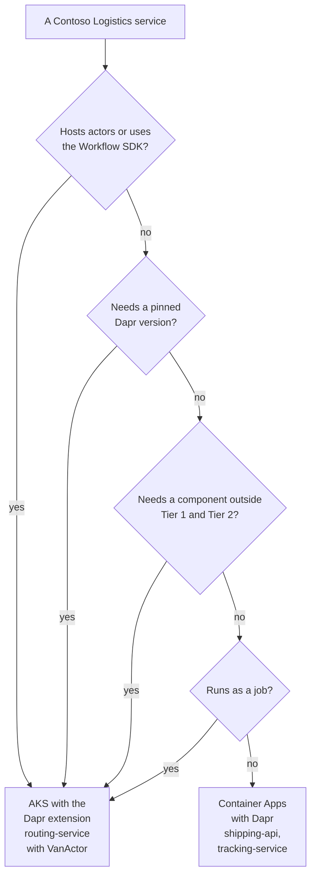

# Managed Dapr: Container Apps vs. AKS

> **_NOTE:_** Duration: about 10 minutes.

Contoso Logistics can host its services on two platforms. Booking and tracking are stateless request handlers that suit Container Apps, while `routing-service` hosts the `VanActor` actors and needs the AKS path. Both platforms offer Dapr, but they differ in who chooses the version, which components are supported, and which features exist at all.

This topic compares Dapr on Container Apps with the Dapr extension for AKS. It covers the component tiers and the limits that apply on Container Apps, the version window on AKS, and a decision table for choosing a host for each service.

## Dapr on Container Apps

Container Apps enables Dapr per app through the app's Dapr settings, and the sidecar exposes the building block APIs on port 3500. Components are defined once on the managed environment, and their scopes list the app IDs that load each one.

```bash
az containerapp create --name shipping-api --resource-group <resource-group> --environment <environment-name> --enable-dapr --dapr-app-id shipping-api --dapr-app-port 8080
```

The platform sets the Dapr configuration. Only the sidecar options listed in the Container Apps Dapr reference are available, and the Dapr configuration spec is not supported. Any sidecar annotation outside that list is also unavailable.

## Tiers and Supported Components

Container Apps supports a subset of Dapr components, grouped into two tiers. Tier 1 components receive immediate investigation for security or serious regression issues. Tier 2 components receive lower-priority investigation because they are not in a stable state or come from a third party.

| Tier | State | Pub/sub | Other |
| --- | --- | --- | --- |
| Tier 1 | `state.azure.cosmosdb`, `state.azure.blobstorage`, `state.azure.tablestorage`, `state.sqlserver` | `pubsub.azure.servicebus.queues`, `pubsub.azure.servicebus.topics`, `pubsub.azure.eventhubs` | `secretstores.azure.keyvault`; bindings for Storage Queues, Service Bus Queues, Blob Storage and Event Hubs |
| Tier 2 | `state.postgresql`, `state.mysql`, `state.redis` | `pubsub.kafka`, `pubsub.redis` | Bindings for Event Grid, Cosmos DB, Kafka, PostgreSQL, Redis and Cron; configuration for PostgreSQL and Redis |

Only the GA, Tier 1 and Tier 2 APIs and components are supported. The Cosmos DB state store from [topic 3](../03-state-stores/readme.md) and the Service Bus topics component from [topic 4](../04-pub-sub/readme.md) are both Tier 1.

## Versions on Container Apps

Container Apps does not let you choose a Dapr version. The FAQ states that custom version selection is not supported and that the environment is upgraded automatically. The planned maintenance feature on the environment controls when those upgrades happen, but it does not select a version.

Dapr versions in Container Apps carry an Azure suffix such as `-msft.1`. The FAQ says updates are applied on a best-effort basis and that Container Apps does not follow a fixed release schedule for new features. Check each API that your code uses against the supported list above before you rely on it in Container Apps.

## Jobs, Express and SDK Limits

The Container Apps documentation lists the limits that matter for this class. The first one applies to apps that use the Dapr .NET actor or workflow packages, and the quote is verbatim:

> Currently, the Dapr server extensions, actor, and workflow SDK packages aren't compatible with Azure Container Apps.

Three other limits shape the design. Dapr is not supported for jobs, so a scheduled task that needs a sidecar must run elsewhere.

Actor reminders need a minimum of one replica to stay active. Container Apps Express, which provides a simplified configuration surface, does not support Dapr, jobs, workload profiles or system-assigned managed identities.

## The AKS Dapr Extension

The Dapr extension for AKS installs Dapr as a cluster extension, typed `Microsoft.Dapr`. Because the extension is an AKS feature, it follows the AKS support policy. The following command creates the extension with automatic minor-version upgrades turned off, which is the setting for production clusters.

```bash
az k8s-extension create --cluster-type managedClusters --cluster-name <aks-cluster> --resource-group <resource-group> --name dapr --extension-type Microsoft.Dapr --auto-upgrade-minor-version false
```

The extension supports the current and the previous Dapr versions. That rolling window is the operational responsibility of the cluster owner, so an old cluster may need intermediate upgrades before it reaches a supported version.

The `stable` release train is the default, and the `dev` train carries experimental features that are not suitable for production. To pin a version, set `--version` together with `--auto-upgrade-minor-version false`.

The extension also enables high availability and mTLS by default, so a new cluster starts with three control-plane replicas and workload certificates that last 24 hours. The Container Apps restriction does not apply to AKS, so AKS is the path for `VanActor` from [topic 6](../06-actors/readme.md) on this comparison.

## Decision Table

| Question | Container Apps with Dapr | AKS with the Dapr extension |
| --- | --- | --- |
| Who picks the Dapr version | The platform, with automatic upgrades | You, through pinned or auto-upgraded minor versions |
| Actor SDK packages | Not compatible | No restriction documented for the extension |
| Jobs | Dapr not supported | Not listed as a limit in the extension docs |
| Component support | Tier 1 and Tier 2 list above | Components you deploy and operate |
| Configuration | Listed sidecar options only | Extension configuration settings |
| Component resiliency | Preview | Resiliency spec from [topic 5](../05-resiliency/readme.md) |
| Operating model | Managed by Azure | Cluster owner runs the version window |

Choose Container Apps for stateless services that use the Tier 1 components, and accept the platform's upgrade timing. Choose AKS for services that host actors, need a pinned version, or depend on a component outside the Container Apps list.



## Key Topics

- [Microservice APIs powered by Dapr](https://learn.microsoft.com/azure/container-apps/dapr-overview)
- [Install the Dapr extension for AKS](https://learn.microsoft.com/azure/aks/dapr)
- [Configure the Dapr extension for AKS](https://learn.microsoft.com/azure/aks/dapr-settings)
- [Azure Container Apps Express overview](https://learn.microsoft.com/azure/container-apps/express-overview)
