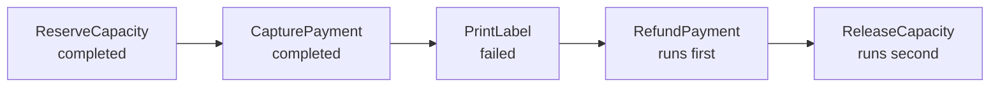

# Saga Orchestration: Compensating Activities

Contoso books a shipment across three services. Capacity, payment, and the label each change state in their own database, so no single transaction covers all three. If printing the label fails, the company must release the capacity and refund the payment, and the system must reach that consistent state even when a step fails halfway.

The saga pattern solves this with a sequence of local transactions and a compensating action for each one. This topic builds the Contoso booking saga as a Durable Task orchestration. It covers the compensation order, retry policies, idempotent activities, and the choice between choreography and orchestration.

## The Booking Saga and Its Compensations

Each forward step has one compensation that reverses its effect. The orchestrator runs the forward steps in order, and it records a compensation as each step completes. The table lists the pairs for the booking.

| Forward step | Activity | Compensation |
| --- | --- | --- |
| 1 | `ReserveCapacity` | `ReleaseCapacity` |
| 2 | `CapturePayment` | `RefundPayment` |
| 3 | `PrintLabel` | `VoidLabel` |

When a step fails, the orchestrator runs the compensations of the completed steps in reverse order. The diagram shows a failure at `PrintLabel`, where the refund runs before the capacity release.



The code below registers each compensation as its forward step succeeds. It pushes the compensations onto a stack, so the last one pushed runs first. A `TaskFailedException` from any forward step triggers the stack, and the orchestrator returns a compensated result.

```csharp
public class BookingSagaOrchestrator : TaskOrchestrator<string, string>
{
    public override async Task<string> RunAsync(TaskOrchestrationContext context, string parcelId)
    {
        var compensations = new Stack<Func<Task>>();
        try
        {
            string reservation = await context.CallActivityAsync<string>("ReserveCapacity", parcelId);
            compensations.Push(() => context.CallActivityAsync("ReleaseCapacity", reservation));

            string payment = await context.CallActivityAsync<string>("CapturePayment", parcelId);
            compensations.Push(() => context.CallActivityAsync("RefundPayment", payment));

            string label = await context.CallActivityAsync<string>("PrintLabel", parcelId);
            compensations.Push(() => context.CallActivityAsync("VoidLabel", label));

            return label;
        }
        catch (TaskFailedException)
        {
            while (compensations.Count > 0)
            {
                await compensations.Pop()();
            }

            return "compensated";
        }
    }
}
```

The `VoidLabel` compensation covers a label that prints before a later failure. The three forward steps in this booking end with `PrintLabel`, so the orchestrator returns the label and never runs `VoidLabel`. A compensation that throws fails the orchestration, so design each compensation to be retryable as well.

## Pivot, Retryable, and Compensable Steps

The Architecture Center sorts saga steps into three roles. A compensable step can be undone by another transaction with the opposite effect, and the pivot is the point of no return, after which compensations no longer apply. A retryable step follows the pivot, and it must succeed eventually, so it has to be idempotent.

Map the booking onto these roles before you write the orchestrator. `ReserveCapacity`, `CapturePayment`, and `PrintLabel` are compensable, because `ReleaseCapacity`, `RefundPayment`, and `VoidLabel` reverse them. The booking has no irreversible step, so it has no pivot.

A later step that cannot be recalled, such as a message to a carrier, would become the pivot, and the steps after it would need retries.

Compensations can fail too. The pattern guidance notes that compensating transactions might not always succeed, which can leave the system in an inconsistent state. Monitor sagas in the dashboard from topic 2, and alert on any orchestration that ends in a compensated or failed state.

## Retry Policies and Idempotent Activities

A transient error, such as a timeout from the payment provider, should retry before the saga compensates. The Durable Task SDK retries a failed activity according to a policy. The policy has five settings, which the table describes.

| Setting | Meaning |
| --- | --- |
| Max number of attempts | Total retries allowed; 1 means no retries |
| First retry interval | Wait before the first retry |
| Backoff coefficient | Growth factor between retries; defaults to 1 |
| Max retry interval | Upper bound for the wait between retries |
| Retry timeout | Total time that the retries may take |

The Durable Functions isolated model expresses the policy with `TaskOptions` and `TaskRetryOptions`. The example retries `PrintLabel` up to three times, starting after five seconds.

```csharp
var retryOptions = new TaskOptions(
    new TaskRetryOptions(new RetryPolicy(
        maxNumberOfAttempts: 3,
        firstRetryInterval: TimeSpan.FromSeconds(5))));

string label = await context.CallActivityAsync<string>("PrintLabel", parcelId, retryOptions);
```

The runtime guarantees at-least-once execution, so a retry can run an activity that already succeeded. Each activity must therefore be idempotent. Pass a stable key that the downstream service checks, such as the parcel ID plus the step name, so a repeated call returns the first result.

Without that key, a retried `CapturePayment` can charge the customer twice. Semantic locks help with a related risk, where two sagas change the same record at once. A semantic lock is an application-level marker that a compensable step sets while an update is in progress, so the other saga can see that the update is underway.

## Choreography Versus Orchestration

The Architecture Center describes two ways to coordinate a saga. In choreography, each service publishes events and reacts to the events of others, and no coordinator exists.

In orchestration, one controller calls each participant and stores the state of the saga. The table summarizes the trade-offs from the pattern guidance.

| Approach | Strengths | Weaknesses |
| --- | --- | --- |
| Choreography | Few services and simple flows; no coordinator; no single point of failure | Hard to follow as steps grow; risk of cyclic dependencies; hard to test end to end |
| Orchestration | Complex flows and growing service counts; no cyclic dependencies; clear responsibilities | Needs coordination logic; the orchestrator manages the whole flow |

The booking suits orchestration, because it has three services, a fixed order, and compensations that must run in reverse. The tracking projection from Module 6 suits choreography, because each event feeds an independent read model.

## Key Topics

- [Saga distributed transactions pattern](https://learn.microsoft.com/azure/architecture/patterns/saga)
- [Compensating Transaction pattern](https://learn.microsoft.com/azure/architecture/patterns/compensating-transaction)
- [Choreography pattern](https://learn.microsoft.com/azure/architecture/patterns/choreography)
- [Handle errors and retries in orchestrations](https://learn.microsoft.com/azure/durable-task/common/durable-task-error-handling)
