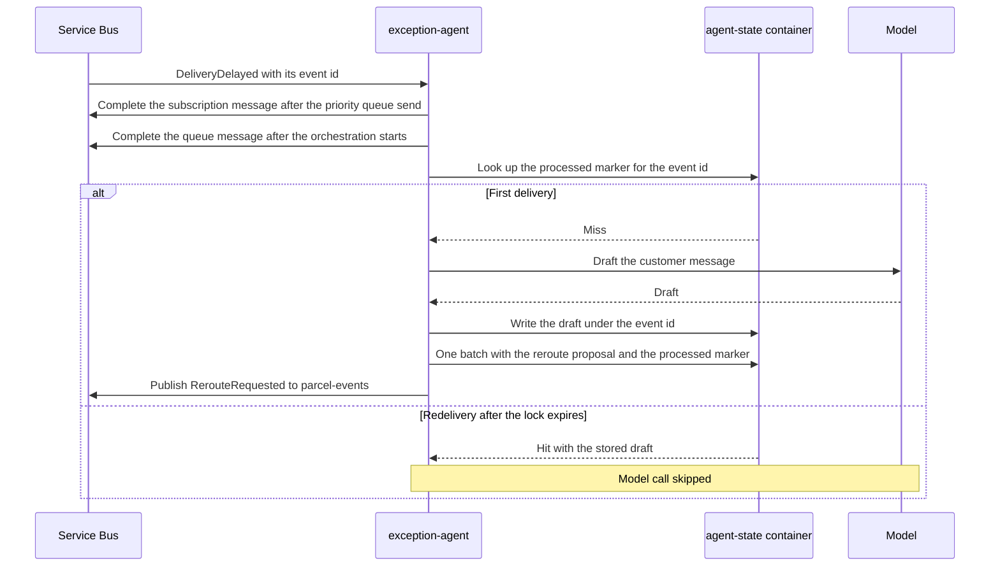

# Agent Subscribers: React to Events

> **_NOTE:_** Duration: about 8 minutes.

A delayed parcel is the moment Contoso Logistics needs a human-quality answer fast. When a parcel misses its promised window, the durable deadline raises DeliveryDelayed, and the exception-agent has to decide what the customer hears and whether a van should take a different route. The agent is one more subscriber in the event flow, and it reacts the way any other service does.

This topic shows the agent as an event consumer: what it reads from DeliveryDelayed, what it writes back as a command or an event, and how it stays idempotent when the broker delivers a message twice. The agent sits behind the same contracts as the routing and notification services, so the rules from the first modules apply without change. This topic is the alternative to [Topic 03](../03-durable-llm-calls/readme.md), where a durable orchestration calls the model as an activity; the lab combines both, with the subscriber starting the orchestration.

## The Agent as an Event Consumer

The exception-agent subscribes to the events it needs through a topic subscription with a filter on the event type, the same filter pattern as Module 4. It receives the event in the CloudEvents 1.0 envelope that the event types topic defines, and it reads only the fields it needs to reason about the parcel.

```json
{
  "specversion": "1.0",
  "id": "5f0c1a2e-8d3b-4c7a-9e21-6b4f0d9a7c11",
  "source": "booking-worker",
  "type": "DeliveryDelayed",
  "time": "2026-10-18T09:15:00Z",
  "datacontenttype": "application/json",
  "data": {
    "shipmentId": "00000000-0000-0000-0000-000000000000",
    "trackingNumber": "PX-4471"
  }
}
```

The publisher owns the schema, and the agent declares the subset of fields it reads. A new optional field on the publisher side does not break the agent. A removed or renamed field does.

Choreography guidance calls this out directly. Use a schema registry and backward-compatible changes, because independent services consume the same events.

The agent also keeps the data it sends to the model to a minimum. Customer details enter a prompt only when the draft needs them, so the prompt carries no field that the task does not use.

## Output as a Command or an Event

In the lab, the agent sends one kind of message, an event, and keeps its draft in the agent-state container. A command asks one named service to act. An event states a fact that any interested service can use.

The agent never calls RerouteParcel directly, because the routing service owns the van assignments.

| Output | Kind | Consumer | Next step |
| --- | --- | --- | --- |
| Draft customer message | `NotifyCustomer` command (design) | notification-service | Held for review until an operator approves it |
| Reroute proposal | `RerouteRequested` event | routing-service, ops-console (design, no lab consumer) | A person approves through the reroute-approval endpoint, which raises `RerouteApproved` |
| Approval | `RerouteApproved` event | Durable orchestration from Module 8 | The orchestration calls RerouteParcel |

The draft and the proposal are both decisions made by a model, so both carry the event id and parcel id that produced them. Downstream services can then trace each suggestion to the delay that caused it. The human approval closes the loop, and Module 8 covers how the orchestration waits for it.

## Idempotency for Agent Consumers

Brokers in this class deliver at least once. Service Bus duplicate detection suppresses repeated sends inside its history window, but it does not stop a redelivery after a lock expires. Event Hubs checkpoints can replay a range after a restart.

The idempotent consumer pattern handles both cases by recording what it has already processed.

For a model-driven consumer, the order of the steps decides the outcome. The agent first checks the agent-state container for a processed marker keyed by the event id, and only then calls the model. It writes the draft under the event id, then writes the reroute proposal and the processed marker in one transactional batch, so a crash cannot leave a marker without its proposal.



Module 6 shows the same pattern with the transactional outbox.

Model output is not deterministic. A second call for the same event can produce different wording, so a retry must reuse the stored draft. The reroute proposal is keyed by the event id with a `reroute-` prefix, in the parcel's partition, so a duplicate delivery upserts one proposal and creates no second one.

The lab does not dead-letter these events, because the dispatcher completes a message once its orchestration starts. In a production design, an event that the model cannot handle after its retries goes to the dead-letter queue with a reason, so an operator can inspect it. Module 4 covers dead-letter handling in detail.

## Key Topics

- [Choreography pattern](https://learn.microsoft.com/azure/architecture/patterns/choreography)
- [Idempotent Consumer pattern](https://learn.microsoft.com/azure/architecture/patterns/idempotent-consumer)
- [Event-driven architecture style](https://learn.microsoft.com/azure/architecture/guide/architecture-styles/event-driven)
- [Duplicate detection in Azure Service Bus](https://learn.microsoft.com/azure/service-bus-messaging/duplicate-detection)
