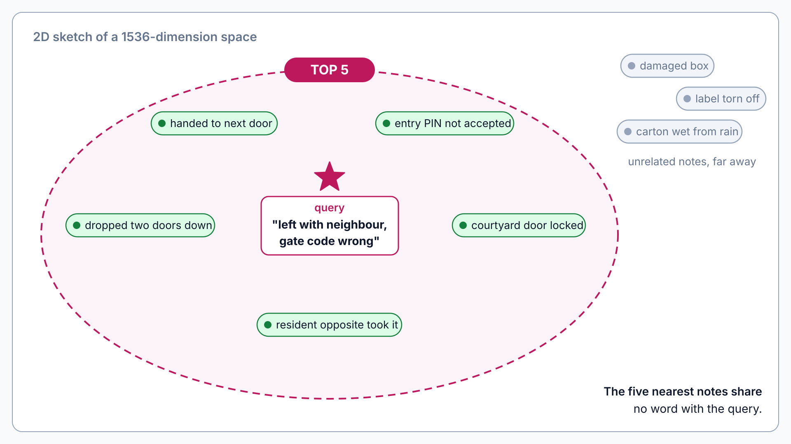
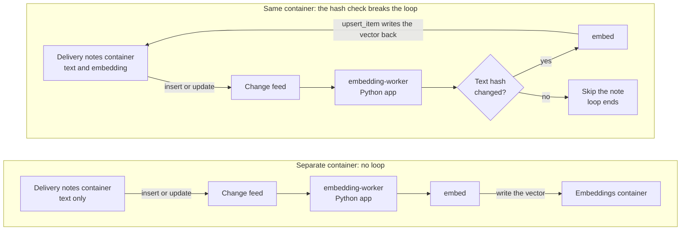

# Vector Search: Change Feed Embeddings

> **_NOTE:_** Duration: about 10 minutes.

Delivery notes are free text. A driver writes "left with neighbour, gate code wrong" after a failed attempt, and the exception-agent needs to find earlier notes that describe the same situation. Keyword search misses most of them, because drivers phrase the same problem in many ways.

An embedding turns each note into a vector, and a vector index finds the notes whose meaning is closest. This topic covers how the Cosmos DB change feed triggers embedding generation for each new or edited note, the container vector policy and the DiskANN vector index as JSON, a VectorDistance query, the Python `embedding-worker` app, and how embeddings stay in sync when a note changes.



## The Change Feed as the Trigger

Delivery notes live in a Cosmos DB container, and every insert or update appends an entry to the change feed. The worker reads that feed, computes an embedding for each changed note, and writes the vector back to the same item. The write path stays simple, because the scanner and driver apps never call the embedding model.

The worker is a projection, the same kind of consumer that Module 6 builds for the tracking read model. Consumers of a change feed process at least once, so the worker must be idempotent. A replay overwrites the vector with one for the same text, so a replay costs a model call and nothing else.

Writing the vector back into the container triggers another change feed entry. The worker must skip any note whose text hash has not changed, or it embeds its own output forever. A simpler design writes embeddings to a separate container, which removes the loop by construction.



## Container Vector Policy and DiskANN Index

Vector search in the NoSQL API needs two policies. The vector embedding policy describes the vector property, and it is set when the container is created. The vector indexing policy builds the index on the same path, and DiskANN is the index type for large collections.

The embedding policy below describes a path that holds float32 vectors of 1536 dimensions, the default size of text-embedding-3-small, compared with cosine distance.

```json
{
  "vectorEmbeddings": [
    {
      "path": "/embedding",
      "dataType": "float32",
      "distanceFunction": "cosine",
      "dimensions": 1536
    }
  ]
}
```

The indexing policy keeps every property indexed, excludes the system _etag property and the vector path from the range index, and adds the DiskANN index on the vector path.

```json
{
  "indexingMode": "consistent",
  "automatic": true,
  "includedPaths": [
    {
      "path": "/*"
    }
  ],
  "excludedPaths": [
    {
      "path": "/\"_etag\"/?"
    },
    {
      "path": "/embedding/*"
    }
  ],
  "vectorIndexes": [
    {
      "path": "/embedding",
      "type": "diskANN"
    }
  ]
}
```

Microsoft documents the vector policy and the vector index as immutable after creation.

A change to the model or the dimensions means a new container, a new policy, and a full re-embedding run.

DiskANN is an approximate index, so the same query can return slightly different results across runs. The flat type gives exact results, but it accepts at most 505 dimensions, so 1536-dimension embeddings need quantizedFlat for a brute-force scan with a small accuracy loss.

## Querying with VectorDistance

The worker finds similar notes with the VectorDistance system function. The query orders by distance and uses TOP, because an unbounded vector query costs more request units and adds latency. The function accepts an options object, so you can raise searchListSizeMultiplier for one query when recall matters more than latency.

```python
import hashlib
import os

def embed(embedder, text):
    response = embedder.embeddings.create(
        model=os.environ["EMBEDDING_DEPLOYMENT"],
        input=text,
    )
    return response.data[0].embedding

def text_hash(text):
    return hashlib.sha256(text.encode("utf-8")).hexdigest()

def process(container, embedder, note):
    text = note.get("text")
    if not text:
        return
    digest = text_hash(text)
    if note.get("textHash") == digest:
        return
    note["embedding"] = embed(embedder, text)
    note["textHash"] = digest
    container.upsert_item(note)

def similar_notes(container, vector):
    query = (
        "SELECT TOP 5 c.id, c.parcelId, c.text, VectorDistance(c.embedding, @vector) AS score "
        "FROM c ORDER BY VectorDistance(c.embedding, @vector)"
    )
    return container.query_items(
        query=query,
        parameters=[{"name": "@vector", "value": vector}],
        enable_cross_partition_query=True,
    )
```

The client is an OpenAI-compatible client that points at the Foundry resource, configured as the Foundry embeddings guide describes. The worker passes the deployment name as the model, which is the value that Foundry uses to select the embedding model. Cross-partition execution is required here, because the query has no partition key filter.

## Keeping Embeddings in Sync on Updates

An edit to a note produces a new change feed entry, and the worker replaces the old vector with a new one in the same upsert. A reader that runs between the edit and the update sees the old vector, which matches the eventual consistency that the event-driven design already accepts. The worker should log the lag, so operators can see how far behind the embeddings run.

Deletes matter only when the vectors live outside the note container, as in the alternative design. In that case, the worker must see the deletes too. The Python ContainerProxy method query_items_change_feed accepts a mode argument, and AllVersionsAndDeletes returns deleted items along with the latest versions.

A model change forces a rebuild. Because the vector policy is immutable, the team creates a new container with the new dimensions, runs the worker against the existing notes, and switches the reads over when the backfill finishes.

## Key Topics

- [Vector search in Azure Cosmos DB for NoSQL](https://learn.microsoft.com/azure/cosmos-db/vector-search)
- [Indexing policies in Azure Cosmos DB](https://learn.microsoft.com/azure/cosmos-db/index-policy)
- [Tips for optimizing vector indexing and search performance](https://learn.microsoft.com/azure/cosmos-db/gen-ai/vector-search-performance-tips)
- [Generate embeddings with Azure OpenAI in Microsoft Foundry Models](https://learn.microsoft.com/azure/foundry/openai/how-to/embeddings)
- [ContainerProxy class, Azure Cosmos DB Python SDK](https://learn.microsoft.com/python/api/azure-cosmos/azure.cosmos.container.containerproxy?view=azure-python)
