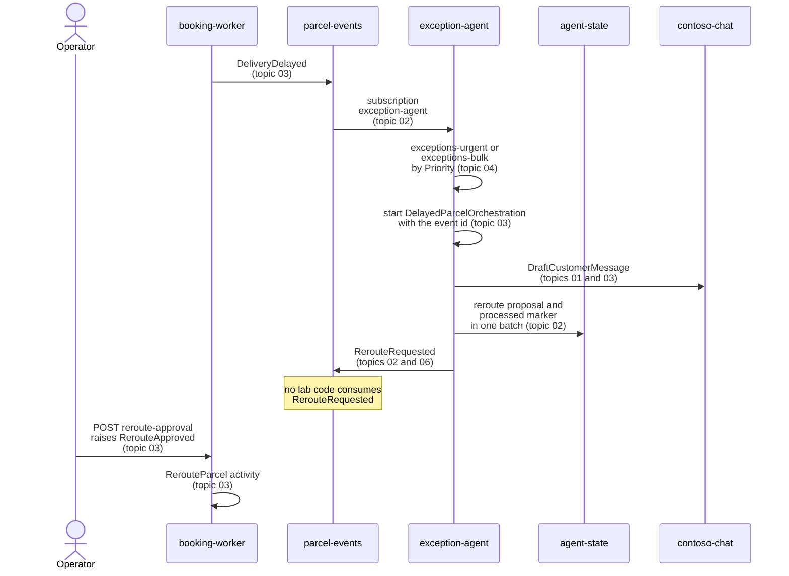

# Module 9: AI Agents in Event-Driven Systems

Module 9 closes the class storyline by adding the exception-agent to the event flow. When a parcel misses its window, the agent subscribes to DeliveryDelayed, drafts the customer message, and proposes a reroute that a person approves. The agent is a service like any other, with the same contracts, the same retries, and the same idempotency rules.

After this module you can call a Microsoft Foundry model deployment through Microsoft.Extensions.AI, run each model call as a durable activity, and keep the agent inside its token quota. You can also index delivery notes with a change feed and a Cosmos DB vector index, and you can decide when agents should coordinate through events and when they should call each other with A2A.

Agent fundamentals, MCP servers, A2A hosting, and durable agents in depth belong to the pro-code-agents class. This module stays at the distributed-systems angle, where the model is one slow, non-deterministic, non-idempotent step in a larger flow.

## Topics

| Topic | Description |
| --- | --- |
| [Microsoft.Extensions.AI: Foundry Model Client](./01-extensions-ai/readme.md) | IChatClient, AzureOpenAIClient with DefaultAzureCredential, UseLogging and UseOpenTelemetry, Aspire.Hosting.Foundry (preview) |
| [Agent Subscribers: React to Events](./02-agent-subscribers/readme.md) | Topic subscriptions, CloudEvents input, RerouteRequested output and a designed NotifyCustomer command, idempotent processing |
| [LLM Calls: Durable Activities](./03-durable-llm-calls/readme.md) | CallActivityAsync, TaskOptions, RetryPolicy, retries on 429, RerouteApproved as an external event |
| [Rate Limits: Priority Queues & KEDA](./04-rate-limits/readme.md) | Token and request quotas, retry-after-ms, separate priority queues, azure-servicebus scale rule with maxReplicas |
| [Vector Search: Change Feed Embeddings](./05-vector-search/readme.md) | Change feed triggers, vectorEmbeddings policy, diskANN vector index, VectorDistance query |
| [Agent Choreography: Events vs. A2A](./06-agent-choreography/readme.md) | Choreography pattern, A2A agent cards at /.well-known/agent-card.json, A2A 1.0 bindings and governance |

## Helpful Claude Slash Commands

| Command | What it does here |
| --- | --- |
| `/model` | Switches the Claude model that writes the exception-agent code, so you can compare drafts of the IChatClient and Python worker code. |
| `/cost` | Shows token use and cost for the Claude session while you iterate on the agent code, so long review loops stay visible. |
| `/security-review` | Audits the agent code for keys in configuration, unsafe handling of delivery-note text, and secrets written to logs. |
| `/review` | Reviews the branch for idempotency and retry logic in the durable activity, the part of the agent that a diff reader most often misses. |

## Key Topics covered in this module

- [What is Microsoft Foundry?](https://learn.microsoft.com/azure/foundry/what-is-foundry)
- [Microsoft.Extensions.AI libraries](https://learn.microsoft.com/dotnet/ai/microsoft-extensions-ai)
- [Handle errors and retries in orchestrations](https://learn.microsoft.com/azure/durable-task/common/durable-task-error-handling)
- [Vector search in Azure Cosmos DB for NoSQL](https://learn.microsoft.com/azure/cosmos-db/vector-search)
- [Priority Queue pattern](https://learn.microsoft.com/azure/architecture/patterns/priority-queue)
- [A2A protocol specification](https://a2a-protocol.org/latest/specification/)
