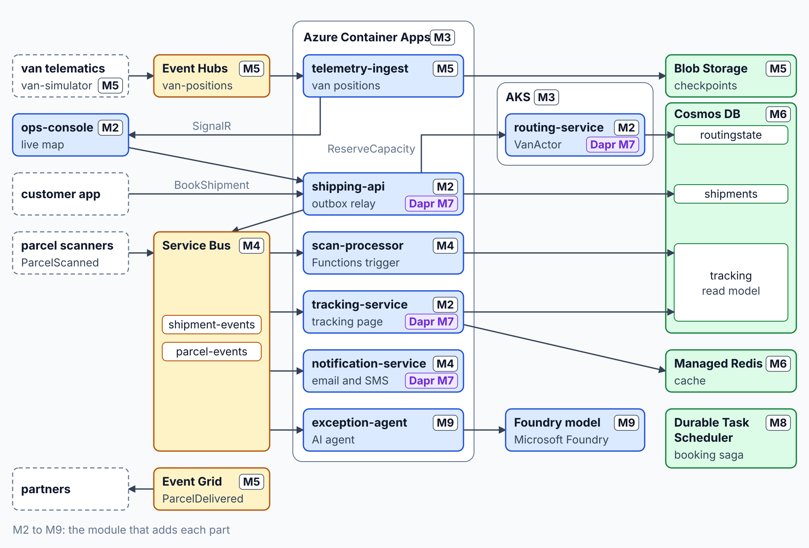

# Event-Driven Apps on Azure

This four-day class is for Azure developers and software architects who design and build event-driven distributed applications on .NET 10. It starts where AI-200 stops: the exam names the building blocks, this class implements the patterns on top of them, from the transactional outbox and idempotent consumers to event sourcing, durable workflows and sagas.

Every topic is taught on one domain, Grey Logistics, a last-mile parcel delivery company: shipments are booked, vans report their position, scanners report every parcel, and an operations console shows the network live. You model the system with Aspire, run it on Azure Container Apps and AKS, connect it with Service Bus, Event Grid and Event Hubs, store its history in Cosmos DB, make it portable with Dapr, make long-running processes survive failures with the Durable Task Scheduler, and finish by adding AI agents that take part in the event flow like any other service.

## Duration

4 Days

## Audience

- Azure Developers building distributed and event-driven applications
- Software Architects designing microservices on Azure

## Prerequisites & Requirements

- C# and .NET experience
- Azure development at AI-200 level
- Docker Desktop
- Azure Subscription
- GitHub Account

## Modules

## Module 1: Designing Event-Driven Distributed Systems

- [Modular Monolith vs. Microservices](./01-distributed-design/01-monolith-vs-microservices/)
- [Sync vs. Async: Commands & Events](./01-distributed-design/02-sync-async/)
- [Event Storming: Find Service Boundaries](./01-distributed-design/03-event-storming/)
- [Event Types: Domain, Integration, CloudEvents](./01-distributed-design/04-event-types/)
- [Reliability Patterns: Outbox, Saga, Idempotency](./01-distributed-design/05-reliability-patterns/)
- [Azure Messaging: Pick the Broker](./01-distributed-design/06-pick-the-broker/)

## Module 2: Building Distributed Apps with Aspire

- [Aspire AppHost: Model the System](./02-aspire/01-apphost/)
- [ServiceDefaults: Telemetry, Resilience, Discovery](./02-aspire/02-service-defaults/)
- [Aspire Integrations: Hosting & Client](./02-aspire/03-integrations/)
- [Aspire Dashboard: Traces Across Services](./02-aspire/04-dashboard/)
- [Polyglot AppHost: Angular & Python](./02-aspire/05-polyglot/)
- [Aspire Testing: Distributed Integration Tests](./02-aspire/06-testing/)

## Module 3: Hosting on Container Apps & AKS

- [Aspire Deploy: ACR & Container Apps](./03-hosting/01-aspire-deploy/)
- [Key Vault & App Configuration](./03-hosting/02-key-vault-app-config/)
- [Revisions: Traffic Splitting & Draining](./03-hosting/03-revisions/)
- [AKS: Aspire-Generated Kubernetes Manifests](./03-hosting/04-aks/)
- [Application Insights: Traces & KQL](./03-hosting/05-app-insights/)

## Module 4: Reliable Messaging with Service Bus

- [Topic Subscriptions: SQL Filters](./04-service-bus/01-subscriptions-filters/)
- [Azure Functions: Service Bus Triggers](./04-service-bus/02-functions-triggers/)
- [Competing Consumers: KEDA Scale Rules](./04-service-bus/03-competing-consumers/)
- [Sessions: Ordered Message Processing](./04-service-bus/04-sessions/)
- [Dead-Letter Queues: Poison Messages](./04-service-bus/05-dead-letter/)
- [Idempotent Consumers: Duplicate Detection](./04-service-bus/06-idempotent-consumers/)

## Module 5: Events & Streams with Event Grid & Event Hubs

- [Event Grid: Custom Topics & Subscriptions](./05-event-grid-hubs/01-custom-topics/)
- [Event Grid: Filters, Retries, Dead-Letter](./05-event-grid-hubs/02-filters-retries/)
- [Event Grid Namespaces: Pull Delivery](./05-event-grid-hubs/03-namespaces-pull/)
- [Event Hubs: Partitions & Checkpoints](./05-event-grid-hubs/04-partitions-checkpoints/)
- [Event Hubs: Kafka-Compatible Streaming](./05-event-grid-hubs/05-kafka/)
- [SignalR Service: Push to Browsers](./05-event-grid-hubs/06-signalr/)

## Module 6: Event Sourcing & CQRS with Cosmos DB

- [Transactional Outbox: Atomic Publishing](./06-event-sourcing-cqrs/01-outbox/)
- [Change Feed Processor: Projections](./06-event-sourcing-cqrs/02-change-feed-processor/)
- [CQRS: Separate Writes from Reads](./06-event-sourcing-cqrs/03-cqrs/)
- [Read Models: Indexing, RUs, Consistency](./06-event-sourcing-cqrs/04-read-models/)
- [Managed Redis: Change-Feed Cache Invalidation](./06-event-sourcing-cqrs/05-redis-cache/)
- [Event Store: Aggregates & Snapshots](./06-event-sourcing-cqrs/06-event-store/)
- [Event Versioning: Evolve Schemas Safely](./06-event-sourcing-cqrs/07-event-versioning/)

## Module 7: Dapr Building Blocks for Portable Services

- [Dapr Sidecar: Run with Aspire](./07-dapr/01-sidecar/)
- [Service Invocation: mTLS & Retries](./07-dapr/02-service-invocation/)
- [State Stores: ETags & Concurrency](./07-dapr/03-state-stores/)
- [Pub/Sub: Swap Brokers via Components](./07-dapr/04-pub-sub/)
- [Resiliency Policies: Retries & Breakers](./07-dapr/05-resiliency/)
- [Dapr Actors: Virtual Actor Model](./07-dapr/06-actors/)
- [Managed Dapr: Container Apps vs. AKS](./07-dapr/07-managed-dapr/)

## Module 8: Durable Execution, Workflows & Sagas

- [Durable Execution: Replay & Determinism](./08-durable-execution/01-durable-execution/)
- [Durable Task Scheduler: Managed Backend](./08-durable-execution/02-durable-task-scheduler/)
- [Durable Functions: Orchestrations & Entities](./08-durable-execution/03-durable-functions/)
- [Durable Timers: External Events & Approvals](./08-durable-execution/04-timers-events/)
- [Durable Task SDK: KEDA-Scaled Workers](./08-durable-execution/05-durable-task-sdk/)
- [Dapr Workflow: Portable Orchestrations](./08-durable-execution/06-dapr-workflow/)
- [Saga Orchestration: Compensating Activities](./08-durable-execution/07-saga/)

## Module 9: AI Agents in Event-Driven Systems

- [Microsoft.Extensions.AI: Foundry Model Client](./09-ai-agents/01-extensions-ai/)
- [Agent Subscribers: React to Events](./09-ai-agents/02-agent-subscribers/)
- [LLM Calls: Durable Activities](./09-ai-agents/03-durable-llm-calls/)
- [Rate Limits: Priority Queues & KEDA](./09-ai-agents/04-rate-limits/)
- [Vector Search: Change Feed Embeddings](./09-ai-agents/05-vector-search/)
- [Agent Choreography: Events vs. A2A](./09-ai-agents/06-agent-choreography/)

## Schedule

| Day | Clock          | Length | Deliverable                                                                             | Description                                                                                                                                                    |
| --- | -------------- | ------ | --------------------------------------------------------------------------------------- | -------------------------------------------------------------------------------------------------------------------------------------------------------------- |
| 1   | 09:00 to 09:30 | 30m    | Welcome & Setup Check                                                                   |                                                                                                                                                                |
| 1   | 09:30 to 10:30 | 1h 00m | [Designing Event-Driven Distributed Systems](01-distributed-design/readme.md)           | Monolith or microservices, commands and events, event storming, event types, reliability patterns, broker choice (6 topics)                                    |
| 1   | 10:30 to 11:15 | 45m    | [Lab: Event-Storm the Parcel Delivery Flow](../labs/01-distributed-design/readme.md)    | Business events, commands and aggregates, service boundaries, a broker and a failure pattern per flow (5 steps)                                                |
| 1   | 11:15 to 11:30 | 15m    | Break                                                                                   |                                                                                                                                                                |
| 1   | 11:30 to 13:00 | 1h 30m | [Building Distributed Apps with Aspire](02-aspire/readme.md)                            | AppHost, ServiceDefaults, integrations, dashboard, polyglot services, distributed tests (6 topics, 6 demos)                                                    |
| 1   | 13:00 to 14:00 | 1h 00m | Lunch                                                                                   |                                                                                                                                                                |
| 1   | 14:00 to 14:55 | 55m    | [Lab: Model Grey Logistics in an Aspire AppHost](../labs/02-aspire/readme.md)        | Solution from the design, shared defaults, AppHost resources, booking and its projection, ops console and exception agent, booking trace (7 steps)             |
| 1   | 14:55 to 15:10 | 15m    | Break                                                                                   |                                                                                                                                                                |
| 1   | 15:10 to 16:25 | 1h 15m | [Hosting on Container Apps & AKS](03-hosting/readme.md)                                 | aspire deploy, Key Vault and App Configuration, revisions and draining, AKS manifests, Application Insights and KQL (5 topics, 5 demos)                        |
| 2   | 09:00 to 09:55 | 55m    | [Lab: Ship Grey Logistics to Container Apps](../labs/03-hosting/readme.md)           | Deploy to Container Apps, Key Vault and App Configuration, Application Insights telemetry, v2 behind a traffic split, KQL over the booking trace (6 steps)     |
| 2   | 09:55 to 11:25 | 1h 30m | [Reliable Messaging with Service Bus](04-service-bus/readme.md)                         | SQL filters, Functions triggers, competing consumers with KEDA, sessions, dead-lettering, duplicate detection (6 topics, 6 demos)                              |
| 2   | 11:25 to 11:40 | 15m    | Break                                                                                   |                                                                                                                                                                |
| 2   | 11:40 to 12:35 | 55m    | [Lab: Process Parcel Scans Reliably with Service Bus](../labs/04-service-bus/readme.md) | Parcel events topic, isolated Functions trigger, sessions per parcel, dead-lettering with a reason, duplicate-safe consumer, KEDA scaling (7 steps)            |
| 2   | 12:35 to 13:35 | 1h 00m | Lunch                                                                                   |                                                                                                                                                                |
| 2   | 13:35 to 15:05 | 1h 30m | [Events & Streams with Event Grid & Event Hubs](05-event-grid-hubs/readme.md)           | Custom topics, filters and retries, namespace pull delivery, partitions and checkpoints, Kafka, SignalR push (6 topics, 6 demos)                               |
| 2   | 15:05 to 15:20 | 15m    | Break                                                                                   |                                                                                                                                                                |
| 2   | 15:20 to 16:05 | 45m    | [Lab: Stream Van Positions to a Live Map](../labs/05-event-grid-hubs/readme.md)         | Van positions over Kafka, checkpoints and the live map, Azure SignalR Service, ParcelDelivered to the partner queue, proof-of-delivery photo event (5 steps)   |
| 3   | 09:00 to 10:45 | 1h 45m | [Event Sourcing & CQRS with Cosmos DB](06-event-sourcing-cqrs/readme.md)                | Outbox, change feed processor, CQRS, read model tuning, Redis invalidation, event store, versioning (7 topics, 7 demos)                                        |
| 3   | 10:45 to 11:00 | 15m    | Break                                                                                   |                                                                                                                                                                |
| 3   | 11:00 to 12:00 | 1h 00m | [Lab: Event-Source Shipments with an Outbox](../labs/06-event-sourcing-cqrs/readme.md)  | Event store with a concurrency check, outbox in one batch, change feed relay, tracking read model, indexing, cache invalidation, CQRS split (7 steps)          |
| 3   | 12:00 to 13:00 | 1h 00m | Lunch                                                                                   |                                                                                                                                                                |
| 3   | 13:00 to 14:45 | 1h 45m | [Dapr Building Blocks for Portable Services](07-dapr/readme.md)                         | Sidecar with Aspire, service invocation, state, pub/sub, resiliency, actors, managed Dapr (7 topics, 7 demos)                                                  |
| 3   | 14:45 to 15:00 | 15m    | Break                                                                                   |                                                                                                                                                                |
| 3   | 15:00 to 16:05 | 1h 05m | [Lab: Make the Services Portable with Dapr](../labs/07-dapr/readme.md)                  | Dapr sidecars, pub/sub, routing state with ETags, service invocation, resiliency policy, VanActor, components on Container Apps (7 steps)                      |
| 4   | 09:00 to 10:45 | 1h 45m | [Durable Execution, Workflows & Sagas](08-durable-execution/readme.md)                  | Replay, Durable Task Scheduler, Durable Functions, timers and approvals, Durable Task SDK, Dapr Workflow, saga (7 topics, 7 demos)                             |
| 4   | 10:45 to 11:00 | 15m    | Break                                                                                   |                                                                                                                                                                |
| 4   | 11:00 to 12:10 | 1h 10m | [Lab: Orchestrate the Booking Saga](../labs/08-durable-execution/readme.md)             | Booking saga with compensations, idempotent activities, restart mid-saga, deadline timer, reroute approval, Durable Functions, replay analyzer, KEDA (9 steps) |
| 4   | 12:10 to 13:10 | 1h 00m | Lunch                                                                                   |                                                                                                                                                                |
| 4   | 13:10 to 14:40 | 1h 30m | [AI Agents in Event-Driven Systems](09-ai-agents/readme.md)                             | Extensions.AI client, agent subscribers, durable LLM calls, rate limits, vector search, choreography (6 topics, 6 demos)                                       |
| 4   | 14:40 to 14:55 | 15m    | Break                                                                                   |                                                                                                                                                                |
| 4   | 14:55 to 15:50 | 55m    | [Lab: Add an Exception Agent to the Event Flow](../labs/09-ai-agents/readme.md)         | DeliveryDelayed subscriber, IChatClient on Foundry, durable activity with retry, idempotent reroute, priority queue, KEDA replica cap, vector search (7 steps) |
