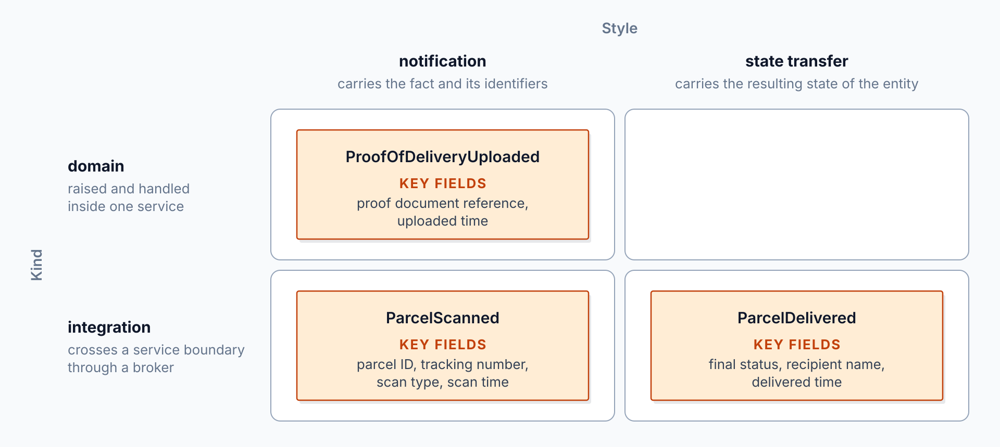
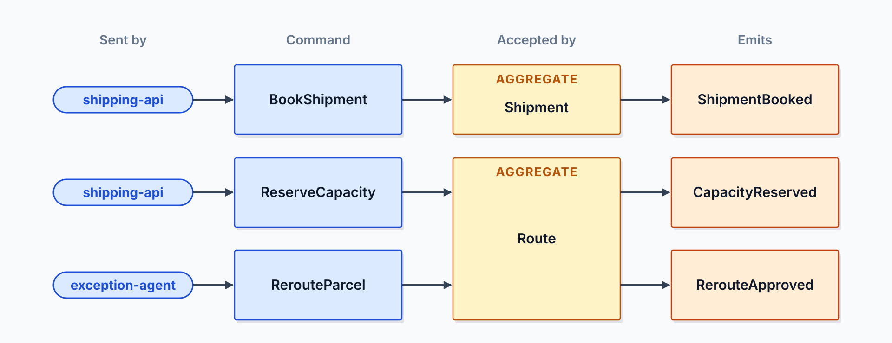

# Event-Storm the Parcel Delivery Flow

Grey Logistics exists today only as a business brief. Nobody has decided where the service seams belong, which events cross them, or how each flow survives a failure. At the end you hold `docs/events.md` and `docs/architecture.md`, the design that lab 2 turns into C# event records.

What you practice here: turning a business story into events, commands and service boundaries, then matching each flow to a broker and a reliability pattern.

Duration: about 45 minutes.

Topics practiced: [Modular Monolith vs. Microservices](../../demos/01-distributed-design/01-monolith-vs-microservices/readme.md), [Sync vs. Async: Commands & Events](../../demos/01-distributed-design/02-sync-async/readme.md), [Event Storming: Find Service Boundaries](../../demos/01-distributed-design/03-event-storming/readme.md), [Event Types: Domain, Integration, CloudEvents](../../demos/01-distributed-design/04-event-types/readme.md), [Reliability Patterns: Outbox, Saga, Idempotency](../../demos/01-distributed-design/05-reliability-patterns/readme.md), [Azure Messaging: Pick the Broker](../../demos/01-distributed-design/06-pick-the-broker/readme.md)

------

Open `labs/01-distributed-design/grey-logistics/` in your editor with your AI coding agent (GitHub Copilot agent mode or Claude Code). The agent reads `AGENTS.md` for the class stack.

---

## What You Build

The lab starts with an empty workspace that holds only agent instruction files, an MCP server configuration and an empty `docs/` folder. At the end, `docs/events.md` lists the 13 events with their commands and aggregates, and `docs/architecture.md` holds the bounded contexts, service map, broker per flow and saga compensations. Lab 2 turns those events into C# records in `Grey.Contracts`.

| Step | What you add | Why it matters |
| --- | --- | --- |
| [1](#step-1-map-the-business-events) | `docs/events.md` with the 13 Grey events, each classified by kind and style | Events record facts that already happened, and every later decision refers back to them. |
| [2](#step-2-find-the-commands-and-aggregates) | An Emitted by column, a Commands section and an Aggregates section | Each command names the aggregate that accepts it, which gives the service boundaries something to group. |
| [3](#step-3-draw-the-service-boundaries) | `docs/architecture.md` with the Bounded Contexts and Service Map sections | Aggregates that share one business language form a bounded context, and each context becomes a service candidate. |
| [4](#step-4-pick-a-broker-for-each-flow) | A Flows section with one broker or HTTP per flow | Each flow carries different traffic, so each one needs its own transport and ordering property. |
| [5](#step-5-protect-each-flow-from-failure) | A Reliability pattern column and a Saga Compensations section | Brokers deliver at least once, so each flow needs a pattern that survives duplicates and failures. |


---

## Design Checks

This lab has no code and no tests. Confirm each check in the produced documents before you start lab 2.

| Check | Where to look |
| --- | --- |
| `docs/events.md` lists all 13 Grey events, each with a kind (domain or integration) and a style (notification or state transfer) | Events table |
| Every event names its emitting aggregate or external source, and every command names the aggregate that accepts it | Events and Commands tables |
| `ParcelScanned` carries the scan types `PickedUp`, `AtHub` and `OutForDelivery` | Events table |
| Every bounded context appears once as a node in the Mermaid service map | Service Map |
| Every Mermaid label is in double quotes, uses `<br/>` for line breaks and contains no `\n` | Service Map |
| Every service in the Bounded Contexts table has a reason from the team, deployment, scaling or data tests | Bounded Contexts |
| Every flow in the Flows table names one broker or HTTP | Flows |
| The scan flow names the tracking number as its ordering key | Flows |
| The van telemetry flow names the van ID as its partition key | Flows |
| Every flow names at least one reliability pattern from the list in step 5 | Flows |
| The saga compensations run in the reverse order of the forward steps | Saga Compensations |
| Every table has a separator row with as many cells as its header row | Both files |
| Neither document contains an em dash | Both files |
| `src/` and `tests/` contain no new files | Project folder |

---

## Step 1: Map the Business Events

Overview: Events come first because each one records a fact that already happened, and every later decision refers back to them. This step writes the parcel journey as a list of facts and classifies each one.

How it works: The agent writes one `## Events` table in `docs/events.md` with a Kind column (domain or integration) and a Style column (notification or state transfer) for each of the 13 events. The kind decides whether a fact stays inside one service or crosses a broker, and the style decides whether a consumer must call back for detail. Read [Domain Events and Integration Events](../../demos/01-distributed-design/04-event-types/readme.md#domain-events-and-integration-events) for the kind split.



Recipe:

```text
Create the file docs/events.md in the workspace root. Start it with the title "# Grey Logistics Events" and a section named "## Events".

Under "## Events", add one table with the columns Event, Journey stage, Kind, Style and Key fields. Use exactly these 13 events, in this order: ShipmentBooked, CapacityReserved, PaymentCaptured, LabelPrinted, ParcelScanned, VanPositionReported, DeliveryAttempted, DeliveryDelayed, ParcelDelivered, ProofOfDeliveryUploaded, RerouteRequested, RerouteApproved, PaymentRefunded.

Journey stage is one of booking, pickup, transit, delivery or billing.
Kind is domain (raised and handled inside one service) or integration (crosses a service boundary through a broker).
Style is notification (carries the fact and its identifiers) or state transfer (carries the resulting state of the entity).
Key fields names the main data fields in words, with no code.
Every event about a shipment carries the shipment ID and the tracking number among its key fields, and ParcelScanned carries the parcel ID.

ParcelScanned carries a scan type with the values PickedUp, AtHub and OutForDelivery.

Write every event name exactly as listed, in the past tense. Use no em dashes.
```

Expected Outcome: `docs/events.md` exists in the workspace root with an Events section of 13 rows in the listed order. Each row has a kind and a style, and the ParcelScanned row names the three scan types.

---

## Step 2: Find the Commands and Aggregates

Overview: A command asks one service to act, and an aggregate decides whether that action is allowed. Naming the aggregate behind each command and event gives the boundaries in step 3 something to group.

How it works: The agent adds an `Emitted by` column to the Events table, then writes `## Commands` and `## Aggregates` tables in `docs/events.md`. Every `Accepted by` value in the Commands table must match a row in the Aggregates table, so each command has one aggregate that decides. Read [The Sticky-Note Grammar](../../demos/01-distributed-design/03-event-storming/readme.md#the-sticky-note-grammar) for how commands differ from events and aggregates.



Recipe:

```text
Read docs/events.md. Add an Emitted by column to the Events table. Fill it with the aggregate that raises each event, or with the external source (parcel scanner, van telematics or a service) when no aggregate raises it.

Add a section named "## Commands" after the Events section. Under it, add one table with the columns Command, Sent by, Accepted by and Emits. Use exactly these 7 commands, in this order: BookShipment, ReserveCapacity, CapturePayment, PrintLabel, AssignRoute, RerouteParcel, NotifyCustomer. The Emits column lists the events from docs/events.md that the command produces.

Add a section named "## Aggregates" after the Commands section. Under it, add one table with the columns Aggregate, Owns, Accepts commands and Emits events. Include the Shipment aggregate, which accepts BookShipment. Add each further aggregate that the commands and events need, and make every Accepted by value match a row in this table.

Use no em dashes.
```

Expected Outcome: `docs/events.md` has three sections. The Events table has an Emitted by column, the Commands section has 7 rows, and every aggregate named in the Commands table has its own row in the Aggregates section.

---

## Step 3: Draw the Service Boundaries

Overview: Aggregates that share one business language form a bounded context, and each context becomes a service candidate. This step decides which contexts become services and which start as modules inside another process.

How it works: The agent groups the aggregates in `docs/events.md` into one row per bounded context under `## Bounded Contexts` in `docs/architecture.md`, each with its hosting service and a reason from the team, deployment, scaling or data tests. The `## Service Map` section holds a Mermaid `flowchart LR` diagram with one node per context and one labeled arrow per message that crosses a boundary. Read [From Contexts to the Grey Service List](../../demos/01-distributed-design/03-event-storming/readme.md#from-contexts-to-the-grey-service-list) for how contexts become services.



Research:

```text
Read docs/events.md. Using the Azure Architecture Center guidance on domain analysis and on identifying microservice boundaries, group the aggregates in the Aggregates section into bounded contexts. Use the Microsoft Learn MCP server to read those pages when it is available.

For each context, argue whether it should be its own deployed service from the first version or a module inside a shared process first. Use team ownership, independent deployment, scaling and data ownership as the tests. Then name the relationship between each pair of contexts that exchange commands or events, such as customer-supplier, open host service or anti-corruption layer.

Do not write any file yet. Reply in the chat.
```

Finding: A good answer lists each bounded context with the aggregates it owns, and it gives each service a reason from the four tests. It names a relationship for every pair of contexts that exchange messages, says which contexts start as modules in one process, and lists the open questions as hotspots, such as who approves a reroute.

Push back when one context spans aggregates that change for different reasons, when two services share a table or a pipeline, or when a service owns no data. Push back when a context disappears from the design without a test-based reason, and when the answer adds a service beyond the Grey list without a reason for each one.

Recipe:

```text
Read docs/events.md. Create the file docs/architecture.md in the workspace root. Start it with the title "# Grey Logistics Architecture" and a section named "## Bounded Contexts".

Under "## Bounded Contexts", add one table with the columns Context, Service, Aggregates and Why it is a boundary. Add one row per bounded context that groups the aggregates in docs/events.md. The Service column names the service that hosts the context. Use these service names where they fit: shipping-api, tracking-service, routing-service, billing-service, label-service, notification-service, telemetry-ingest, exception-agent and ops-console. The design must include a context hosted by each of shipping-api, tracking-service, telemetry-ingest, exception-agent and ops-console, because later labs build them; tracking-service serves the tracking page from parcel scans, telemetry-ingest receives van positions, exception-agent reacts to delivery delays and ops-console is the operations user interface. Name a new service only when the Why column gives a reason from the team, deployment, scaling or data tests. When a context starts as a module inside another service, write the module name followed by the host service in parentheses, for example module-name (host-service).

Add a section named "## Service Map" after the Bounded Contexts table. Under it, add one Mermaid flowchart LR diagram with one node per bounded context, labelled with the context and its service name. Draw one arrow for each command or event that crosses a context boundary, and label each arrow with the message name in double quotes. Quote every node label, use <br/> for line breaks and never write \n.

Use no em dashes.
```

Expected Outcome: `docs/architecture.md` exists with a Bounded Contexts table and a Service Map section. The diagram renders in a Markdown preview with one box per context and one arrow per crossing message. A label that shows a literal backslash-n means the quoting or the line break is wrong.

---

## Step 4: Pick a Broker for Each Flow

Overview: Each flow carries a different kind of traffic, so each one needs its own transport. This step assigns every Grey flow to HTTP or to one Azure messaging service, and it records the ordering or retention property that decides the choice.

How it works: The agent writes a `## Flows` table in `docs/architecture.md` with one row per flow, and its `Broker or HTTP` column holds one of Azure Service Bus, Azure Event Grid, Azure Event Hubs or HTTP. The `Ordering or retention` column names the key or retention need that decides each row, such as the ordering key for scans or the partition key for van positions. Read [Comparison by Delivery, Ordering and Retention](../../demos/01-distributed-design/06-pick-the-broker/readme.md#comparison-by-delivery-ordering-and-retention) to check each choice against those criteria.


Research:

```text
Read docs/events.md and the Service Map section of docs/architecture.md. Decide for each of these seven flows whether it uses HTTP request/reply or one Azure messaging service:

1. Booking saga: ShipmentBooked, ReserveCapacity, CapturePayment, PrintLabel
2. Delivery deadline: DeliveryDelayed, RerouteRequested, RerouteApproved
3. Scan processing: ParcelScanned
4. Van telemetry: VanPositionReported
5. Proof of delivery: ProofOfDeliveryUploaded, ParcelDelivered
6. Tracking projection: shipment events into the tracking read model
7. Exception handling: DeliveryDelayed into the exception agent

The candidates are Azure Service Bus, Azure Event Grid, Azure Event Hubs and HTTP. For each flow, name the ordering, retention, replay or consumer-count property that decides the choice, and cite the Microsoft Learn page that supports it. Use the Microsoft Learn MCP server to check each claim when it is available.

Do not write any file yet. Reply in the chat.
```

Finding: A good answer gives every flow one candidate and names the property behind it. Scans of one parcel must run in order, so the answer should key that flow on the tracking number. Push back on Event Grid for scans, because Event Grid guarantees no ordering.

Van telemetry is a stream that several consumers read. Push back when it goes to a queue without a replay or consumer-group reason. Push back when a flow that a customer waits for runs only on a broker, because the customer needs the answer in the same request. Push back when the answer uses Dapr pub/sub, which this class introduces in Module 7.

Recipe:

```text
Read docs/events.md and docs/architecture.md. Add a section named "## Flows" after the Service Map section of docs/architecture.md. Under it, add one table with the columns Flow, Messages, Broker or HTTP and Ordering or retention. Add one row for each of these seven flows, in this order: Booking saga, Delivery deadline, Scan processing, Van telemetry, Proof of delivery, Tracking projection, Exception handling. The Messages column lists the events and commands from docs/events.md that the flow carries.

Broker or HTTP holds exactly one of these values: Azure Service Bus, Azure Event Grid, Azure Event Hubs or HTTP. Scans of one parcel must stay in order, and unreadable scans need a dead-letter queue. Positions of one van must stay in order, and several consumers must be able to replay them. Proof of delivery announces a fact that partners subscribe to. The booking saga, the delivery deadline, the tracking projection and exception handling carry commands and events that must not be lost. The Ordering or retention column names the ordering key, partition key, retention period or replay need that the choice depends on, or it writes none needed.

Under the table, write one sentence that names how the customer's BookShipment command reaches shipping-api and what the customer receives back.

Use no em dashes.
```

Expected Outcome: `docs/architecture.md` has a Flows section with 7 rows in the listed order. Each Broker or HTTP cell holds one of the four allowed values, the scan row names the tracking number as its ordering key, and the telemetry row names the van ID as its partition key.

---

## Step 5: Protect Each Flow from Failure

Overview: Brokers deliver at least once, services fail on their own, and a multi-service step can fail after earlier steps committed. This step names the reliability pattern that protects each flow and records the order in which the booking saga undoes its work.

How it works: The agent adds a `Reliability pattern` column to the Flows table, with names from a fixed list of six patterns, and it writes the `## Saga Compensations` table in the reverse order of the forward steps. The outbox writes the state change and the event in one local transaction, and the idempotent consumer records processed messages so that a redelivery is harmless. Read [Keeping State and Messages Consistent](../../demos/01-distributed-design/05-reliability-patterns/readme.md#keeping-state-and-messages-consistent) for how these patterns prevent lost or repeated work.


Recipe:

```text
Read docs/events.md and docs/architecture.md. In docs/architecture.md, add a column named Reliability pattern to the Flows table, directly after Broker or HTTP, and fill it for all seven flows.

Each cell names one or more patterns from this list, using these exact names. Separate several names in one cell with a comma.

- Transactional outbox
- Idempotent consumer
- Saga (choreography or orchestration)
- Retry with exponential backoff and jitter
- Dead-lettering after the maximum delivery count
- Claim check

Under the Flows table, add a section named "## Saga Compensations". Under it, add one table with the columns Compensation, Undoes and Order. The booking saga's compensations are ReleaseCapacity, RefundPayment and VoidLabel. ReleaseCapacity undoes ReserveCapacity, RefundPayment undoes CapturePayment, and VoidLabel undoes PrintLabel. Number the rows from 1 to 3 in the order the saga runs them, which is the reverse of the forward steps.

Finally, check docs/events.md and docs/architecture.md for em dashes and replace each one with a colon, comma, semicolon or parentheses. Confirm that every Mermaid label in the Service Map is in double quotes, uses <br/> for line breaks and contains no \n. Confirm that every table in both files has a separator row with exactly as many cells as its header row, and fix any that do not.
```

Expected Outcome: the Flows table has a Reliability pattern column, and each of the seven rows names at least one pattern from the list. The Saga Compensations table lists VoidLabel first, RefundPayment second and ReleaseCapacity third. Neither file contains an em dash, and both files are the input for lab 2.

---

## Solution

The finished design is in `labs/01-distributed-design/grey-logistics-solution/`. Compare your `docs/events.md` and `docs/architecture.md` with the files in its `docs/` folder once every Design Check passes.
