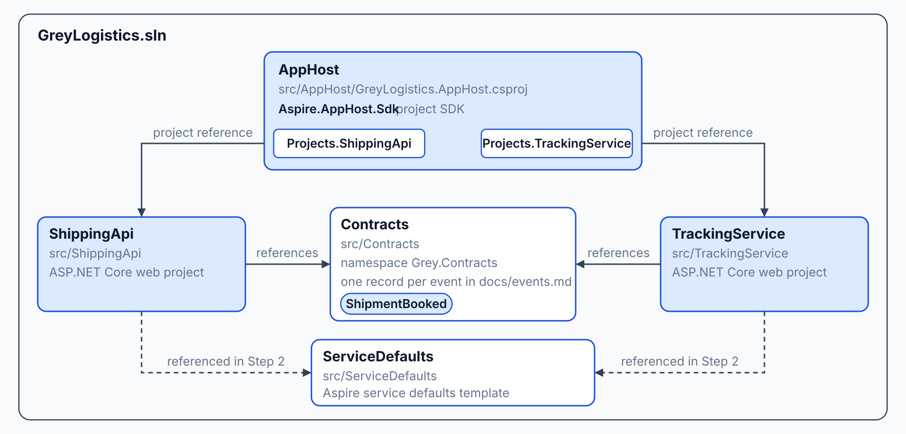
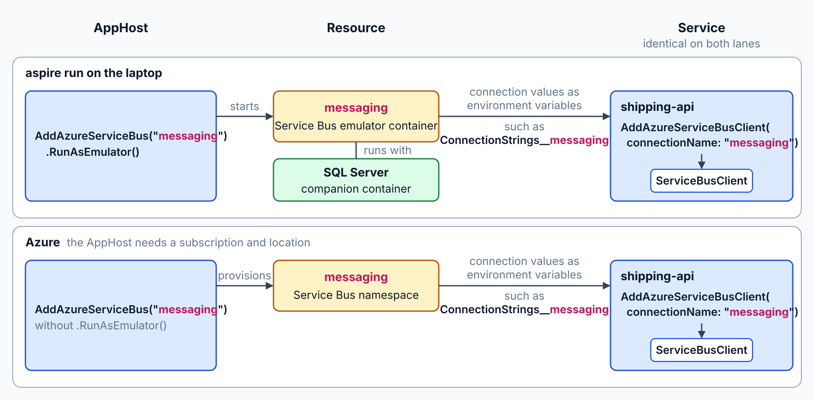
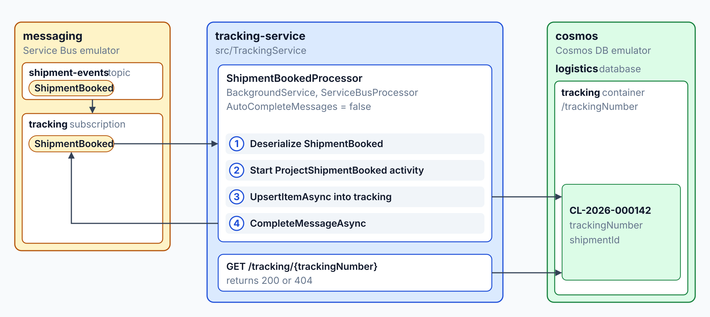
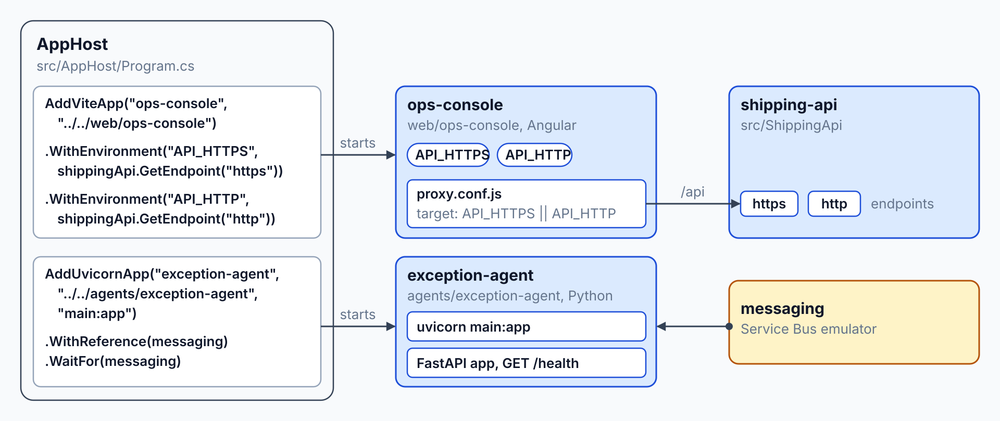

# Model Grey Logistics in an Aspire AppHost

Grey Logistics exists only as design documents: no service runs, no booking reaches the tracking page, and each service would need its own telemetry and connection setup. By the end you hold an Aspire AppHost that starts the shipping API, the tracking service, the Angular ops console and the Python exception agent beside Service Bus and Cosmos DB emulators. A booking travels through Service Bus to the tracking service, and one trace shows its path across both services.

What you practice here: wiring a multi-service .NET system into one Aspire AppHost, with shared ServiceDefaults and one trace as the proof.

Duration: about 55 minutes.

Topics practiced: [Aspire AppHost](../../demos/02-aspire/01-apphost/readme.md), [ServiceDefaults](../../demos/02-aspire/02-service-defaults/readme.md), [Aspire integrations](../../demos/02-aspire/03-integrations/readme.md), [Aspire dashboard](../../demos/02-aspire/04-dashboard/readme.md), [Polyglot AppHost](../../demos/02-aspire/05-polyglot/readme.md), [Aspire testing](../../demos/02-aspire/06-testing/readme.md)

------

Open `labs/02-aspire/grey-logistics/` in your editor with your AI coding agent (GitHub Copilot agent mode or Claude Code). The agent reads `AGENTS.md` for the class stack, and every path in the prompts is relative to that folder. The starter holds the design documents from lab 1.

Setup: install the .NET 10 SDK, the Aspire CLI, Node.js, Python 3 and a container runtime. This lab provisions nothing in Azure.

## What You Build

At the start, Grey Logistics exists only as design documents, and no service runs. At the end, `aspire start` runs the Service Bus and Cosmos DB emulators, `shipping-api`, `tracking-service`, the `ops-console` and the `exception-agent`, and one booking produces one trace across `shipping-api` and `tracking-service`.

| Step | What you add | Why it matters |
| --- | --- | --- |
| [1](#step-1-shape-the-solution-from-the-design) | The solution and its five projects: AppHost, ServiceDefaults, Contracts, ShippingApi and TrackingService | Every later step adds code to a project that already exists |
| [2](#step-2-share-the-service-defaults) | Shared telemetry, resilience and service discovery in ServiceDefaults | Both services get the same traces, health checks and retries from one call each |
| [3](#step-3-declare-the-resources-in-the-apphost) | The Service Bus and Cosmos DB emulators in the AppHost, with both services wired to them | One `aspire start` brings up the backing resources before the services that use them |
| [4](#step-4-book-a-shipment-in-shipping-api) | A `POST /shipments` endpoint that saves the shipment and publishes `ShipmentBooked` | The booking starts the event flow that the rest of the lab follows |
| [5](#step-5-project-the-booking-in-tracking-service) | A Service Bus processor that writes the tracking document and a `GET /tracking/{trackingNumber}` endpoint | The tracking page reads a read model that the event builds |
| [6](#step-6-add-the-ops-console-and-the-exception-agent) | The Angular ops console and the Python exception agent as AppHost resources | The class stack runs under the same AppHost and dashboard as the .NET services |
| [7](#step-7-prove-the-booking-trace) | A script that books a shipment, checks the tracking page and asserts one trace | The trace shows that one booking crosses both services |


---

## Step 1: Shape the Solution from the Design

Overview: The design documents name the services, events and flows, and the AppHost needs one solution that holds them. This step creates the projects that the next six steps fill.

How it works: The solution groups five projects, and the AppHost uses the `Aspire.AppHost.Sdk` project SDK to build the model that starts them. Each AppHost project reference adds a typed entry to the generated `Projects` class, such as `Projects.ShippingApi`, and `src/Contracts` holds the event records, such as `ShipmentBooked`, that every service shares. The [AppHost topic](../../demos/02-aspire/01-apphost/readme.md#the-apphost-declares-resources) explains the model.



Research: Read the design documents and reason through the lab's scope before any code exists.

```text
Read docs/architecture.md and docs/events.md in this folder. Propose the .NET projects, the Angular app and the Python service that this lab needs, and the message broker and database that each flow uses. Give one sentence of reasoning per project and per resource. Do not write any code yet.
```

Finding: A good answer names two .NET services, an Angular console, a Python exception agent, Service Bus for events and Cosmos DB for shipments and tracking. It cites the service map and event names from the documents. Push back if it adds billing, routing or label services, because this lab does not build them, or if it names a different broker for the booking flow than docs/architecture.md gives.

Recipe:

```text
Work in this folder and read docs/events.md and docs/architecture.md first.

Create GreyLogistics.sln in the folder root for .NET 10, and add these projects:
- src/Contracts/Contracts.csproj: a class library with the namespace Grey.Contracts. Add one C# record for each event in docs/events.md, with the event's fields as record properties.
- src/ServiceDefaults/ServiceDefaults.csproj: a class library from the Aspire service defaults template.
- src/ShippingApi/ShippingApi.csproj: an ASP.NET Core web project that references Contracts.
- src/TrackingService/TrackingService.csproj: an ASP.NET Core web project that references Contracts.
- src/AppHost/GreyLogistics.AppHost.csproj: an Aspire AppHost project whose entry file is src/AppHost/Program.cs and that references ShippingApi and TrackingService.

Use the Aspire 13.6 packages and write no code comments.
```

Expected Outcome: `dotnet sln GreyLogistics.sln list` lists the five src projects, and `dotnet build GreyLogistics.sln` completes. The Contracts project holds one record per event in docs/events.md, named with the document's event names.

```text
Project(s)
----------
src\AppHost\GreyLogistics.AppHost.csproj
src\Contracts\Contracts.csproj
src\ServiceDefaults\ServiceDefaults.csproj
src\ShippingApi\ShippingApi.csproj
src\TrackingService\TrackingService.csproj
```

The build ends with `Build succeeded.` and `0 Error(s)`.

## Step 2: Share the Service Defaults

Overview: Every service needs the same telemetry, retries and discovery, and the ServiceDefaults project holds that once. Both services opt in with one call each.

How it works: The `AddServiceDefaults` extension on `IHostApplicationBuilder` in `src/ServiceDefaults/Extensions.cs` sets the `Azure.Experimental.EnableActivitySource` switch, adds OpenTelemetry, health checks and service discovery, and applies `AddStandardResilienceHandler` to every `HttpClient` through `ConfigureHttpClientDefaults`. The `MapDefaultEndpoints` extension on `WebApplication` maps `/health` and `/alive` in the Development environment, and both services call the pair from their `Program.cs` files. The [ServiceDefaults topic](../../demos/02-aspire/02-service-defaults/readme.md#one-call-opts-a-service-in) explains the pattern.


Recipe:

```text
Reference src/ServiceDefaults from src/ShippingApi and src/TrackingService.

In src/ServiceDefaults, add an AddServiceDefaults extension method on IHostApplicationBuilder and a MapDefaultEndpoints extension method on WebApplication, as the Aspire service defaults template generates them. Configure the HTTP client defaults with the standard resilience handler and service discovery. Also enable the Azure SDK ActivitySource support by setting the AppContext switch Azure.Experimental.EnableActivitySource to true in AddServiceDefaults, and add the OpenTelemetry tracing source Azure.*, so that the Service Bus publish and receive of a booking join one trace.

In src/ShippingApi/Program.cs, call AddServiceDefaults on the builder and MapDefaultEndpoints on the app. Register the OpenTelemetry tracing source named Grey.Shipping.

In src/TrackingService/Program.cs, call AddServiceDefaults on the builder and MapDefaultEndpoints on the app. Register the OpenTelemetry tracing source named Grey.Tracking.

Do not change src/Contracts. Write no code comments.
```

Expected Outcome: `dotnet run --project src/ShippingApi` starts in the Development environment, and `GET /health` returns 200 at the address the console prints. The same check passes for `src/TrackingService`.

```text
HTTP/1.1 200 OK
```

## Step 3: Declare the Resources in the AppHost

Overview: The AppHost is the one place that names every resource and wires each service to its connections. A later `aspire run` starts the whole model from this file.

How it works: `src/AppHost/Program.cs` declares the `messaging` Service Bus resource and the `cosmos` Cosmos DB resource with `RunAsEmulator()`, then nests the topic, subscriptions, database and containers under them. Both services call `WithReference` and `WaitFor` on both resources, so they receive the connections and start after the emulators. Resource names such as `tracking-subscription` and `tracking-container` must be unique in the model, while the subscription and container names stay `tracking`; the [wiring section](../../demos/02-aspire/01-apphost/readme.md#wiring-dependencies-with-withreference-and-waitfor) explains the calls.


Recipe:

```text
Add the Aspire 13.6 hosting packages for Azure Service Bus and Azure Cosmos DB to src/AppHost/GreyLogistics.AppHost.csproj.

In src/AppHost/Program.cs, declare these resources with the Aspire API:
- A Service Bus resource named messaging with RunAsEmulator. Under it, a topic named shipment-events with two subscriptions named tracking and exception-agent. Resource names must be unique in the AppHost, so name the subscription resources tracking-subscription and exception-agent-subscription and keep tracking and exception-agent as the subscription names.
- A Cosmos DB resource named cosmos with RunAsEmulator. Under it, a database named logistics with a container named shipments (partition key /shipmentId) and a container named tracking (partition key /trackingNumber). Name the tracking container resource tracking-container and keep tracking as the container name.
- A project resource named shipping-api from the ShippingApi project. It references cosmos and messaging, and it waits for cosmos and messaging.
- A project resource named tracking-service from the TrackingService project. It references cosmos and messaging, and it waits for cosmos and messaging.

Do not add the ops-console or exception-agent resources yet. Write no code comments.
```

Expected Outcome: `aspire start` from the `grey-logistics/` folder starts the Service Bus and Cosmos DB emulator containers, then `shipping-api` and `tracking-service`. `aspire describe` lists them like this (trimmed to the resources this step declares):

```text
Name                          Type                                State    Health
cosmos                        AzureCosmosDBResource               Running  Healthy
logistics                     AzureCosmosDBDatabaseResource       Running  Healthy
messaging                     AzureServiceBusResource             Running  Healthy
messaging-mssql               Container                           Running  Healthy
shipment-events               AzureServiceBusTopicResource        Running  Healthy
shipments                     AzureCosmosDBContainerResource      Running  Healthy
shipping-api                  Project                             Running  Healthy
tracking-container            AzureCosmosDBContainerResource      Running  Healthy
tracking-service              Project                             Running  Healthy
tracking-subscription         AzureServiceBusSubscriptionResource Running  Healthy
exception-agent-subscription  AzureServiceBusSubscriptionResource Running  Healthy
```

Stop the AppHost with `aspire stop` before the next step.

## Step 4: Book a Shipment in shipping-api

Overview: A booking changes the shipment state and announces the change. shipping-api does both in one request, as a two-step handoff that Module 6 replaces with an outbox.

How it works: The `AddAzureCosmosClient("cosmos")` and `AddAzureServiceBusClient("messaging")` calls in `src/ShippingApi/Program.cs` register clients that the `POST /shipments` handler receives as `CosmosClient` and `ServiceBusClient` parameters. The handler starts a `BookShipment` activity from the `Grey.Shipping` `ActivitySource`, saves the document to the `shipments` container, and sends the `ShipmentBooked` record as JSON through a `ServiceBusSender` on the `shipment-events` topic. The client integrations read the connection names from the AppHost, so `cosmos` and `messaging` must match the resources from Step 3; the [client packages section](../../demos/02-aspire/03-integrations/readme.md#client-packages-consume-the-connection) explains how.



Recipe:

```text
In src/ShippingApi, add the Aspire client packages Aspire.Microsoft.Azure.Cosmos and Aspire.Azure.Messaging.ServiceBus. In Program.cs, register the clients with AddAzureCosmosClient("cosmos") and AddAzureServiceBusClient("messaging").

Add a POST /shipments endpoint. The request body is JSON with shipmentId and trackingNumber. Give every other ShipmentBooked property a default value, so the request needs only those two fields. The endpoint:
1. Starts an Activity named BookShipment from the Grey.Shipping ActivitySource.
2. Saves a shipment document with an id, the shipmentId and the trackingNumber to the shipments container of the logistics database.
3. Publishes a ShipmentBooked record from Grey.Contracts as JSON to the shipment-events topic.
4. Logs an information message with the shipmentId and trackingNumber as structured fields.
5. Returns 201 Created with the trackingNumber in the body.

Write no code comments.
```

Expected Outcome: With the AppHost running, a POST to `shipping-api` at `/shipments` returns 201 Created with the tracking number. The `shipping-api` log shows the booking line with its shipmentId and trackingNumber values. The booking itself is sent in Step 7.

```text
HTTP/1.1 201 Created
Content-Type: application/json; charset=utf-8
Location: /shipments/3f2c9a1e-7b4d-4e8a-9c21-5d6f0b8e4a17

{"trackingNumber":"CL-2026-000142"}
```

```text
INFO shipping-api Shipment 3f2c9a1e-7b4d-4e8a-9c21-5d6f0b8e4a17 booked with tracking number CL-2026-000142
```

## Step 5: Project the Booking in tracking-service

Overview: tracking-service reads each ShipmentBooked event from its own subscription and stores a tracking document that a lookup can read. The subscription keeps its traffic separate from the other consumers.

How it works: `ShipmentBookedProcessor` in `src/TrackingService/ShipmentBookedProcessor.cs` is a `BackgroundService` that starts a `ServiceBusProcessor` on the `shipment-events` topic and the `tracking` subscription, with `AutoCompleteMessages` set to false. For each message, it deserializes the `ShipmentBooked` record, upserts the `tracking` document in Cosmos DB inside a `ProjectShipmentBooked` activity, and completes the message only after that write. The `AddHostedService<ShipmentBookedProcessor>()` call in `src/TrackingService/Program.cs` starts it with the service, and the [client packages section](../../demos/02-aspire/03-integrations/readme.md#client-packages-consume-the-connection) explains the injected clients.



Gate: Write the gate before the code, so the step has a target that the agent cannot move. Topic [Aspire testing](../../demos/02-aspire/06-testing/readme.md#gating-each-step-with-a-test) explains the pattern.

```text
Create the xUnit test project tests/GreyLogistics.Tests for .NET 10 with the Aspire.Hosting.Testing package and a project reference to src/AppHost, and add it to GreyLogistics.sln. Add one test class BookingGates with one test BookingReachesTracking, marked with [Trait("Gate", "BookingReachesTracking")]. The test starts the AppHost with DistributedApplicationTestingBuilder, waits until shipping-api and tracking-service are healthy, posts a booking with a new shipmentId and a new trackingNumber to shipping-api at /shipments, and polls tracking-service at /tracking/{trackingNumber} every two seconds for up to 60 seconds. It passes when tracking-service answers 200. Cap the whole test at ten minutes. Write no code comments.

Run dotnet test tests/GreyLogistics.Tests --filter "Gate=BookingReachesTracking" once and report the result. Do not change any code outside tests/GreyLogistics.Tests.
```

The gate fails now, because tracking-service has no tracking endpoint yet.

Recipe:

```text
In src/TrackingService, add the Aspire client packages Aspire.Microsoft.Azure.Cosmos and Aspire.Azure.Messaging.ServiceBus. In Program.cs, register the clients with AddAzureCosmosClient("cosmos") and AddAzureServiceBusClient("messaging").

Add a background worker named ShipmentBookedProcessor. It receives messages from the shipment-events topic through the subscription named tracking, using a ServiceBusProcessor from the Service Bus client. For each message:
1. Deserializes the body as ShipmentBooked from Grey.Contracts.
2. Starts an Activity named ProjectShipmentBooked from the Grey.Tracking ActivitySource.
3. Upserts a document with the id set to the trackingNumber, plus the trackingNumber and the shipmentId, into the tracking container of the logistics database.
4. Completes the message.

Add a GET /tracking/{trackingNumber} endpoint that reads the document from the tracking container. It returns 200 with the document as JSON, or 404 when no document exists. Write no code comments. Do not edit anything under tests/GreyLogistics.Tests.
```

Expected Outcome: Before a booking, `GET /tracking/{trackingNumber}` on `tracking-service` returns 404. After the booking from Step 4, the same request returns 200 with the trackingNumber in the JSON body.

```text
HTTP/1.1 404 Not Found
```

```text
HTTP/1.1 200 OK
Content-Type: application/json; charset=utf-8

{"id":"CL-2026-000142","trackingNumber":"CL-2026-000142","shipmentId":"3f2c9a1e-7b4d-4e8a-9c21-5d6f0b8e4a17"}
```

Stop the AppHost, then run the gate again. It passes now:

```bash
dotnet test tests/GreyLogistics.Tests --filter "Gate=BookingReachesTracking"
```

```text
Passed!  - Failed:     0, Passed:     1, Skipped:     0, Total:     1
```

## Step 6: Add the Ops Console and the Exception Agent

Overview: The Angular ops console and the Python exception agent run under the same AppHost as the .NET services, so one `aspire run` starts the whole system and the dashboard lists them beside the others.

How it works: In `src/AppHost/Program.cs`, the `ops-console` resource from `AddViteApp` receives the `shipping-api` HTTPS and HTTP endpoints through two `WithEnvironment` calls as `API_HTTPS` and `API_HTTP`, and `web/ops-console/proxy.conf.js` reads those variables to forward `/api` requests. `AddUvicornApp` runs the FastAPI `app` in `agents/exception-agent/main.py` as a uvicorn process beside the .NET services. The [JavaScript hosting section](../../demos/02-aspire/05-polyglot/readme.md#hosting-javascript-apps-with-addviteapp-and-addjavascriptapp) explains `AddViteApp`.



Recipe:

```text
Create web/ops-console as an Angular application for Angular 17 or later, with a package.json whose dev script serves the app. The app shows one page with the heading Grey Logistics Operations.

Add an Angular dev server proxy that forwards /api requests to the shipping API. The proxy reads the shipping API address from the API_HTTPS or API_HTTP environment variable that the AppHost passes to the console.

Create agents/exception-agent with a requirements.txt that lists fastapi and uvicorn, and a main.py that defines a FastAPI app named app with a GET /health endpoint that returns 200. Create a .venv folder in agents/exception-agent and install requirements.txt into it. The agent does not consume messages yet.

In src/AppHost/Program.cs, add these resources:
- An ops-console Vite app from the directory ../../web/ops-console. It references shipping-api, waits for shipping-api and gets external HTTP endpoints.
- An exception-agent uvicorn app from the directory ../../agents/exception-agent with the module and variable main:app. It references messaging and waits for messaging.

Add the Aspire JavaScript and Python hosting packages to src/AppHost. Write no code comments.
```

Expected Outcome: `aspire start` now also starts `ops-console` and `exception-agent`, and `aspire describe` lists them beside the other resources. The page at the `ops-console` endpoint answers 200 and shows the heading. The `ops-console` resource view lists the API_HTTP or API_HTTPS variable with the shipping-api address, and the proxy must read that same variable. `GET /health` on `exception-agent` returns 200.

```text
exception-agent               Executable   Running  Healthy
exception-agent-installer     Executable   Finished
ops-console                   Executable   Running  Healthy
ops-console-installer         Executable   Finished
```

> **_NOTE:_** Gate tests could prove this step, but this lab skips them to save time. They would check:
>
> - The AppHost declares `shipping-api`, `tracking-service`, `ops-console`, `exception-agent`, the Service Bus resource `messaging` and the Cosmos DB resource `cosmos`.
> - `shipping-api`, `tracking-service` and `exception-agent` reach the healthy state, and each answers `GET /health` with 200.
> - The `ops-console` resource runs and answers `GET /` with 200.

## Step 7: Prove the Booking Trace

Overview: One booking must show up as one trace across both services. This step adds a script that books a shipment and asserts the trace, then stops the AppHost on its own.

How it works: The script runs `aspire start`, `aspire wait`, `aspire describe` and `aspire otel traces` against the AppHost, then runs `aspire stop` in a `finally` block, so the AppHost stops even when a check fails. The `ServiceDefaults` project and each service register their `ActivitySource` and the `Azure.*` sources, so the HTTP call and the Service Bus publish and receive join one trace titled `POST /shipments`. The [traces topic](../../demos/02-aspire/04-dashboard/readme.md#traces-across-http-and-service-bus) explains how the trace context moves through the message.



Recipe:

```text
Create scripts/verify-booking-trace.py, a Python 3 script that finishes on its own. It starts the AppHost with aspire start, waits for shipping-api and tracking-service to be healthy with aspire wait, and reads their http URLs from aspire describe --format Json. It posts a booking with shipmentId 3f2c9a1e-7b4d-4e8a-9c21-5d6f0b8e4a17 and trackingNumber CL-2026-000142 to shipping-api at /shipments and expects 201. It polls tracking-service at /tracking/CL-2026-000142 for up to 60 seconds and expects 200. It reads the traces with aspire otel traces --format Json --limit 100, without --search because the spans do not carry the tracking number, and asserts that the trace titled POST /shipments holds spans from both shipping-api and tracking-service. It prints one line per check, runs aspire stop in a finally block so the AppHost never keeps running, and exits with a non-zero code when a check fails.

The aspire describe JSON has a resources array whose items carry displayName and a urls array of objects with url and isInternal. The aspire otel traces JSON is an array of traces with traceId, title and a spans array whose items carry source and name.

Run the script once with a timeout of 600 seconds. Do not start the AppHost in any other way. Write no code comments.
```

Expected Outcome: `python scripts/verify-booking-trace.py` prints its checks, exits with code 0 and leaves no AppHost running (`aspire ps` reports no running AppHost).

```text
PASS aspire start
PASS shipping-api healthy
PASS tracking-service healthy
PASS resolve urls: {"shipping-api": "http://localhost:5220", "tracking-service": "http://localhost:5135"}
PASS POST /shipments returns 201: got 201
PASS GET /tracking returns 200: got 200
PASS trace POST /shipments spans shipping-api and tracking-service: sources ['cosmos', 'shipping-api', 'tracking-service']
PASS aspire stop
```

The ports differ on your machine. The exact wording of the lines depends on the script your agent wrote.

To see the trace yourself, run `aspire run` from the `grey-logistics/` folder and open the dashboard link it prints. Find the `shipping-api` endpoint on the Resources page and send this booking to its `/shipments` endpoint:

```json
{
  "shipmentId": "3f2c9a1e-7b4d-4e8a-9c21-5d6f0b8e4a17",
  "trackingNumber": "CL-2026-000142"
}
```

The POST returns 201 Created, and `GET /tracking/CL-2026-000142` on tracking-service returns 200 with that tracking number. The Traces page shows one trace that starts in shipping-api and continues in tracking-service through the Service Bus publish and receive. The Structured logs page shows the booking line with the shipmentId and trackingNumber fields. Stop the AppHost with Ctrl+C.

## Solution

The finished state of this lab is in `labs/02-aspire/grey-logistics-solution/`. Compare your tree with it when the booking trace script passes.
