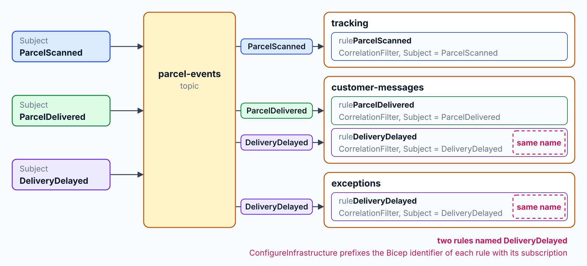
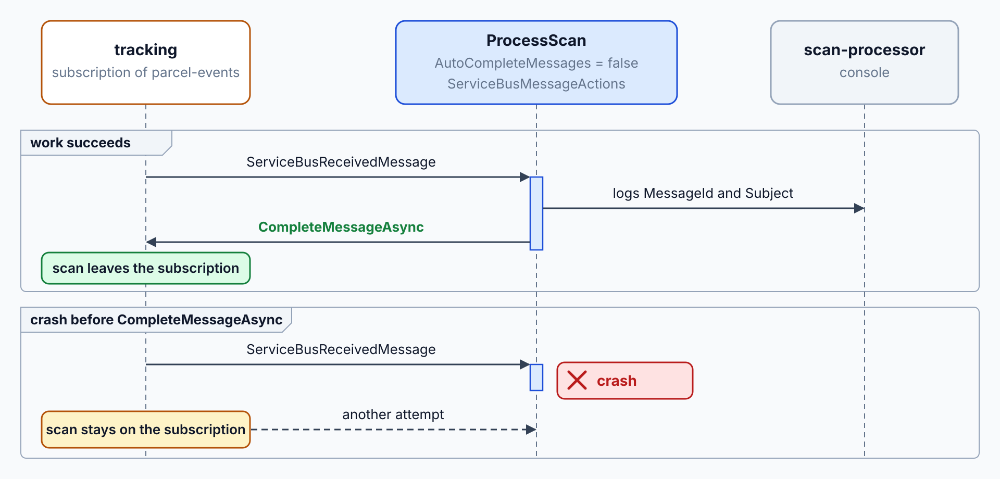
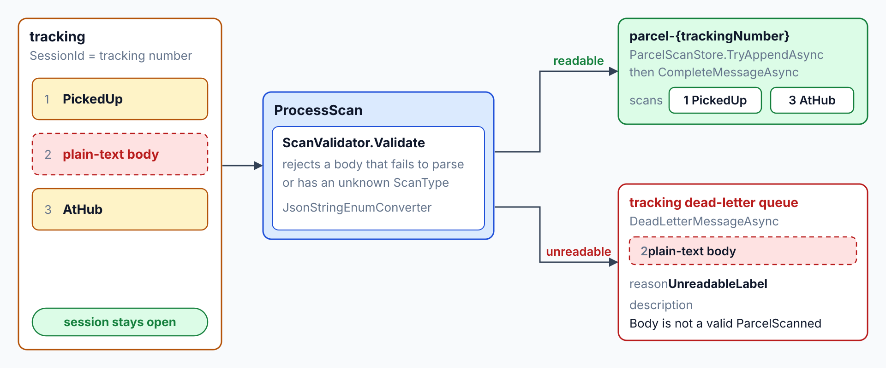
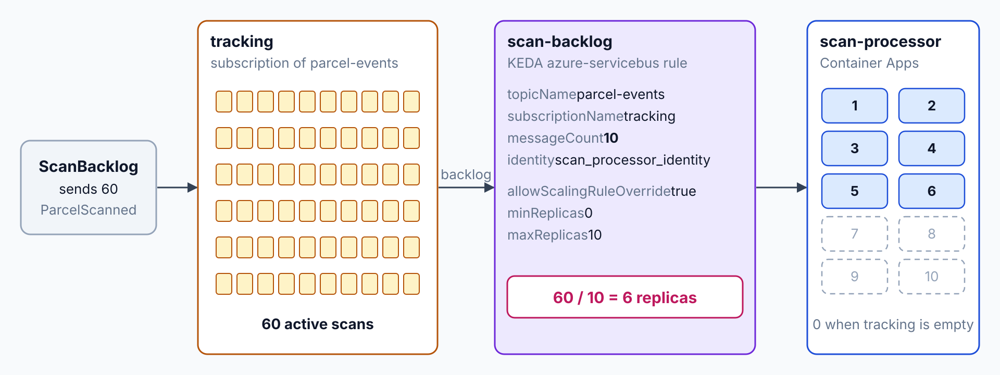

# Process Parcel Scans Reliably with Service Bus

Today the tracking service has no ordered, poison-safe or duplicate-safe path for parcel scans. By the end, Contoso Logistics reads scans from a Service Bus topic through a Functions trigger, keeps each parcel in order, dead-letters unreadable scans, stores each scan once, and scales the consumer on Container Apps with a KEDA rule.

What you practice here: consuming one event stream with filtered subscriptions, sessions, dead-lettering and an idempotent store.

Duration: about 55 minutes.

Topics practiced: [Topic Subscriptions: SQL Filters](../../demos/04-service-bus/01-subscriptions-filters/readme.md), [Azure Functions: Service Bus Triggers](../../demos/04-service-bus/02-functions-triggers/readme.md), [Competing Consumers: KEDA Scale Rules](../../demos/04-service-bus/03-competing-consumers/readme.md), [Sessions: Ordered Message Processing](../../demos/04-service-bus/04-sessions/readme.md), [Dead-Letter Queues: Poison Messages](../../demos/04-service-bus/05-dead-letter/readme.md), [Idempotent Consumers: Duplicate Detection](../../demos/04-service-bus/06-idempotent-consumers/readme.md)

------

Open `labs/04-service-bus/contoso-logistics/` in your editor with your AI coding agent (GitHub Copilot agent mode or Claude Code). The agent reads `AGENTS.md` for the class stack. Start Docker Desktop first, because the Service Bus and Cosmos DB emulators run as containers.

## What You Build

The lab starts from the Contoso Logistics solution of lab 3, which publishes shipment events but has no ordered, poison-safe or duplicate-safe path for parcel scans. It ends with a `parcel-events` topic that feeds a scan processor, which stores each scan once and in order, dead-letters unreadable label scans and scales on the scan backlog. The processor runs as the `scan-processor` app on Container Apps, and its KEDA rule is applied after the single deploy.

| Step | What you add | Why it matters |
| --- | --- | --- |
| [1](#step-1-model-the-parcel-events-topic) | `parcel-events` topic with three filtered subscriptions in the AppHost | Each consumer receives only the events it handles, and the emulator and Azure get the same topology. |
| [2](#step-2-process-scans-in-an-isolated-functions-trigger) | `ScanProcessor` isolated Functions app with a Service Bus trigger and manual settlement | A scan leaves the subscription only after its work succeeds. |
| [3](#step-3-keep-each-parcels-scans-in-order-with-sessions) | Sessions on the `tracking` subscription, with the tracking number as session ID | The scans of one parcel are applied in the order they were sent. |
| [4](#step-4-dead-letter-unreadable-scans-with-a-reason) | Validation of each scan and dead-lettering of unreadable ones with reason `UnreadableLabel` | A poison scan stops in the dead-letter queue with a reason, while the parcel's other scans keep moving. |
| [5](#step-5-make-the-consumer-duplicate-safe) | Duplicate detection on the topic and a processed-message marker in a Cosmos DB transactional batch | A repeated scan is stored once, even when the broker or the consumer delivers it twice. |
| [6](#step-6-deploy-once-and-scale-the-consumer-with-keda) | `scan-processor` deployed to Container Apps with a KEDA `azure-servicebus` rule | The consumer adds replicas as the tracking backlog grows and scales to zero when it empties. |
| [7](#step-7-record-the-patterns) | `docs/scan-processing.md` mapping each pattern to its implementing file | The next team can find the code behind each pattern. |


---

## Step 1: Model the Parcel Events Topic

Overview: The shipping API publishes every parcel event to one topic. Each consumer needs only its own events, so the tracking service, the notification service and the exception agent each get a filtered subscription. You define them in the AppHost model, so the local emulator and the deployed namespace get the same topology.

How it works: `AddSubjectSubscription` in `src/AppHost/Program.cs` adds each subscription to the `parcel-events` topic with an `AzureServiceBusRule` that has a `CorrelationFilter` on `Subject`. The `ConfigureInfrastructure` callback prefixes each `ServiceBusRule` Bicep identifier with its parent subscription, so two subscriptions can hold a rule with the same name. The [topic subscriptions and filters](../../demos/04-service-bus/01-subscriptions-filters/readme.md#topics-subscriptions-and-filters) section covers the filter types.



Finding: A good answer adds the topic and three subscriptions in `src/AppHost/Program.cs` with correlation filter rules on the message Subject. Aspire models correlation filters, and the same model deploys to Azure later, which a SQL filter typed into an emulator config file would not. Push back if a subscription keeps a rule that matches every message.

The emulator has no Microsoft Entra ID, autoscale or large-message support. Push back if the answer connects with `DefaultAzureCredential`; local connections use the emulator's SAS connection string, and the KEDA step runs in Azure.

Recipe:

```text
In the AppHost project src/AppHost/Program.cs, add the topic parcel-events to the existing Service Bus resource messaging, which already runs as the emulator locally and deploys as Azure Service Bus. Define three subscriptions on it in the AppHost model, so the emulator and the deployed namespace get the same topology:
- tracking, with one correlation filter rule on Subject = ParcelScanned
- customer-messages, with two correlation filter rules, Subject = ParcelDelivered and Subject = DeliveryDelayed
- exceptions, with one correlation filter rule on Subject = DeliveryDelayed

Each subscription holds only its own rules and no rule that matches every message. Name each rule after the subject it matches. Aspire derives each rule's Bicep identifier from the rule name alone, so in a ConfigureInfrastructure callback on messaging, prefix the Bicep identifier of every ServiceBusRule with the Bicep identifier of its parent subscription. Reference messaging from every project that sends or receives on the topic. Add no comments that restate the code.
```

Expected Outcome: The AppHost starts the Service Bus emulator with the topic parcel-events and its three subscriptions. Each subscription holds only its own rules: tracking matches ParcelScanned, customer-messages matches ParcelDelivered and DeliveryDelayed, and exceptions matches DeliveryDelayed.

Restart the AppHost after any change to the topology, because the emulator reads it only at startup.

> **_NOTE:_** A gate test could prove this step, but this lab skips it to save time. It would check:
>
> - A ParcelScanned, a ParcelDelivered and a DeliveryDelayed event each reach only the subscriptions whose correlation filter selects them.

## Step 2: Process Scans in an Isolated Functions Trigger

Overview: The tracking service runs its scan processor as an isolated Functions app. The function starts for each message on the tracking subscription and settles the message only after its work succeeds, so a crash leaves the scan on the subscription for another attempt.

How it works: `ProcessScan` in `src/ScanProcessor/ScanFunctions.cs` runs for each message on the `tracking` subscription, because its `ServiceBusTrigger` sets `AutoCompleteMessages = false` and binds a `ServiceBusMessageActions` parameter. The function calls `CompleteMessageAsync` only after its work succeeds, so a crash before that call leaves the scan on the subscription. The trigger reads the `ServiceBusConnection` setting that `WithReference(messaging, "ServiceBusConnection")` supplies in `src/AppHost/Program.cs`, and the [settlement section](../../demos/04-service-bus/02-functions-triggers/readme.md#settlement-and-redelivery) explains the outcomes.



Finding: A good answer has a `ScanFunctions` class with a Service Bus trigger on parcel-events and tracking, AutoCompleteMessages set to false, a ServiceBusReceivedMessage binding with message actions, and maxConcurrentCalls set to 8 in `host.json`. Push back if the answer keeps AutoCompleteMessages at true while it also binds message actions, because the runtime then settles the message before the code decides. Push back if it hard-codes a connection string in the function project; the AppHost passes the emulator connection string instead.

Recipe:

```text
Create the isolated Azure Functions project src/ScanProcessor/ for .NET 10. Reference Microsoft.Azure.Functions.Worker.Extensions.ServiceBus version 5.14.1 or later.

In src/ScanProcessor/ScanFunctions.cs, add a class ScanFunctions with one function named ProcessScan. Its Service Bus trigger listens to the topic parcel-events and the subscription tracking, reads its connection from the app setting ServiceBusConnection, and sets AutoCompleteMessages to false. The function binds the message as ServiceBusReceivedMessage and binds the message actions, logs the MessageId and Subject, and then completes the message.

In src/ScanProcessor/host.json, set extensions.serviceBus.maxConcurrentCalls to 8 and extensions.serviceBus.prefetchCount to 0.

Add src/ScanProcessor/.gitignore with the .NET patterns and local.settings.json included. Add src/ScanProcessor/local.settings.example.json that lists the setting names the project reads.

In src/AppHost/Program.cs, add the ScanProcessor project with AddAzureFunctionsProject and reference the messaging resource under the connection name ServiceBusConnection, so the trigger gets the emulator connection string locally and an identity-based connection in Azure. Add no comments that restate the code.
```

Expected Outcome: With the AppHost running, have your agent send three ParcelScanned messages to parcel-events with the emulator connection string from the Aspire dashboard. The scan-processor console logs one line per scan with its MessageId and Subject.

## Step 3: Keep Each Parcel's Scans in Order with Sessions

Overview: Scans of one parcel must apply in order, or the tracking page can show a van leaving before the hub scan lands. Sessions give each parcel its own ordered lane, and the parcel ID serves as the session ID.

How it works: `RequiresSession` on the `tracking` subscription in `src/AppHost/Program.cs` and `IsSessionsEnabled = true` on the trigger give each parcel one ordered session, because the publisher sets the tracking number as the session ID. `ProcessScan` passes `message.SessionId` to `ParcelScanStore.TryAppendAsync` in `src/ScanProcessor/ParcelScanStore.cs`, which appends each scan type to the `scans` array of the `parcel-{trackingNumber}` document. The [sessions section](../../demos/04-service-bus/04-sessions/readme.md#session-enabled-entities-and-session-ids) explains why the session lock keeps those scans in order.



Finding: A good answer sets RequiresSession on the tracking subscription, sets IsSessionsEnabled on the trigger, and writes one read-model document per parcel with an ordered scans array in the tracking container (partition key `/trackingNumber`). Push back if the answer processes two scans of one session in parallel or keys the ordering on MessageId, because the session lock guards the order.

Once tracking requires sessions, a scan without a session ID dead-letters with the reason `Session ID is null`. The publisher must set the parcel ID as the session ID on every scan.

Recipe:

```text
In src/AppHost/Program.cs, set RequiresSession to true on the tracking subscription of parcel-events.

In src/ScanProcessor/ScanFunctions.cs, set IsSessionsEnabled to true on the ProcessScan trigger, and settle each message with the ServiceBusMessageActions the trigger provides.

In src/ScanProcessor/host.json, set extensions.serviceBus.maxConcurrentSessions to 8.

Create src/ScanProcessor/ParcelScanStore.cs with a public class ParcelScanStore. Its constructor takes the Microsoft.Azure.Cosmos Container for the existing tracking container (database logistics, partition key /trackingNumber). It has a public method Task<bool> TryAppendAsync(string trackingNumber, string scanType, string messageId) that appends the scan type as a string to an ordered array named scans in the document with id parcel-{trackingNumber}, creating the document when it does not exist, and returns true.

In src/AppHost/Program.cs, give scan-processor a reference to the cosmos resource and wait for it. In src/ScanProcessor/Program.cs, register the Cosmos DB client with the Aspire client integration for the connection named cosmos, and register ParcelScanStore with the container tracking of the database logistics.

The function deserializes the message body into the ParcelScanned record from src/Contracts with JsonSerializerDefaults.Web and a JsonStringEnumConverter. It passes the session ID (the tracking number), the record's scan type as a string and the MessageId to the store, and completes the message after the store returns. Add no comments that restate the code.
```

Expected Outcome: Send PickedUp, AtHub and OutForDelivery scans for two parcels, interleaved, each with its tracking number as SessionId. Each parcel's document holds PickedUp, AtHub and OutForDelivery in the order they were sent, even though another parcel's scans arrived in between.

> **_NOTE:_** A gate test could prove this step, but this lab skips it to save time. It would check:
>
> - Three scans of one parcel, sent with the parcel ID as session ID and interleaved with another parcel's scans, are applied in the order they were sent.

## Step 4: Dead-Letter Unreadable Scans with a Reason

Overview: A label scanner can produce a scan that no handler can parse, and every redelivery spends handler time on it. The function dead-letters that message with a reason, so an operator sees why it failed while the parcel's other scans keep moving.

How it works: `ScanValidator.Validate` in `src/ScanProcessor/ScanValidator.cs` deserializes the body into `ParcelScanned` with `JsonSerializerDefaults.Web` and `JsonStringEnumConverter`, and it rejects a body that fails to parse or has an unknown `ScanType`. When validation fails, `ProcessScan` calls `DeadLetterMessageAsync` with the reason `UnreadableLabel` and the error text, which moves only that message to the dead-letter subqueue. The [dead-letter section](../../demos/04-service-bus/05-dead-letter/readme.md#dead-lettering-explicitly) explains reasons and descriptions.



Finding: A good answer checks each scan before it reaches the store, and it dead-letters an unreadable scan with the reason `UnreadableLabel` and a description that names the error. It dead-letters only that message, so the session stays open for the parcel's later scans. Push back if the answer abandons unreadable scans, because each abandon adds a delivery until the broker dead-letters the scan with the reason `MaxDeliveryCountExceeded`, which says nothing about the label.

Recipe:

```text
In src/ScanProcessor/ScanValidator.cs, add a static method that takes the message body and returns either the parsed ParcelScanned record from src/Contracts or an error description. Deserialize with JsonSerializerDefaults.Web and a JsonStringEnumConverter. A scan is unreadable when its body does not deserialize into ParcelScanned, or when its scan type is not PickedUp, AtHub or OutForDelivery.

In src/ScanProcessor/ScanFunctions.cs, call the validator before the store. For an unreadable scan, dead-letter that message with the reason UnreadableLabel and a description that names the error, using ServiceBusMessageActions. Dead-letter only that message, so the session stays open for the parcel's later scans.

Add no comments that restate the code.
```

Expected Outcome: Send a scan with a plain-text body between two readable scans of one parcel. The malformed scan sits in the dead-letter queue of the tracking subscription with the reason UnreadableLabel. The readable scans of that parcel are applied in order around it.

> **_NOTE:_** A gate test could prove this step, but this lab skips it to save time. It would check:
>
> - A scan with an unreadable body lands in the tracking dead-letter queue with a reason, and the readable scans of that parcel still apply in order.

## Step 5: Make the Consumer Duplicate-Safe

How it works: `ParcelScanStore.TryAppendAsync` in `src/ScanProcessor/ParcelScanStore.cs` sends one `CreateTransactionalBatch` on the `/trackingNumber` partition key that creates the `processed-{messageId}` marker and patches the parcel document. A `HttpStatusCode.Conflict` on the marker makes the method return `false`, so `ProcessScan` logs the duplicate and completes the message. The [atomic marker section](../../demos/04-service-bus/06-idempotent-consumers/readme.md#atomic-marker-and-side-effect) explains why both writes commit together.


Research: Ask the agent to reason before it writes code. Its answer should come from the Microsoft Learn pages it reads, not from memory.

```text
Read the Microsoft Learn pages on Service Bus duplicate detection and on Cosmos DB transactional batch operations. Explain where duplicate protection for a parcel scan must live in Contoso Logistics: at the broker, at the consumer, or at both. Cover the duplicate detection window, what a crash between the store write and the message completion does on redelivery, and how a single write can store a scan and its marker together.
```

Finding: A good answer names the 10 minute default duplicate detection window and says that the broker checks only sends. It says the consumer needs its own marker, because a crash or a lost lock redelivers the message to the handler. It proposes one Cosmos DB transactional batch that writes the marker and the scan update together, on partition `/trackingNumber`.

Push back if it proposes a check-then-write sequence, because a crash between the two writes repeats or loses the work, or if the marker sits in a different partition from the parcel document, because a batch stays in one partition.

Recipe:

```text
In src/AppHost/Program.cs, enable duplicate detection on the parcel-events topic with a history window of 5 minutes, the largest window the Service Bus emulator accepts.

In src/ScanProcessor/ParcelScanStore.cs, change TryAppendAsync so it writes the scan and a processed marker in one Cosmos DB transactional batch on partition key /trackingNumber. The marker item has the id processed-{messageId}. The same batch appends the scan type to the parcel document's scans array. When the batch conflicts on the marker, the method returns false and writes nothing.

In src/ScanProcessor/ScanFunctions.cs, a false result completes the message and logs its MessageId as a duplicate. Any other failure throws, so the message returns to the subscription.

Add no comments that restate the code.
```

Expected Outcome: Send the same scan twice with the same MessageId. The parcel document holds one entry for the scan, and the tracking container holds one `processed-{MessageId}` marker.

> **_NOTE:_** A gate test could prove this step, but this lab skips it to save time. It would check:
>
> - Applying the same scan message twice through the consumer's store leaves one scan entry and one processed marker.

## Step 6: Deploy Once and Scale the Consumer with KEDA

Overview: Scan bursts at a depot can outrun one consumer, so the consumer app scales on the backlog of the tracking subscription. This step adds one replica for every ten active scans, up to ten replicas. The scaler reads the backlog with a managed identity, so the app holds no connection string. It runs in Azure, because the emulator has no autoscale.

How it works: `infra/scan-consumer.azcli` patches the `scan-processor` container app with `az rest` and adds a scale rule named `scan-backlog` of type `azure-servicebus` that counts the `tracking` subscription, with `messageCount` set to 10 and up to 10 replicas. The rule's `identity` points to the user-assigned identity whose name starts with `scan_processor_identity`, so the scaler reads the backlog without a connection string. The [KEDA section](../../demos/04-service-bus/03-competing-consumers/readme.md#scale-rules-with-keda-in-container-apps) explains the rule's metadata and identity fields.



Run the provisioning script once before you start: `bash labs/04-service-bus/provision.azcli`. It grants your signed-in user the right to send to the Service Bus namespace that lab 3 deployed into `rg-azn-labs`, so the backlog sender can authenticate with your Azure CLI sign-in.

Recipe:

```text
Create the console project src/ScanBacklog/ScanBacklog.csproj for .NET 10 that references Azure.Messaging.ServiceBus and Azure.Identity, and add it to ContosoLogistics.sln. src/ScanBacklog/Program.cs takes the fully qualified Service Bus namespace as its first argument and a message count as its second. It sends that many ParcelScanned messages to parcel-events through AzureCliCredential, because it runs on your machine with your az login, each with the Subject ParcelScanned, a SessionId equal to its tracking number and a web-default JSON body with the scan type as a string, cycling the scan type through PickedUp, AtHub and OutForDelivery.

Create infra/scan-consumer.azcli as a bash script that starts with export MSYS_NO_PATHCONV=1, so Git Bash passes resource IDs unchanged. It reads the Service Bus namespace name and the scan-processor app's own user-assigned identity, whose name starts with scan_processor_identity, from resource group rg-azn-labs; the app also carries the environment's registry identity. Functions on Container Apps generates its scale rules from the triggers and rejects custom rules until allowScalingRuleOverride is true, so the script patches the container app scan-processor with az rest against api-version 2026-03-02-preview. The patch sets allowScalingRuleOverride to true, minimum replicas 0, maximum replicas 10 and one custom scale rule named scan-backlog of type azure-servicebus with the metadata namespace, topicName parcel-events, subscriptionName tracking and messageCount 10, authenticated with that identity.

Add no comments that restate the code.
```

Expected Outcome: Deploy once, run the script, send 60 scans, then count the replicas. The deployment adds the topic parcel-events with its three subscriptions to the Service Bus namespace from lab 3 and adds the scan-processor app to the same Container Apps environment. Azure adds a `$Default` rule that matches every message to each new subscription, and the emulator does not, so delete it once after the first deploy. From the `contoso-logistics/` folder in Git Bash:

```bash
export Azure__SubscriptionId="$(az account show --query id --output tsv)"
export Azure__Location="swedencentral"
export Azure__ResourceGroup="rg-azn-labs"
aspire deploy --non-interactive
export MSYS_NO_PATHCONV=1
NAMESPACE=$(az servicebus namespace list --resource-group rg-azn-labs --query "[0].name" --output tsv)
for SUBSCRIPTION in tracking customer-messages exceptions; do
  az servicebus topic subscription rule delete --resource-group rg-azn-labs --namespace-name $NAMESPACE --topic-name parcel-events --subscription-name $SUBSCRIPTION --name '$Default'
done
bash infra/scan-consumer.azcli
dotnet run --project src/ScanBacklog -- $(az servicebus namespace list --resource-group rg-azn-labs --query "[0].name" --output tsv).servicebus.windows.net 60
az containerapp replica list --name scan-processor --resource-group rg-azn-labs --query "length(@)" --output tsv
```

The sender exits after it sends 60 messages. The replica count rises from zero toward six over several 30-second polling intervals.

The scan-processor drains the backlog while it scales, so the count rises and then falls back toward zero once the subscription is empty. If the count stays at zero for several minutes, the role assignment is still propagating; run the replica command again.

## Step 7: Record the Patterns

Overview: The consumer now has four patterns and one scale rule, and the next team needs to find the code behind each one. This step records that map.

How it works: `docs/scan-processing.md` is one Markdown table that maps each pattern to the file that implements it, so a reader can go from a Service Bus feature to the code. The table names no connection strings, keys or resource IDs, which keeps the document safe to share. The [module topics](../../demos/04-service-bus/readme.md#topics) cover each pattern in depth.

Recipe:

```text
Create docs/scan-processing.md with a table that has one row per pattern. Columns: Pattern, Service Bus feature, Implemented in. The rows are filtered subscriptions (subscription correlation filters), ordered scans per parcel (sessions), dead-lettered unreadable scans (dead-lettering), and the duplicate-safe consumer (duplicate detection with a processed marker). Name the file that implements each feature. Add a final row for the KEDA scale rule that names infra/scan-consumer.azcli.

Keep connection strings, keys and resource IDs out of the document.
```

Expected Outcome: The file `docs/scan-processing.md` lists the four patterns and the KEDA rule, each with its implementing file.

## Solution

The finished state is in `labs/04-service-bus/contoso-logistics-solution/`, which the steps of this guide produce. Compare your `src/`, `infra/` and `docs/` folders with it when you finish.

## Cleanup

Keep the Azure environment: the next lab deploys into the same resource group `rg-azn-labs`. Stop the AppHost. Run `deprovision.azcli` only if you end the class before lab 9; it deletes `rg-azn-labs` with everything the labs created.
