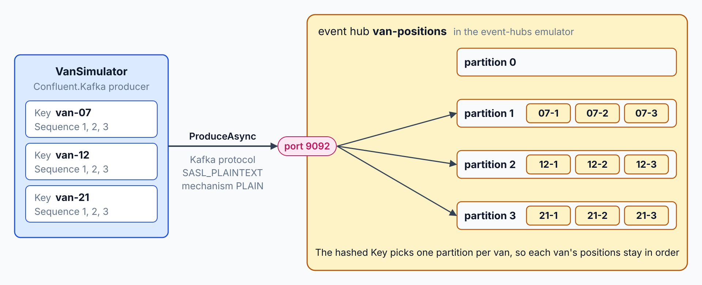
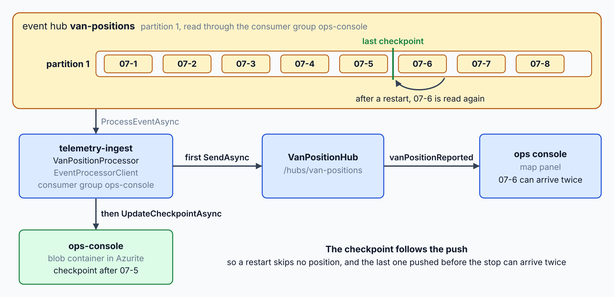
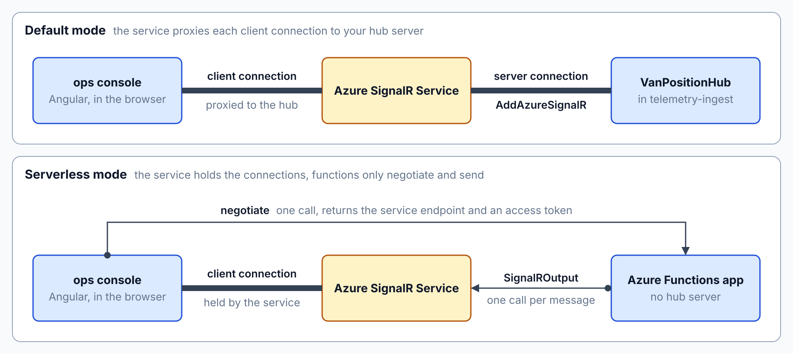
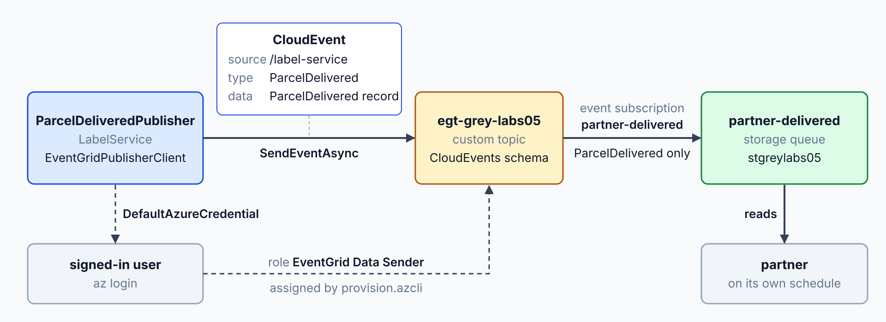

# Stream Van Positions to a Live Map

The ops console shows no vans, and no partner learns when a parcel is delivered. By the end, van positions stream into the console as they arrive, and a delivery photo sent to storage tells a partner that the parcel is delivered.

What you practice here: consuming a partitioned stream with checkpoints, then routing events to browsers and partners through managed services.

Duration: about 45 minutes.

Topics practiced: [Event Grid: Custom Topics & Subscriptions](../../demos/05-event-grid-hubs/01-custom-topics/readme.md), [Event Grid: Filters, Retries, Dead-Letter](../../demos/05-event-grid-hubs/02-filters-retries/readme.md), [Event Hubs: Partitions & Checkpoints](../../demos/05-event-grid-hubs/04-partitions-checkpoints/readme.md), [Event Hubs: Kafka-Compatible Streaming](../../demos/05-event-grid-hubs/05-kafka/readme.md), [SignalR Service: Push to Browsers](../../demos/05-event-grid-hubs/06-signalr/readme.md)

------

Open `labs/05-event-grid-hubs/contoso-logistics/` in your editor with your AI coding agent (GitHub Copilot agent mode or Claude Code). The agent reads `AGENTS.md` for the class stack, and every path in the prompts is relative to that folder.

Setup: Docker Desktop must run for Steps 1 and 2. Before Step 3, sign in with `az login` if the Azure CLI asks for it, then run `bash labs/05-event-grid-hubs/provision.azcli` from the repository root. The script creates every Azure resource that Steps 3 to 5 use, all in `rg-azn-labs`.

## What You Build

At the start, the ops console shows no vans and no partner receives delivery events, because the lab begins from the lab 4 solution. At the end, a van simulator streams keyed positions through Event Hubs and `telemetry-ingest` to the live map, and a proof-of-delivery photo in Blob Storage publishes `ParcelDelivered` to the partner queue through Event Grid.

| Step | What you add | Why it matters |
| --- | --- | --- |
| [1](#step-1-send-van-positions-to-event-hubs-over-kafka) | A van simulator that produces keyed positions to `van-positions` over the Kafka endpoint of the Event Hubs emulator | Keys keep each van's positions in order within one partition |
| [2](#step-2-checkpoint-the-processor-and-push-to-the-live-map) | A `telemetry-ingest` processor with blob checkpoints, a SignalR hub and a map panel | The processor resumes after a restart, and the map shows each position as it arrives |
| [3](#step-3-switch-the-hub-to-azure-signalr-service) | An Azure SignalR Service connection that a configuration value switches on | Browsers connect through a managed push service, and the hub route and the map stay the same |
| [4](#step-4-publish-parceldelivered-to-the-partner-queue) | `ParcelDeliveredPublisher`, which sends `ParcelDelivered` as a CloudEvent to the custom topic | Partners read the delivery confirmation from their own queue |
| [5](#step-5-turn-a-proof-of-delivery-photo-into-parceldelivered) | A background worker that turns a proof-of-delivery photo into a `ParcelDelivered` event | A photo upload confirms the delivery without a manual publish |


---

## Step 1: Send Van Positions to Event Hubs over Kafka

Overview: The telematics vendors already publish to Kafka, so the van simulator uses a Kafka client, and the local Event Hubs emulator accepts it unchanged. Keying each message by van id keeps one van's positions in order within one partition.

How it works: `src/VanSimulator/Program.cs` creates a `ProducerBuilder<string, string>` from a `ProducerConfig` with `SecurityProtocol.SaslPlaintext` and `SaslMechanism.Plain`, and it calls `ProduceAsync` on `van-positions` with the `VanId` as the message `Key`. The Kafka endpoint on port 9092 and the four partitions are set in `src/AppHost/Program.cs`, and the producer's partitioner hashes each key to one partition, which keeps one van's positions in order. The message value is a JSON `VanPositionReported` record from `src/Contracts/VanPositionReported.cs`, and the [Confluent.Kafka producer section](../../demos/05-event-grid-hubs/05-kafka/readme.md#producing-van-gps-positions-with-confluentkafka) explains the pattern.



Recipe:

```text
Work in this folder. Read AGENTS.md first.

1. In src/Contracts/, add the record VanPositionReported in the namespace Contoso.Contracts with these properties: VanId (string), Sequence (long), Latitude (double), Longitude (double) and ObservedAt (DateTimeOffset).
2. In src/AppHost/, add an Azure Event Hubs resource named event-hubs that runs as the emulator. Add the hub van-positions to it, with one consumer group named ops-console. Set the partition count of van-positions to 4 in the emulator configuration callback, because the emulator reads its configuration only when it starts.
3. Create the console project src/VanSimulator/ with a reference to Contracts and the Confluent.Kafka package. Every second, send one VanPositionReported for each of three vans, VanId van-07, van-12 and van-21, with Sequence increasing by one per van from 1. Use the VanId as the Kafka message key and the JSON-serialized record as the value.
4. Aspire does not publish the emulator's Kafka port, so in the emulator callback add an endpoint named kafka for port 9092 and pass its host and port to the simulator. Configure the producer for that endpoint: that host and port as the bootstrap server, security protocol SASL_PLAINTEXT, SASL mechanism PLAIN, SASL username $ConnectionString, and the SASL password taken from the emulator connection string that the AppHost injects.
5. Register VanSimulator in the AppHost so that it starts after event-hubs and receives the connection string.

Do not change the existing services. Write no code comments.
```

Expected Outcome: The Aspire dashboard lists `event-hubs` and `van-simulator` as running, and the simulator runs without errors.

> **_NOTE:_** A gate test could prove this step, but this lab skips it to save time. It would check:
>
> - the van simulator sends positions over the Kafka endpoint, and `van-positions` holds at least five positions for each of the three vans, with consecutive `Sequence` values per van.

## Step 2: Checkpoint the Processor and Push to the Live Map

Overview: The processor must resume where it stopped, and the map must show each position as it arrives. This step adds a processor with a blob checkpoint store, a SignalR hub, and a map panel in the ops console.

How it works: `VanPositionProcessor` in `src/TelemetryIngest/VanPositionProcessor.cs` runs an `EventProcessorClient` on the `ops-console` consumer group of `van-positions`, keeps its checkpoints in a `BlobContainerClient` for the `ops-console` container, and sends each `VanPositionReported` with `SendAsync("vanPositionReported", ...)` before it calls `UpdateCheckpointAsync`. Because the checkpoint follows the push, a restart replays the positions after the last checkpoint, so the map can receive a position twice. The hub `VanPositionHub` is mapped at `/hubs/van-positions` in `src/TelemetryIngest/Program.cs`, and `web/ops-console/src/app/van-map/van-map.ts` listens for `vanPositionReported` through a `HubConnectionBuilder`, as the [EventProcessorClient section](../../demos/05-event-grid-hubs/04-partitions-checkpoints/readme.md#eventprocessorclient-and-the-blob-checkpoint-store) explains.



Research:

```text
Read the Microsoft Learn pages on Event Hubs event processing and checkpoints, using the Microsoft Learn MCP server. Compare two checkpoint policies for a processor that pushes each van position to a SignalR hub: checkpoint after every position, and checkpoint after each batch of positions. For each policy, explain what a crash between the push and the checkpoint means for the positions a restart delivers. Do not change any file.
```

Finding: A good answer names at-least-once delivery, says that a restart replays the events after the last stored checkpoint, and weighs one blob write per position against the replays after a crash. Push back if it claims exactly-once delivery, or if it keeps checkpoints in memory where the blob container should hold them.

Recipe:

```text
Work in this folder. Keep the AppHost and the van simulator from Step 1.

1. In src/AppHost/, add an Azure Storage resource named storage that runs as the Azurite emulator, with a blob container named ops-console. Give telemetry-ingest references to event-hubs and storage.
2. Create the ASP.NET Core project src/TelemetryIngest/ with a reference to ServiceDefaults, and register it in the AppHost. Use the Azure.Messaging.EventHubs.Processor package with an EventProcessorClient that reads van-positions through the consumer group ops-console. Store its checkpoints in the ops-console blob container with the Azure.Storage.Blobs package. Use the connection strings that Aspire injects.
3. For each event, deserialize VanPositionReported, send it to every client connected to the hub method vanPositionReported, and then update the checkpoint. Report processor errors through the processor's error handler.
4. Add the hub class VanPositionHub in src/TelemetryIngest/, mapped at /hubs/van-positions. Allow the origin of the ops-console in CORS, with credentials.
5. In web/ops-console/, add a map panel that connects to /hubs/van-positions with the @microsoft/signalr package, listens for vanPositionReported, and draws the latest position of each van as a labelled dot on an SVG plane. Plot longitude as x and latitude as y.

Do not add a second consumer group. Write no code comments.
```

Expected Outcome: The ops console draws one dot per van, and the dots move while the simulator runs. Stop `telemetry-ingest` in the Aspire dashboard and start it again: the dots keep moving with no gap in any van's sequence numbers.

> **_NOTE:_** Gate tests could prove this step, but this lab skips them to save time. They would check:
>
> - `telemetry-ingest` reads `van-positions` through the `ops-console` consumer group, and a SignalR client connected to `/hubs/van-positions` receives at least five positions for each van.
> - after `telemetry-ingest` stops and starts again, each van's `Sequence` values continue with no gap.

## Step 3: Switch the Hub to Azure SignalR Service

Overview: Browsers should connect through a managed push service, which then holds the client connections for the hub. This step adds one switch: when the Azure SignalR connection string is set, the hub runs through Azure SignalR Service in Default mode, and the ops console keeps the same hub URL.

How it works: `src/TelemetryIngest/Program.cs` reads `Azure:SignalR:ConnectionString` and, only when it has a value, calls `AddAzureSignalR` on the registration from `AddSignalR`, using the `Microsoft.Azure.SignalR` package. `provision.azcli` creates the service with `--service-mode Default`, so the hub server keeps the client connections and the service proxies them to the hub over a server connection. The hub route and the `vanPositionReported` method stay the same, so the map in `web/ops-console` needs no change, as the [ASP.NET Core hub section](../../demos/05-event-grid-hubs/06-signalr/readme.md#aspnet-core-hub-with-addazuresignalr) explains.



The provision script allows all origins for the lab, so restrict the origin list before any real use.

Run from `labs/05-event-grid-hubs/contoso-logistics/`:

```bash
dotnet user-secrets init --project src/TelemetryIngest
dotnet user-secrets set "Azure:SignalR:ConnectionString" "$(az signalr key list --name sigr-contoso-labs05 --resource-group rg-azn-labs --query primaryConnectionString --output tsv)" --project src/TelemetryIngest
```

In PowerShell, run the `az signalr key list` command on its own and pass its output as the value of `dotnet user-secrets set`.

Recipe:

```text
Work in this folder. The Azure SignalR connection string is in the user secrets of src/TelemetryIngest/ under Azure:SignalR:ConnectionString.

1. Add the Microsoft.Azure.SignalR package to src/TelemetryIngest/.
2. In src/TelemetryIngest/Program.cs, keep the AddSignalR registration. When the configuration key Azure:SignalR:ConnectionString has a value, also call AddAzureSignalR on that registration. When the key is empty, the hub keeps running locally.
3. Keep the hub route /hubs/van-positions and the method name vanPositionReported unchanged, so web/ops-console needs no change.

Write no code comments.
```

Expected Outcome: The ops console still draws the vans. The negotiate request to `/hubs/van-positions` returns an endpoint on `sigr-contoso-labs05.service.signalr.net`, which you can see in the browser's network panel.

> **_NOTE:_** A gate test could prove this step, but this lab skips it to save time. It would check:
>
> - with the Azure SignalR connection string set, the negotiate response points the client at a `service.signalr.net` host, and positions still arrive.

## Step 4: Publish ParcelDelivered to the Partner Queue

Overview: A partner receives `ParcelDelivered` as a CloudEvent from a queue it can read on its own schedule. `provision.azcli` created the custom topic `egt-contoso-labs05`, which accepts CloudEvents, and the `partner-delivered` subscription, which routes `ParcelDelivered` to the `partner-delivered` queue. This step writes the publisher.

How it works: `ParcelDeliveredPublisher` in `src/LabelService/ParcelDeliveredPublisher.cs` wraps an `EventGridPublisherClient` and sends each `ParcelDelivered` record as a `CloudEvent` with the source `/label-service` and the type `ParcelDelivered`. `src/LabelService/Program.cs` authenticates the client with `DefaultAzureCredential`, so the publisher uses the `EventGrid Data Sender` role that `provision.azcli` assigns to the signed-in user instead of an access key. The `partner-delivered` event subscription in `provision.azcli` routes the event to the `partner-delivered` storage queue, where the partner reads it on its own schedule, as the [custom topics section](../../demos/05-event-grid-hubs/01-custom-topics/readme.md#publishing-cloudevents-with-eventgridpublisherclient) explains.



Recipe:

```text
Work in this folder.

1. Use the existing record ParcelDelivered from src/Contracts/ unchanged.
2. Create the worker project src/LabelService/ with the Azure.Messaging.EventGrid, Azure.Identity and Azure.Storage.Queues packages. Its settings come from user secrets: Azure:EventGrid:TopicEndpoint and Azure:Storage:AccountName.
3. In src/LabelService/, add the public class ParcelDeliveredPublisher with the constructor ParcelDeliveredPublisher(Uri topicEndpoint, TokenCredential credential) and the method Task PublishAsync(ParcelDelivered delivered, CancellationToken cancellationToken). It sends one CloudEvent to the custom topic through EventGridPublisherClient, with the source /label-service, the event type ParcelDelivered, and the record as the data. Register it in Program.cs with the topic endpoint setting and DefaultAzureCredential.

Do not register src/LabelService in the AppHost. Write no code comments.
```

After the agent creates `src/LabelService/`, run this block from `labs/05-event-grid-hubs/contoso-logistics/`:

```bash
dotnet user-secrets init --project src/LabelService
dotnet user-secrets set "Azure:EventGrid:TopicEndpoint" "$(az eventgrid topic show --name egt-contoso-labs05 --resource-group rg-azn-labs --query endpoint --output tsv)" --project src/LabelService
dotnet user-secrets set "Azure:Storage:AccountName" "stcontosolabs05" --project src/LabelService
```

Expected Outcome: Have your agent publish one ParcelDelivered for a new tracking number through ParcelDeliveredPublisher. Within a minute, `az storage message peek --account-name stcontosolabs05 --queue-name partner-delivered --auth-mode login --num-messages 32` shows a CloudEvent with the type ParcelDelivered and that tracking number in its data.

> **_NOTE:_** A gate test could prove this step, but this lab skips it to save time. It would check:
>
> - a `ParcelDelivered` CloudEvent published to the `egt-contoso-labs05` custom topic arrives in the `partner-delivered` queue with the same tracking number within two minutes.

## Step 5: Turn a Proof-of-Delivery Photo into ParcelDelivered

Overview: A proof-of-delivery photo is the real trigger for `ParcelDelivered`, so the label service reacts to the storage event on its own, without a manual call. `provision.azcli` created the system topic that raises `BlobCreated` for the `proof-of-delivery` container and routes it to the `pod-events` queue. This step writes the handler that publishes `ParcelDelivered`.

How it works: `ProofOfDeliveryWorker` in `src/LabelService/ProofOfDeliveryWorker.cs` reads the `pod-events` queue, parses each message with `CloudEvent.Parse`, and takes the tracking number from the blob name when the type is `Microsoft.Storage.BlobCreated` and the subject names the `proof-of-delivery` container. It publishes a `ParcelDelivered` through `ParcelDeliveredPublisher` and calls `DeleteMessageAsync` only after the publish succeeds, so a failed publish makes the message visible again after its one-minute visibility timeout. Messages of any other type or container are deleted without a publish, as the [Blob Storage system topic section](../../demos/05-event-grid-hubs/01-custom-topics/readme.md#blob-storage-system-topic-for-proof-of-delivery) explains.


Recipe:

```text
Work in this folder.

1. In src/LabelService/, add a background worker that reads the pod-events queue of the storage account named by the setting Azure:Storage:AccountName, with DefaultAzureCredential and the Azure.Storage.Queues package.
2. For each message, parse the CloudEvent. When its type is Microsoft.Storage.BlobCreated and its subject names the proof-of-delivery container, take the tracking number from the blob name without its extension (CL-10482.jpg gives CL-10482). Publish a ParcelDelivered for that tracking number with ParcelDeliveredPublisher, with FinalStatus Delivered and the event time as DeliveredAt, and delete the message only after the publish succeeds.
3. Delete messages of any other type or container without publishing them.

Write no code comments.
```

Expected Outcome: Uploading a photo named for a parcel to the `proof-of-delivery` container in the Azure portal produces one `ParcelDelivered` message in `partner-delivered` for that parcel, with no manual publish step, while `dotnet run --project src/LabelService` runs.

> **_NOTE:_** A gate test could prove this step, but this lab skips it to save time. It would check:
>
> - a photo uploaded to the `proof-of-delivery` container raises a `BlobCreated` event, the label service publishes `ParcelDelivered`, and the `partner-delivered` queue receives it within three minutes.

## Solution

The finished state is in `labs/05-event-grid-hubs/contoso-logistics-solution/`. Compare your folder with it when you finish.

## Cleanup

Keep the Azure environment: the next lab deploys into the same resource group `rg-azn-labs`. Stop the AppHost. Run `deprovision.azcli` only if you end the class before lab 9; it deletes `rg-azn-labs` with everything the labs created.
