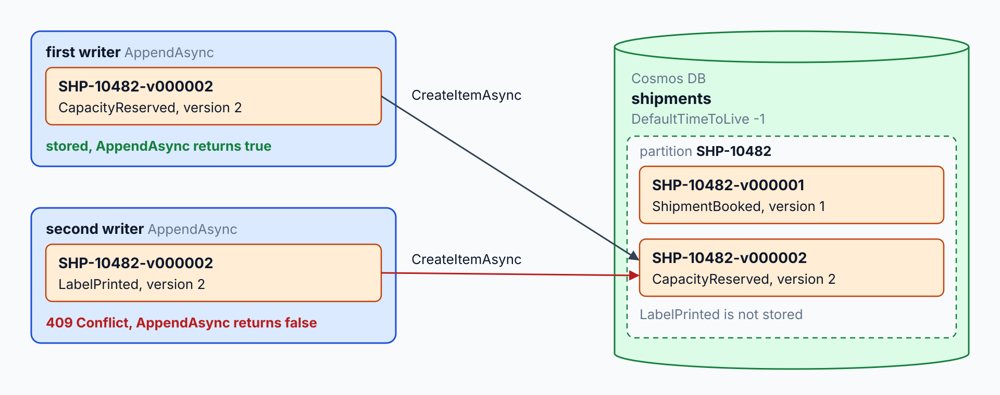
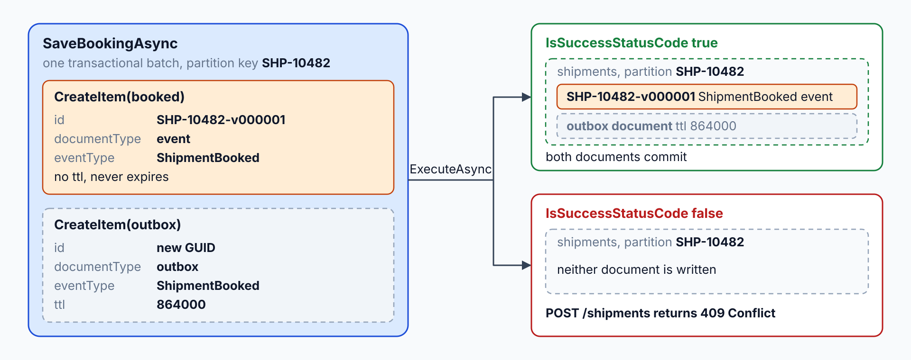
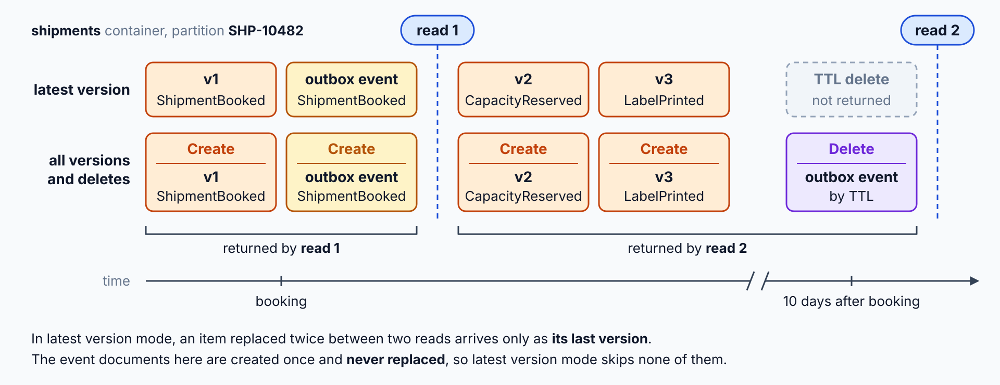
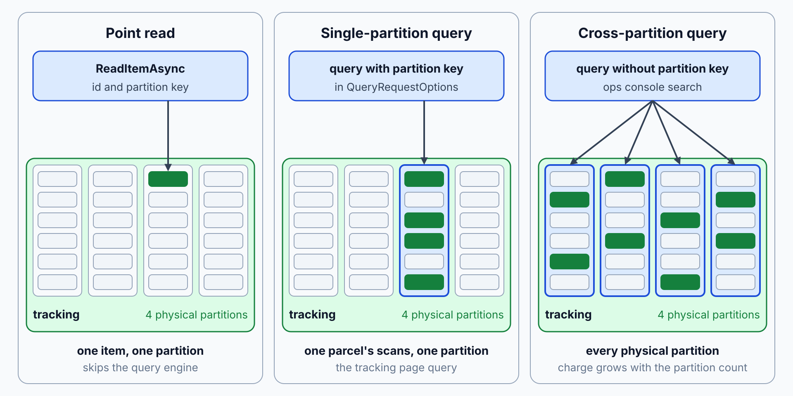

# Event-Source Shipments with an Outbox

Booking writes the shipment and then publishes its event in a separate step, so a crash between the two can lose the event or announce a shipment that was never saved. The tracking page has no read model of its own, and nothing clears a cached page when a new scan arrives. At the end you hold a shipment event store that rejects conflicting appends, an outbox that survives a restart, a tracking read model fed from the change feed, and a Redis entry that clears after each scan.

What you practice here: pairing a business event and its outbox document in one atomic batch, then letting a change feed publish and project every change.

Duration: about 60 minutes.

Topics practiced: [Transactional Outbox: Atomic Publishing](../../demos/06-event-sourcing-cqrs/01-outbox/readme.md), [Change Feed Processor: Projections](../../demos/06-event-sourcing-cqrs/02-change-feed-processor/readme.md), [CQRS: Separate Writes from Reads](../../demos/06-event-sourcing-cqrs/03-cqrs/readme.md), [Read Models: Indexing, RUs, Consistency](../../demos/06-event-sourcing-cqrs/04-read-models/readme.md), [Managed Redis: Change-Feed Cache Invalidation](../../demos/06-event-sourcing-cqrs/05-redis-cache/readme.md), [Event Store: Aggregates & Snapshots](../../demos/06-event-sourcing-cqrs/06-event-store/readme.md)

------

Open `labs/06-event-sourcing-cqrs/contoso-logistics/` in your editor with your AI coding agent (GitHub Copilot agent mode or Claude Code). The agent reads `AGENTS.md` for the class stack. Start Docker Desktop first, because the Cosmos DB and Redis emulators run from the AppHost.

## What You Build

At the start, `shipping-api` saves a shipment document and publishes `ShipmentBooked` in two separate calls, and `tracking-service` reads the `tracking` container directly. At the end, each change is stored as an immutable event, the booking and its outbox event commit in one batch, and a change feed relays the outbox to `shipment-events`. A projection feeds a tracking read model that Redis caches and invalidates after each scan, and the booking and tracking endpoints are split into a command and a query.

| Step | What you add | Why it matters |
| --- | --- | --- |
| [1](#step-1-store-shipment-events-with-a-concurrency-check) | An event store for the Shipment aggregate that rejects a second event for the same version | A conflicting write fails instead of overwriting history |
| [2](#step-2-save-the-booking-and-its-outbox-event-in-one-batch) | A transactional batch that saves the `ShipmentBooked` event and its outbox document together | A crash can't leave a booked shipment without its event |
| [3](#step-3-relay-outbox-events-to-service-bus-through-the-change-feed) | A change feed processor, `outbox-relay`, that sends outbox documents to `shipment-events` | Events reach Service Bus even when the service restarts after the save |
| [4](#step-4-project-scans-into-the-tracking-read-model) | A projection, `tracking-projection`, that upserts `ParcelScanned` events into the `tracking` container | The tracking page reads a model built for its query |
| [5](#step-5-index-the-tracking-container-for-its-queries) | A consistent indexing policy and a composite index for the ops console query | Each query matches an index instead of scanning the container |
| [6](#step-6-invalidate-the-cached-tracking-page-after-each-scan) | A Redis cache for the tracking page and a key delete after each scan | Repeat page loads skip the query, and the next read after a scan shows it |
| [7](#step-7-split-commands-from-queries) | A `BookShipment` command that returns 202 Accepted and a `GET /tracking/{trackingNumber}` query | Booking and reading change independently, and a 202 doesn't promise a scan yet |


---

## Step 1: Store Shipment Events with a Concurrency Check

Overview: Each change to a shipment becomes an immutable event, and the event ID carries the shipment version. A second writer that targets the same version collides with the first, so the store rejects it and keeps the first event.

How it works: `ShipmentEventStore.AppendAsync` in `src/ShippingApi/Persistence/ShipmentEventStore.cs` creates each event with the ID `{shipmentId}-v{version:D6}` and the partition key `shipmentId`, and it returns `false` when Cosmos DB answers 409 Conflict. `ShipmentRepository.LoadAsync` replays the events in version order through `Shipment.Apply`, and `ShipmentsContainerSetup.EnsureAsync` sets `DefaultTimeToLive` to `-1` on the `shipments` container. Because the ID is the guard and no document is replaced, the store needs no ETag check, as [optimistic concurrency with unique version IDs](../../demos/06-event-sourcing-cqrs/06-event-store/readme.md#optimistic-concurrency-with-unique-version-ids) explains.



Research:

```text
Read `src/ShippingApi/`. Explain how Azure Cosmos DB can reject a second event for the same shipment version in the `shipments` container (partition key `/shipmentId`). Compare a deterministic document ID with an ETag check, and recommend one for an append-only event log. Change no files.
```

Finding: A good answer compares the two failures: a create with a taken ID returns 409 Conflict, and a replace with a stale ETag returns 412 Precondition Failed. It recommends the deterministic ID for appends, because an event is never replaced. Push back if the answer reads the last version and then writes without an atomic guard, or if it proposes overwriting event documents to bump a version field.

Recipe:

```text
In `src/ShippingApi/`, add an event store for the Shipment aggregate that rejects conflicting appends. Use the Microsoft.Azure.Cosmos v3 SDK on .NET 10 and the `shipments` container with partition key `/shipmentId`.

Create these files:

- `src/ShippingApi/Persistence/ShipmentsContainerSetup.cs`: class `ShipmentsContainerSetup` with `Task<Container> EnsureAsync(Database database, CancellationToken cancellationToken)`. The AppHost already declares the `shipments` container, so the method creates it when it is missing and otherwise replaces its properties, so the container always has partition key `/shipmentId` and `DefaultTimeToLive` set to -1.
- `src/ShippingApi/Persistence/ShipmentDocument.cs`: record with `id`, `shipmentId`, `trackingNumber`, `documentType`, `eventType`, `version`, `occurredAt`, `scanType` and `data` (the event payload).
- `src/ShippingApi/Domain/Shipment.cs`: class `Shipment` with `Version`, `Status`, `static Shipment Empty(string shipmentId)` and `Shipment Apply(ShipmentDocument document)`, which returns the updated shipment for each event.
- `src/ShippingApi/Persistence/ShipmentRepository.cs`: class `ShipmentRepository` with `Task<Shipment> LoadAsync(string shipmentId, CancellationToken cancellationToken)`. It queries the event documents of one shipment in ascending version order, scoped to the partition key, and replays them with `Apply`.
- `src/ShippingApi/Persistence/ShipmentEventStore.cs`: class `ShipmentEventStore` with `Task<bool> AppendAsync(ShipmentDocument shipmentEvent, CancellationToken cancellationToken)`. It creates the document with the ID `{shipmentId}-v{version}`, where the version has six digits with leading zeros, for example `SHP-10482-v000002`. It returns true on success, returns false when Cosmos DB answers 409 Conflict, and never replaces a document.
- `src/ShippingApi/Program.cs`: call `ShipmentsContainerSetup.EnsureAsync` once at startup, before the app serves requests.

Add no inline comments.
```

Expected Outcome: `dotnet build ContosoLogistics.sln` succeeds. The first append for a shipment version is stored. A second append for the same version returns false, and the `shipments` container keeps only the first event for that version.

> **_NOTE:_** A gate test could prove this step, but this lab skips it to save time. It would check:
>
> - Two appends that target the same version of one shipment: the first is stored, the second returns false, and only one event exists for that version.

## Step 2: Save the Booking and Its Outbox Event in One Batch

Overview: The booking must store its `ShipmentBooked` event and an outbox document together or not at all. Both documents share the shipment's partition key, so one transactional batch commits them as one unit.

How it works: `ShipmentOutboxWriter.SaveBookingAsync` in `src/ShippingApi/Persistence/ShipmentOutboxWriter.cs` adds both documents to one `CreateTransactionalBatch` call with the partition key `booked.shipmentId`, and it returns the response's `IsSuccessStatusCode`. `BookShipmentHandler.HandleAsync` in `src/ShippingApi/Commands/BookShipmentHandler.cs` builds the `ShipmentBooked` document without a `ttl` and the outbox document with `ttl` set to `864000`. The `POST /shipments` endpoint in `src/ShippingApi/Program.cs` returns 409 Conflict when the batch fails, and both documents commit or neither does, as [one transactional batch on one partition key](../../demos/06-event-sourcing-cqrs/01-outbox/readme.md#one-transactional-batch-on-one-partition-key) explains.



Finding: Expect one batch with two create operations, both scoped to `shipmentId`, and a check on `IsSuccessStatusCode` before the endpoint reports success. Push back if the code writes the event and the outbox document in two separate calls, if the outbox document uses a different partition key, if the event document carries a `ttl`, or if the batch result is never checked. If the `shipments` container already exists from an earlier lab, the emulator ignores its default TTL change; stop the AppHost, remove the Cosmos DB emulator container with Docker, and start again.

Recipe:

```text
In `src/ShippingApi/`, save each booking as one Cosmos DB transactional batch on the `shipments` container (partition key `/shipmentId`). Use the Microsoft.Azure.Cosmos v3 SDK on .NET 10.

Create this file:

- `src/ShippingApi/Persistence/ShipmentOutboxWriter.cs`: class `ShipmentOutboxWriter` that takes the `shipments` container and exposes `Task<bool> SaveBookingAsync(ShipmentDocument booked, ShipmentDocument outbox, CancellationToken cancellationToken)`. It adds both documents to one transactional batch for the partition key `shipmentId` and returns the batch response's `IsSuccessStatusCode`.

The booking endpoint builds both documents. The `booked` document is the `ShipmentBooked` event with `documentType` set to `event` and version 1, and it has no `ttl`. The `outbox` document has a new GUID as `id`, `documentType` set to `outbox`, the same `shipmentId`, the event name in `eventType`, the event payload in `data`, and `ttl` set to 864000.

Change the existing booking endpoint in `src/ShippingApi/` so it saves through `SaveBookingAsync` and returns 409 Conflict when the save returns false. Add no inline comments.
```

Expected Outcome: `dotnet build ContosoLogistics.sln` succeeds. After one booking, the `shipments` container holds two documents with the same partition key: one with `documentType` `event` and one with `documentType` `outbox`.

## Step 3: Relay Outbox Events to Service Bus Through the Change Feed

Overview: The outbox document waits in `shipments` until a change feed processor publishes it to the `shipment-events` topic. The processor resumes from its last checkpoint after a restart, so a booking reaches Service Bus even when the service stops right after the save.

How it works: `OutboxRelayHost` in `src/ShippingApi/Outbox/OutboxRelayHost.cs` builds the processor `outbox-relay` on the `shipments` container with the `leases` container, the instance name from `Outbox:InstanceName`, and `OutboxRelay.HandleChangesAsync` as its delegate, and it starts only when `Outbox:RelayEnabled` is `true`. For each outbox document, `OutboxRelay` in `src/ShippingApi/Outbox/OutboxRelay.cs` sends a message with `MessageId` set to `id`, `SessionId` set to `shipmentId`, and `Subject` set to `eventType`, and it awaits every send so that an exception makes the processor retry the batch. The topic enables duplicate detection in `src/AppHost/Program.cs`, which drops the copies that a retry creates, as [the change feed relay](../../demos/06-event-sourcing-cqrs/01-outbox/readme.md#relaying-with-the-change-feed) explains.



Finding: Expect a processor named `outbox-relay` with the lease container `leases` (partition key `/id`), a handler that awaits every send, a filter on `documentType` equal to `outbox`, and MessageId, SessionId and Subject set as the recipe describes. The topic has duplicate detection on and no partitioning, because the Service Bus emulator doesn't support partitioned entities. Push back if the handler fires sends without awaiting them, catches exceptions so the batch is never retried, sets no MessageId, creates a new instance name on each start, or enables partitioning on the topic.

Recipe:

```text
In this folder, publish outbox documents from the `shipments` container to the Service Bus topic `shipment-events`. Use the Azure.Messaging.ServiceBus package and the Microsoft.Azure.Cosmos v3 SDK on .NET 10.

Changes:

- `src/AppHost/`: enable duplicate detection on the existing topic `shipment-events` with a history window of five minutes, the largest window the Service Bus emulator accepts. Do not enable partitioning. Pass the Service Bus resource to shipping-api the same way it is already passed. Also pass the setting `Outbox:RelayEnabled` to shipping-api as the environment variable `Outbox__RelayEnabled`, taken from the AppHost configuration, with `true` as the default.
- `src/ShippingApi/Outbox/OutboxRelay.cs`: class `OutboxRelay` that takes the `ServiceBusSender` for `shipment-events` and exposes `Task HandleChangesAsync(ChangeFeedProcessorContext context, IReadOnlyCollection<ShipmentDocument> changes, CancellationToken cancellationToken)`. For each change with `documentType` equal to `outbox`, it sends a message with MessageId set to the document `id`, SessionId set to `shipmentId`, Subject set to `eventType`, and the body set to `data`. It awaits every send and lets exceptions reach the processor, so the batch is retried.
- `src/ShippingApi/Outbox/OutboxRelayHost.cs`: class `OutboxRelayHost`, a `BackgroundService` that builds a change feed processor named `outbox-relay` on the `shipments` container, with `OutboxRelay.HandleChangesAsync` as its delegate. It uses the lease container `leases`, created when missing with partition key `/id`, and an instance name read from the configuration key `Outbox:InstanceName`, which stays the same for each replica. It starts the processor only when `Outbox:RelayEnabled` is `true`, and it stops the processor on shutdown.
- `src/ShippingApi/Program.cs`: register `OutboxRelay`, the relay host and the Service Bus sender.

Add no inline comments.
```

Expected Outcome: `dotnet build ContosoLogistics.sln` succeeds. With `Outbox:RelayEnabled` set to `false`, a booking leaves its outbox document in `shipments` and sends nothing to `shipment-events`. With the relay on, the `ShipmentBooked` message arrives with the outbox document ID as its MessageId and the shipment ID as its SessionId. The outbox documents stay in `shipments` after publishing, until their ten-day TTL removes them.

> **_NOTE:_** A gate test could prove this step, but this lab skips it to save time. It would check:
>
> - A booking saved while the relay is off leaves its outbox document in `shipments` and nothing on `shipment-events`; once the relay runs, `ShipmentBooked` arrives with the outbox document ID as its MessageId and the shipment ID as its SessionId.

## Step 4: Project Scans into the Tracking Read Model

Overview: The tracking page reads its own `tracking` container, and a change feed processor in tracking-service fills it from `ParcelScanned` events. Each scan is stored under its event ID, so a repeated change writes the same record again.

How it works: `TrackingProjectionHost` in `src/TrackingService/Projection/TrackingProjectionHost.cs` builds the processor `tracking-projection` on the `shipments` container in the default latest version mode, with the shared `leases` container and `WithStartTime(DateTime.MinValue.ToUniversalTime())`, so scans written before its first start are read. `TrackingProjection.HandleChangesAsync` in `src/TrackingService/Projection/TrackingProjection.cs` upserts a `ScanRecord` for each `ParcelScanned` event, with the event `id` as its document ID and `trackingNumber` as its partition key, and it awaits each upsert. Because an upsert repeats safely, the handler never uses a create, as [at-least-once delivery and idempotent projections](../../demos/06-event-sourcing-cqrs/02-change-feed-processor/readme.md#at-least-once-delivery-and-idempotent-projections) explains.



Finding: Expect a processor named `tracking-projection` that shares the `leases` container with `outbox-relay` under its own name, so both processors coexist. Expect an upsert (not a create), an await on every upsert, a query scoped to the partition key, and `ORDER BY occurredAt` ascending.

Push back if the handler uses a create: a repeat then fails, and the processor keeps retrying the batch. Push back if the processor starts at its default position, because the scans written before its first start would never reach the page.

Recipe:

```text
In `src/TrackingService/`, build the tracking read model from the change feed of the `shipments` container. Use the Microsoft.Azure.Cosmos v3 SDK on .NET 10.

Create these files:

- `src/TrackingService/Persistence/TrackingContainerSetup.cs`: class `TrackingContainerSetup` with `Task<Container> EnsureAsync(Database database, CancellationToken cancellationToken)`. It creates the `tracking` container when missing, with partition key `/trackingNumber`.
- `src/TrackingService/Projection/ShipmentEventDocument.cs`: record with `id`, `shipmentId`, `trackingNumber`, `documentType`, `eventType`, `version`, `occurredAt`, `scanType` and `data`. Copy the shape of the shipment document; do not reference the shipping-api project.
- `src/TrackingService/Projection/ScanRecord.cs`: record `ScanRecord(string id, string trackingNumber, string scanType, DateTimeOffset occurredAt)`.
- `src/TrackingService/Projection/TrackingProjection.cs`: class `TrackingProjection` that takes the `tracking` container and exposes `Task HandleChangesAsync(ChangeFeedProcessorContext context, IReadOnlyCollection<ShipmentEventDocument> changes, CancellationToken cancellationToken)`. For each change with `documentType` equal to `event` and `eventType` equal to `ParcelScanned`, it upserts a `ScanRecord` whose `id` is the event ID, with partition key `trackingNumber`. It awaits each upsert and lets exceptions reach the processor.
- `src/TrackingService/Projection/TrackingProjectionHost.cs`: class `TrackingProjectionHost`, a `BackgroundService` that builds a change feed processor named `tracking-projection` on the `shipments` container, with `TrackingProjection.HandleChangesAsync` as its delegate. It uses the lease container `leases`, created when missing with partition key `/id`, and an instance name read from the configuration key `Tracking:InstanceName`, which stays the same for each replica. It starts the processor from the beginning of the container and stops it on shutdown.
- `src/TrackingService/Queries/TrackingQueryHandler.cs`: class `TrackingQueryHandler` that takes the `tracking` container and exposes `Task<IReadOnlyList<ScanRecord>> HandleAsync(string trackingNumber, CancellationToken cancellationToken)`. It queries with the partition key set to the tracking number and sorts by `occurredAt` ascending.
- `src/TrackingService/Program.cs`: register the container setup, the projection host and the query handler.

Add no inline comments.
```

Expected Outcome: `dotnet build ContosoLogistics.sln` succeeds. After a `ParcelScanned` event is appended to `shipments`, the `tracking` container holds a `ScanRecord` whose document ID equals the `ParcelScanned` event ID.

> **_NOTE:_** A gate test could prove this step, but this lab skips it to save time. It would check:
>
> - A `ParcelScanned` event appended to `shipments` appears as a `ScanRecord` in the `tracking` container within a bounded wait, with the event ID as its document ID.

## Step 5: Index the Tracking Container for Its Queries

Overview: The tracking page filters on the partition key and sorts by time, and an ops-console query sorts by scan type and then by time. The policy goes into the container setup from step 4.

How it works: `TrackingContainerSetup.EnsureAsync` in `src/TrackingService/Persistence/TrackingContainerSetup.cs` applies the consistent policy with `/*` included, `/_etag/?` excluded, and a composite index on `scanType` ascending and `occurredAt` descending, both when it creates the container and when it replaces one, and `docs/tracking-indexing-policy.json` holds the same policy for deployment. `NewestScansByTypeAsync` in `src/TrackingService/Queries/TrackingQueryHandler.cs` runs the ops console query across all partitions, while `HandleAsync` sets `QueryRequestOptions.PartitionKey` to keep the page query on one partition. The composite index matches the sort order of the ops console query, and [point reads versus queries](../../demos/06-event-sourcing-cqrs/04-read-models/readme.md#point-reads-versus-queries) explains the cost of a cross-partition query.



Research:

```text
Read `src/TrackingService/Queries/TrackingQueryHandler.cs` and `src/TrackingService/Projection/ScanRecord.cs`. List each query the `tracking` container serves and each property it filters or sorts on. Recommend the indexing policy for the container: the included and excluded paths, and any composite index with its sort orders. Change no files.
```

Finding: A good answer lists the page query (partition key `trackingNumber`, sorted by `occurredAt`) and the ops query (sorted by `scanType`, then `occurredAt` descending), and it matches a composite index to the second query's sort order. Push back if the policy puts wildcards in a composite path, excludes a property that a query filters or sorts on, or claims request-unit savings from this local emulator. The vNext emulator doesn't report request units, and Learn lists range and composite indexes as planned, so the emulator accepts the policy without using it for queries yet.

Recipe:

```text
In `src/TrackingService/`, set an indexing policy on the `tracking` container and add the ops query. Use the Microsoft.Azure.Cosmos v3 SDK on .NET 10.

Changes:

- `src/TrackingService/Persistence/TrackingContainerSetup.cs`: give the `tracking` container this indexing policy in consistent mode, both when the method creates the container and when it already exists, because the AppHost creates it first: included path `/*`, excluded path `/_etag/?`, and one composite index on `scanType` ascending followed by `occurredAt` descending.
- `docs/tracking-indexing-policy.json`: the same policy as JSON, for deployment.
- `src/TrackingService/Queries/TrackingQueryHandler.cs`: add `Task<IReadOnlyList<ScanRecord>> NewestScansByTypeAsync(CancellationToken cancellationToken)`, which runs `SELECT * FROM c ORDER BY c.scanType ASC, c.occurredAt DESC` across partitions and returns every row.

Keep the public signatures exactly as written. Add no inline comments.
```

Expected Outcome: `dotnet build ContosoLogistics.sln` succeeds. `docs/tracking-indexing-policy.json` exists in `contoso-logistics/docs/` with the composite entry. Reading the `tracking` container's indexing policy back returns the composite index.

## Step 6: Invalidate the Cached Tracking Page After Each Scan

Overview: The tracking page is cached in Redis under the key `tracking:<trackingNumber>`. The projection deletes that key after each scan is written, so the next read loads the new scan from the read model, and a time to live bounds how long any stale page can stay.

How it works: The AppHost in `src/AppHost/Program.cs` adds a Redis container named `cache` with `AddRedis("cache")` and passes it to `tracking-service` with `WithReference`, and `src/TrackingService/Program.cs` registers it with `AddRedisClient("cache")`. `TrackingCache.GetScansAsync` in `src/TrackingService/Caching/TrackingCache.cs` reads the key with `StringGetAsync`, and on a miss it stores the page with `StringSetAsync` for five minutes plus up to 30 seconds of random offset. `TrackingProjection` calls `KeyDeleteAsync` on the same key after each upsert, so the next read reloads the page, as [invalidating from the change feed](../../demos/06-event-sourcing-cqrs/05-redis-cache/readme.md#invalidating-from-the-change-feed) explains.


Finding: Expect a Redis container named `cache` from Aspire's Redis hosting integration, passed to tracking-service with `WithReference`, and one shared connection multiplexer registered through the Redis client integration. Expect the projection to delete the key after the upsert, not before.

Push back if the projection deletes first, because a read between the delete and the upsert caches the old page again. Push back if the answer adds Entra ID or Azure Managed Redis: this lab runs a local Redis container, and the Entra variant belongs to the Azure deployment.

Recipe:

```text
In this folder, put the tracking page behind a Redis cache and invalidate its entry after each scan.

Changes:

- `src/AppHost/`: add a Redis container named `cache` with Aspire's Redis hosting integration (package Aspire.Hosting.Redis), and pass it to tracking-service with `WithReference`.
- `src/TrackingService/`: register the connection multiplexer with the Aspire Redis client integration (package Aspire.StackExchange.Redis) using the name `cache`, and expose `IDatabase` from it as a singleton.
- `src/TrackingService/Caching/TrackingCache.cs`: class `TrackingCache` that takes `IDatabase` and `TrackingQueryHandler` and exposes `Task<IReadOnlyList<ScanRecord>> GetScansAsync(string trackingNumber, CancellationToken cancellationToken)`. It reads the key `tracking:<trackingNumber>`. On a hit it deserializes and returns the page. On a miss it runs the query, stores the serialized page with a time to live of five minutes plus a random offset of up to 30 seconds, and returns the page.
- `src/TrackingService/Projection/TrackingProjection.cs`: take `IDatabase` as a second constructor parameter, and after each upsert call `KeyDeleteAsync` for the key `tracking:<trackingNumber>`.
- `src/TrackingService/Program.cs`: register `TrackingCache` and the Redis services.

Add no inline comments.
```

Expected Outcome: `dotnet build ContosoLogistics.sln` succeeds. After a `ParcelScanned` event is written, the `tracking:<trackingNumber>` key is gone from Redis, and the next read of the tracking page returns the new scan. The Aspire dashboard lists the `cache` resource beside the emulators.

> **_NOTE:_** A gate test could prove this step, but this lab skips it to save time. It would check:
>
> - After the tracking page is cached in Redis, a new `ParcelScanned` event deletes the `tracking:<trackingNumber>` key, and the next read returns the new scan.

## Step 7: Split Commands from Queries

Overview: The booking becomes a command that returns only acceptance, and the tracking page reads through a query that never calls shipping-api.

How it works: `BookShipmentHandler.HandleAsync` in `src/ShippingApi/Commands/BookShipmentHandler.cs` takes the `BookShipment` record, saves through `ShipmentOutboxWriter`, and returns only the success flag, which the `POST /shipments` endpoint maps to 202 Accepted with `ShipmentId` and `TrackingNumber`. The `GET /tracking/{trackingNumber}` endpoint in `src/TrackingService/Program.cs` returns the result of `TrackingCache.GetScansAsync`, which reads the `tracking` container and never calls `shipping-api`. The two services share no project reference, as [commands change state, queries return views](../../demos/06-event-sourcing-cqrs/03-cqrs/readme.md#commands-change-state-queries-return-views) explains.


Finding: Expect a `BookShipment` command, a handler that returns only a success flag, and a booking endpoint that returns 202 Accepted with the shipment ID and tracking number. Expect a `GET /tracking/{trackingNumber}` endpoint in tracking-service that returns the result of `TrackingCache.GetScansAsync`, and no project reference between shipping-api and tracking-service in either direction.

A 202 means the booking is stored with its outbox document; it doesn't mean the tracking page shows a scan yet. Push back if the handler returns the shipment view, if the query side calls shipping-api over HTTP, or if the query endpoint reads the `shipments` container.

Recipe:

```text
In this folder, separate the booking command from the tracking query. Use the Microsoft.Azure.Cosmos v3 SDK on .NET 10.

Changes:

- `src/ShippingApi/Commands/BookShipment.cs`: record `BookShipment(string ShipmentId, string CustomerId, string PickupAddress, string DeliveryAddress, DateTimeOffset PromisedBy)`.
- `src/ShippingApi/Commands/BookShipmentHandler.cs`: class `BookShipmentHandler` that takes `ShipmentOutboxWriter` and exposes `Task<bool> HandleAsync(BookShipment command, CancellationToken cancellationToken)`. It generates the tracking number, builds the version 1 `ShipmentBooked` event document and its outbox document, calls `SaveBookingAsync`, and returns only the success flag.
- Update the booking endpoint in `src/ShippingApi/` to bind the request to `BookShipment` and call `BookShipmentHandler`. It returns 202 Accepted with the shipment ID and the tracking number when the handler returns true, and 409 Conflict when it returns false.
- Add a `GET /tracking/{trackingNumber}` endpoint in `src/TrackingService/` that returns the result of `TrackingCache.GetScansAsync`.
- Do not add a project reference between `src/ShippingApi/` and `src/TrackingService/` in either direction.

Keep the public signatures exactly as written. Add no inline comments.
```

Expected Outcome: `dotnet build ContosoLogistics.sln` succeeds. A booking returns 202 Accepted with its tracking number, and the tracking endpoint returns the scans once the projection has run.

## Solution

The finished state is in `contoso-logistics-solution/`.
