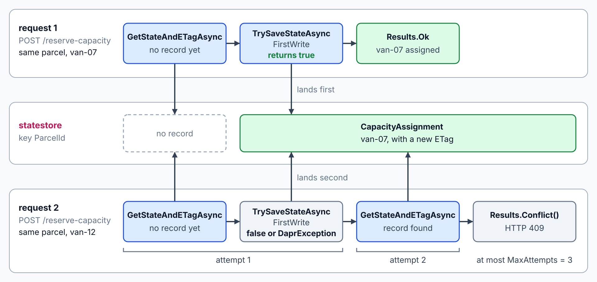
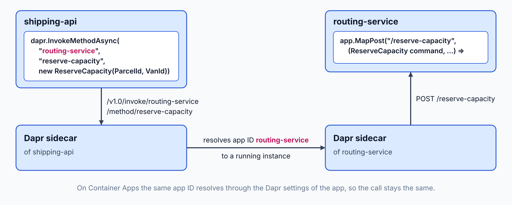

# Make the Services Portable with Dapr

Each Contoso Logistics service talks to its broker, its store and its peers through a vendor SDK, so changing a broker means changing code. Routing must also stop two requests from assigning one parcel to two vans, or from overfilling one van. At the end you hold the scan, tracking, notification and routing flows on Dapr building blocks, with the same components set on Container Apps.

What you practice here: swapping an infrastructure dependency behind a named building block.

Duration: about 65 minutes.

Topics practiced: [Dapr Sidecar: Run with Aspire](../../demos/07-dapr/01-sidecar/readme.md), [Service Invocation: mTLS & Retries](../../demos/07-dapr/02-service-invocation/readme.md), [State Stores: ETags & Concurrency](../../demos/07-dapr/03-state-stores/readme.md), [Pub/Sub: Swap Brokers via Components](../../demos/07-dapr/04-pub-sub/readme.md), [Resiliency Policies: Retries & Breakers](../../demos/07-dapr/05-resiliency/readme.md), [Dapr Actors: Virtual Actor Model](../../demos/07-dapr/06-actors/readme.md), [Managed Dapr: Container Apps vs. AKS](../../demos/07-dapr/07-managed-dapr/readme.md)

------

Open `labs/07-dapr/contoso-logistics/` in your editor with your AI coding agent (GitHub Copilot agent mode or Claude Code). The agent reads `AGENTS.md` for the class stack.

## What You Build

The lab starts with the Contoso Logistics services calling Service Bus, Cosmos DB and Redis through their own SDKs. It ends with the scan, tracking, notification and routing flows on Dapr building blocks: pub/sub, state with ETags, service invocation, resiliency and one `VanActor` per van. The same component names resolve to Service Bus and Cosmos DB on Container Apps through the environment components from step 7.

| Step | What you add | Why it matters |
| --- | --- | --- |
| [1](#step-1-run-the-services-with-dapr-sidecars) | A new notification-service and Dapr sidecars for tracking-service, notification-service and shipping-api, backed by the `pubsub` and `statestore` components | The code names components, and the YAML files choose the broker and the store |
| [2](#step-2-publish-and-subscribe-through-dapr-pubsub) | Scan events published to `parcel-events` through `pubsub` and received by notification-service | The publisher names no broker, and the tracking number travels as the `SessionId` |
| [3](#step-3-store-routing-state-with-etags) | A new routing-service with its sidecar, and a parcel assignment written to `statestore` with an ETag check | Two requests for one parcel cannot both succeed |
| [4](#step-4-call-routing-service-through-dapr-service-invocation) | A reserve-capacity call from shipping-api to routing-service by app ID | The caller builds no host name, and Container Apps resolves the same app ID |
| [5](#step-5-add-a-resiliency-policy-to-the-routing-calls) | One resiliency spec with a timeout, retries and a circuit breaker for routing-service | Limits change in one file, and the caller keeps no retry loop |
| [6](#step-6-model-each-van-as-a-vanactor) | A `VanActor` per van in routing-service | Two assignments to one van run one after the other, so capacity holds |
| [7](#step-7-set-the-components-on-the-container-apps-environment) | The pub/sub and state components on the Container Apps environment | The same component names resolve to Service Bus and Cosmos DB in Azure |


---

## Step 1: Run the Services with Dapr Sidecars

Overview: Each service gets a Dapr sidecar from the AppHost, and the sidecar loads two local components named `pubsub` and `statestore`, both backed by Redis. Run `dapr init` once on your machine before this step, as topic 01 describes. Later steps call these names, so a change of broker or store stays in the component files.

How it works: `src/AppHost/Program.cs` calls `AddDapr`, registers the `pubsub` and `statestore` components with `AddDaprComponent`, pointing each `LocalPath` at its YAML file in `src/AppHost/components/`, and attaches them with `WithDaprSidecar`. Each sidecar reads its component files at startup, so the code names `pubsub` and `statestore`, and the YAML decides the broker and the store. [Wire Dapr into the AppHost](../../demos/07-dapr/01-sidecar/readme.md#wire-dapr-into-the-apphost) shows the same calls in a small example.


Finding: The Aspire dashboard lists a sidecar beside tracking-service, notification-service and shipping-api, and both components load. Push back if a sidecar starts with no component file behind it, because that sidecar serves no building block.

Recipe:

```text
Work in this folder. Read AGENTS.md first and follow the class stack.

Create the project src/NotificationService as an empty ASP.NET Core service that uses src/ServiceDefaults, add it to ContosoLogistics.sln, and add it to the AppHost as notification-service.

Add the CommunityToolkit.Aspire.Hosting.Dapr package to src/AppHost. In src/AppHost/Program.cs, enable Dapr and attach a Dapr sidecar to tracking-service, notification-service and shipping-api. Register two components named pubsub and statestore, both backed by the Redis container that dapr init starts on localhost:6379, and load them from the files src/AppHost/components/pubsub-local.yaml and src/AppHost/components/statestore-local.yaml. Use the pubsub.redis and state.redis component types. Reference both components from each of the three services, so each sidecar loads them. Keep the Service Bus and Cosmos DB emulators running for the flows that have not moved yet.

Do not change any service logic in this step.
```

Expected Outcome: The AppHost starts without errors. The dashboard shows a sidecar for each of the three services, and both components show as loaded.

> **_NOTE:_** A gate test could prove this step, but this lab skips it to save time. It would check:
>
> - The AppHost starts tracking-service, notification-service and shipping-api, and each one has a Dapr sidecar that reports healthy.

## Step 2: Publish and Subscribe through Dapr Pub/Sub

Overview: Tracking-service publishes each scan it records, and notification-service receives it. The flow uses the `pubsub` component by name instead of the Service Bus SDK, so the broker becomes a component file. Dapr wraps each message in a CloudEvents envelope, and that envelope changes what a subscriber reads.

How it works: `TrackingProjection` in `src/TrackingService/Projection/TrackingProjection.cs` calls `DaprClient.PublishEventAsync` on the `pubsub` component with the topic `parcel-events` and a `SessionId` metadata value set to the tracking number. Dapr wraps the `ParcelScanned` payload in a CloudEvents envelope, and `src/NotificationService/Program.cs` receives it through `UseCloudEvents`, `MapSubscribeHandler` and the `WithTopic` endpoint. [Subscribe with the Topic Attribute](../../demos/07-dapr/04-pub-sub/readme.md#subscribe-with-the-topic-attribute) explains the subscription side.



Research:

```text
Read the Dapr pub/sub overview and the Azure Service Bus topics component page on docs.dapr.io. Explain how a publish that carries a SessionId metadata value reaches a subscriber, what the CloudEvents envelope adds to the message, and which Service Bus features the Dapr path does not expose. Name each page you used.
```

Finding: A good answer names the publish call on the `pubsub` component with the topic `parcel-events`, the SessionId metadata set to the tracking number, the payload under the `data` field of the envelope, and a subscription declared with the Topic attribute or a subscription file. Push back if the answer keeps `Azure.Messaging.ServiceBus` in the publish path, or if it says sessions work end to end through Dapr. The topic page documents the session id on publish but not a session receiver.

Recipe:

```text
Work in this folder. Read AGENTS.md first and follow the class stack.

In src/TrackingService, publish a ParcelScanned message through the pubsub component to the topic parcel-events each time the tracking projection records a scan. Read the ParcelScanned fields from the data field of the event document, and pass the tracking number as the SessionId metadata value. In src/NotificationService, subscribe to parcel-events on the pubsub component, with the handler taking the ParcelScanned record from src/Contracts. Register Dapr with the CloudEvents middleware and the subscribe handler in each service's Program.cs.

Keep the record types in src/Contracts unchanged. Use no Azure.Messaging.ServiceBus type in this flow.
```

Expected Outcome: After a `ParcelScanned` event is appended to `shipments`, tracking-service publishes it through the `pubsub` component, and notification-service receives it through a Dapr subscription. The traces show the publish and the delivery through both sidecars.

> **_NOTE:_** Gate tests could prove this step, but this lab skips them to save time. They would check:
>
> - Tracking-service publishes ParcelScanned messages through the `pubsub` component, notification-service receives them through a Dapr subscription, and the flow uses no `Azure.Messaging.ServiceBus` type.
> - The lab 4 scan patterns (duplicate message, poison message, scan order per parcel) still work after the swap.
> - The lab 6 patterns (shipment concurrency check, outbox, change feed projection, Redis cache invalidation) still work after the swap.

## Step 3: Store Routing State with ETags

Overview: This step creates routing-service and its first endpoint, which assigns a parcel to a van exactly once. The assignment record lives in the `statestore` component, and its ETag makes a second writer fail with a conflict. The ETag check covers each assignment record on its own, so the van capacity check arrives in step 6.

How it works: `POST /reserve-capacity` in `src/RoutingService/Program.cs` reads the parcel record with `GetStateAndETagAsync` from the `statestore` component, then writes it with `TrySaveStateAsync` and `ConcurrencyMode.FirstWrite`. A losing writer gets `false` or a `DaprException`, rereads the record, and tries again up to `MaxAttempts` times before the endpoint returns `Results.Conflict()`. [ETags and First-Write-Wins](../../demos/07-dapr/03-state-stores/readme.md#etags-and-first-write-wins) explains the ETag rules behind this loop.



Research:

```text
Read the Dapr state management overview and its section on ETags and concurrency on docs.dapr.io. Compare first-write-wins and last-write-wins for a record that must change only once, such as a parcel assigned to a van. Recommend one mode, and explain what the caller does when a write conflicts.
```

Finding: A good answer chooses first-write-wins with the ETag from the read, a bounded reread loop, and a conflict response after the last attempt. Push back if it chooses last-write-wins for an assignment that must happen once, or if it proposes a transaction for one key, because a transaction does not replace the ETag check across separate requests.

Recipe:

```text
Work in this folder. Read AGENTS.md first and follow the class stack.

Create the project src/RoutingService from the ASP.NET Core empty template (dotnet new web) and enable Dapr in it. Add it to ContosoLogistics.sln and to the AppHost as routing-service with a Dapr sidecar and a reference to the statestore component.

Add the endpoint POST /reserve-capacity. It takes a parcel id and a van id, and it stores the assignment under the parcel id as the key in the statestore component. Read the record with its ETag and write it with first-write-wins concurrency. If the parcel already has an assignment, return HTTP 409. If a write conflicts, reread and retry up to three times, then return HTTP 409. On the Redis state store, TrySaveStateAsync throws a DaprException when a first write loses the race, so catch it and treat it as a conflict too.
```

Expected Outcome: Routing-service starts with its sidecar. A first POST for a parcel stores the assignment and returns success, and a second POST for the same parcel to another van returns a conflict.

> **_NOTE:_** A gate test could prove this step, but this lab skips it to save time. It would check:
>
> - A second assignment of the same parcel returns a conflict, and a write with a stale ETag reads again and retries before it gives up.

## Step 4: Call routing-service through Dapr Service Invocation

Overview: Shipping-api calls routing-service by app ID through its own sidecar, so it never builds an address for it. Container Apps resolves the same app ID through its Dapr settings, so the call stays the same when the service moves there.

How it works: `src/ShippingApi/Program.cs` calls `DaprClient.InvokeMethodAsync` with the app ID `routing-service`, the method `reserve-capacity` and a `ReserveCapacity` record from `src/ShippingApi/Commands/ReserveCapacity.cs`. The shipping-api sidecar resolves that app ID to a running routing-service instance, so the caller builds no host name or port, and the target is the `MapPost("/reserve-capacity")` route in `src/RoutingService/Program.cs`. [DaprClient and the HttpClient Helper](../../demos/07-dapr/02-service-invocation/readme.md#daprclient-and-the-httpclient-helper) shows the typed call and the HTTP helper.



Finding: The call goes through the sidecar, and the trace of the shipping-api span shows the invoke path `/v1.0/invoke/routing-service/method/reserve-capacity`. Push back if shipping-api still builds a URL with a host name or port for routing-service.

Recipe:

```text
Work in this folder. Read AGENTS.md first and follow the class stack.

In src/ShippingApi, reserve capacity for each booking with a Dapr service invocation to app ID routing-service and method reserve-capacity. Use the Dapr client typed invocation method and a request record that carries the shipment id as the parcel id and the van id from the booking flow. Add the van id to the booking request if it is missing.
```

Expected Outcome: A booking in the shipping-api flow reserves its parcel on routing-service through the sidecar, and the trace shows the invoke path with the app ID.

> **_NOTE:_** A gate test could prove this step, but this lab skips it to save time. It would check:
>
> - A booking reaches routing-service by app ID through the shipping-api sidecar and receives an answer.

## Step 5: Add a Resiliency Policy to the Routing Calls

Overview: The timeout, the retries and the circuit breaker for the shipping-api to routing-service call go into one resiliency spec. The caller code stays free of retry loops, and a change to the limits touches one file.

How it works: `src/AppHost/components/resiliency.yaml` defines the `general` timeout, the `retryPolicy` retry policy with `matching.httpStatusCodes` set to `500-599`, and the `cbPolicy` circuit breaker, and its `targets.apps` entry applies them to `routing-service`. `src/AppHost/Program.cs` sets `ResourcesPaths` on the shipping-api sidecar, so that sidecar loads the file. [The Resiliency Spec](../../demos/07-dapr/05-resiliency/readme.md#the-resiliency-spec) explains each field, and `src/ShippingApi` keeps no retry loop.


Research:

```text
Read the Dapr resiliency overview on docs.dapr.io. Explain how a timeout, a retry policy and a circuit breaker combine on calls to one app, which one ends the whole operation first, and what a trip condition counts. Propose a timeout, retry and trip setting for calls from shipping-api to routing-service, and explain how the values interact.
```

Finding: A good answer states that the timeout applies to each attempt, so a hung routing-service holds one call for the timeout times the attempts plus the retry delays. It uses a constant retry policy first, limits retries to status codes 500 to 599, and writes the trip condition in the form `consecutiveFailures >= N`. Push back if the answer retries every error status, because routing-service answers a conflict with 409 and a retried conflict only repeats the same answer. Push back also if it says a 409 never counts toward the breaker: the breaker counts every error status, conflicts included.

Recipe:

```text
Work in this folder. Read AGENTS.md first and follow the class stack.

Add a Dapr resiliency spec named shipping-resiliency in src/AppHost/components/resiliency.yaml. Define a timeout policy named general, a constant retry policy named retryPolicy with a two second delay and three retries that retries only HTTP status codes 500 to 599, and a circuit breaker named cbPolicy that trips after five consecutive failures. Target the app routing-service with all three policies. Attach the spec to the Dapr setup in src/AppHost/Program.cs so the shipping-api sidecar loads it.

Set the general timeout to five seconds; Dapr applies it to each attempt. Keep retry loops out of src/ShippingApi.
```

Expected Outcome: A call that fails once and then succeeds returns success after one retry. A conflict from routing-service returns 409 at once, without a retry. After five consecutive failures from routing-service, the next call fails fast while the breaker is open.

> **_NOTE:_** A gate test could prove this step, but this lab skips it to save time. It would check:
>
> - A transient routing-service failure succeeds after a retry, and the circuit breaker opens after the configured run of consecutive failures.

## Step 6: Model Each Van as a VanActor

Overview: Each van gets one VanActor, so two assignments for the same van run one after the other and cannot both see the same free capacity. The actor runs on the local AppHost only, because the Dapr actor packages do not run on Container Apps managed Dapr.

How it works: `src/RoutingService/VanActor.cs` derives from `Actor`, keeps the parcel count of one van in `StateManager`, and reads its capacity from `Van:Capacity`. `src/RoutingService/Program.cs` registers the actor with `AddActors` and `RegisterActor<VanActor>()`, and `ActorProxy.Create<IVanActor>` sends each request to the instance for its `VanId`. [The VanActor in .NET](../../demos/07-dapr/06-actors/readme.md#the-vanactor-in-net) shows the class shape, and the runtime runs one call at a time per actor.


Research:

```text
Compare two places to keep the capacity of one van: an actor that owns the van, and a state record with ETag checks as used in step 3. Name what each needs from the platform, what each costs when many assignments arrive at once, and which one you would choose for one van that receives many requests.
```

Finding: A good answer chooses the actor for single-owner assignment, and it names the state store that holds actor state, which is the statestore component with `actorStateStore` set to true for local runs. Push back if the answer deploys VanActor to Container Apps, because the Container Apps documentation states that the Dapr actor packages are not compatible with it.

Recipe:

```text
Work in this folder. Read AGENTS.md first and follow the class stack.

In src/RoutingService, add the interface IVanActor and the class VanActor. VanActor holds the parcel count of one van, with a capacity limit read from configuration. It exposes AssignParcelAsync(parcelId), which returns false when the van is full, and ReportPositionAsync(latitude, longitude), which stores the last position. Register VanActor in the routing-service host and map the actor endpoints. In src/AppHost/components/statestore-local.yaml, mark the statestore component as the actor state store for local runs.

Change the POST /reserve-capacity endpoint so it calls VanActor.AssignParcelAsync for the van before it writes the parcel record from step 3. Do not change the ETag logic of that record. Do not add any actor package to Container Apps deployment files.
```

Expected Outcome: Concurrent assignments to one van run one after the other, and the van accepts no more parcels than its capacity limit.

> **_NOTE:_** A gate test could prove this step, but this lab skips it to save time. It would check:
>
> - Concurrent assignments to one van never push it past its capacity limit.

## Step 7: Set the Components on the Container Apps Environment

Overview: The pub/sub and state components move to the Container Apps environment `cae-azn-labs-07` in `rg-azn-labs`, region `swedencentral`, so the same component names resolve in Azure. Run `labs/07-dapr/provision.azcli` once before this step. Managed Dapr does not host VanActor or the local Redis components, so this step sets only pub/sub and state.

How it works: Each file in `src/AppHost/components/azure/` sets `componentType`, `version`, `metadata`, `secrets` and `scopes`, and it reads each secret through `secretRef`. The `az containerapp env dapr-component set` command with `--yaml` registers a file on the environment, and each `scopes` list decides which app IDs load the component. [Dapr on Container Apps](../../demos/07-dapr/07-managed-dapr/readme.md#dapr-on-container-apps) explains the environment-level model.


Finding: Container Apps uses the short component schema with `componentType`, `version`, `metadata`, `secrets` and `scopes`, not the `apiVersion` and `kind` wrapper of the local files. Push back if an Azure file uses a Redis type, because Redis state and pub/sub are Tier 2 on Container Apps. Push back also if the `routingstate` container lacks the partition key `/partitionKey`, which the Dapr Cosmos DB state component requires.

Recipe:

```text
Work in this folder. Read AGENTS.md first and follow the class stack.

Create src/AppHost/components/azure/pubsub.example.yaml with componentType pubsub.azure.servicebus.topics for the Service Bus namespace sb-azn-labs-07-contoso, authenticated with the namespace connection string, and scope it to the app IDs tracking-service and notification-service. Create src/AppHost/components/azure/statestore.example.yaml with componentType state.azure.cosmosdb for the Cosmos DB account cosmos-azn-labs-07-contoso, database logistics and container routingstate, and scope it to the app ID routing-service. In each file, list every secret in the secrets list with an empty value, and reference it from metadata with secretRef. Follow the Dapr components in Azure Container Apps page on Microsoft Learn for the exact field names.

Add src/AppHost/components/azure/pubsub.yaml and src/AppHost/components/azure/statestore.yaml to .gitignore, so the filled-in copies never reach git.
```

Expected Outcome: Copy each example to its real file, fill in the Service Bus connection string and the Cosmos DB endpoint and key from the Azure portal, then run the three commands below from the contoso-logistics folder. The list command shows `pubsub` and `statestore`.

```azurecli
az containerapp env dapr-component set --name cae-azn-labs-07 --resource-group rg-azn-labs --dapr-component-name pubsub --yaml src/AppHost/components/azure/pubsub.yaml
az containerapp env dapr-component set --name cae-azn-labs-07 --resource-group rg-azn-labs --dapr-component-name statestore --yaml src/AppHost/components/azure/statestore.yaml
az containerapp env dapr-component list --name cae-azn-labs-07 --resource-group rg-azn-labs
```

> **_NOTE:_** A gate test could prove this step, but this lab skips it to save time. It would check:
>
> - The Azure component examples name Tier 1 component types, leave every secret empty, and scope each component to app IDs.

## Solution

The finished reference is `labs/07-dapr/contoso-logistics-solution/`, produced by running this guide.

## Cleanup

Keep the Azure environment: the next lab deploys into the same resource group `rg-azn-labs`. Stop the AppHost. Run `deprovision.azcli` only if you end the class before lab 9; it deletes `rg-azn-labs` with everything the labs created.
