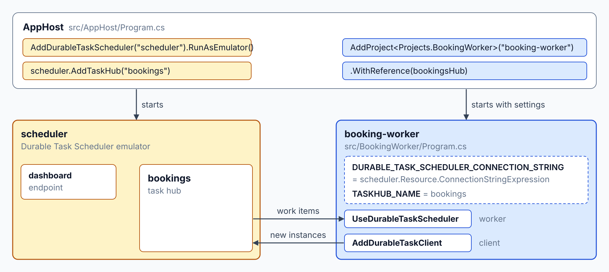
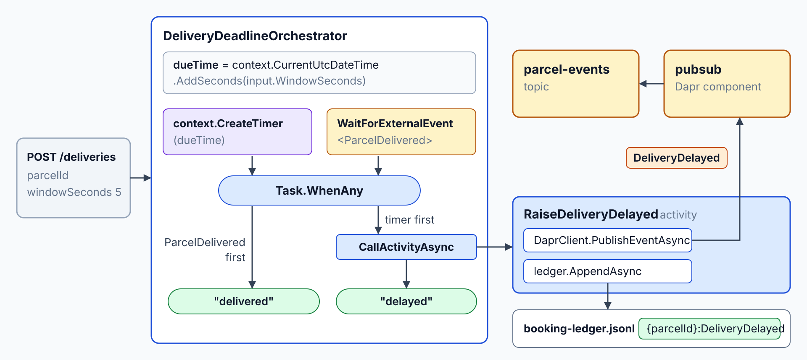
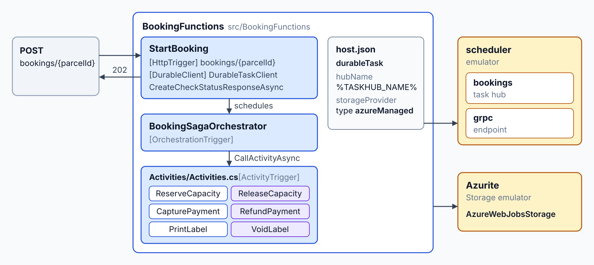
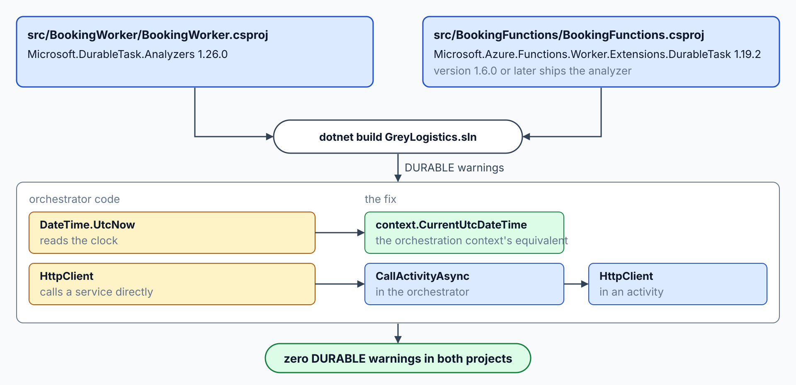

# Orchestrate the Booking Saga

Today the booking runs as plain service calls, so a crash between two calls can charge a customer and never print a label. By the end of this lab, the booking runs as a durable saga that compensates when a step fails, survives a worker restart, raises a delivery deadline, waits for a customer's reroute approval, and scales on Container Apps.

What you practice here: writing a durable orchestration with compensations, timers, and external events.

Duration: about 70 minutes.

Topics practiced: [Durable Execution: Replay & Determinism](../../demos/08-durable-execution/01-durable-execution/readme.md), [Durable Task Scheduler: Managed Backend](../../demos/08-durable-execution/02-durable-task-scheduler/readme.md), [Durable Functions: Orchestrations & Entities](../../demos/08-durable-execution/03-durable-functions/readme.md), [Durable Timers: External Events & Approvals](../../demos/08-durable-execution/04-timers-events/readme.md), [Durable Task SDK: KEDA-Scaled Workers](../../demos/08-durable-execution/05-durable-task-sdk/readme.md), [Saga Orchestration: Compensating Activities](../../demos/08-durable-execution/07-saga/readme.md)

------

Open `labs/08-durable-execution/grey-logistics/` in your editor with your AI coding agent (GitHub Copilot agent mode or Claude Code). The agent reads `AGENTS.md` for the class stack. The starter is the lab 7 solution.

You need Docker Desktop, the .NET 10 SDK, the Aspire CLI, and the Azure CLI with the `durabletask` and `containerapp` extensions. Step 7 also needs Azure Functions Core Tools.

Before step 1, run `az login` yourself. Then run `bash labs/08-durable-execution/provision.azcli` from the repository root in a second terminal (Git Bash on Windows works). Scheduler creation can take up to 15 minutes, and step 9 needs the resources it creates.

## What You Build

At the start, Grey books a parcel as plain service calls, so a crash between two calls can charge a customer and never print a label. At the end, a durable saga books the parcel on the Durable Task Scheduler, compensates the completed steps when one fails, and survives a worker restart. The lab then adds a delivery deadline timer, a reroute approval, a Durable Functions copy of the saga, and a KEDA scale rule that scales `booking-worker` on Container Apps from the scheduler backlog.

| Step | What you add | Why it matters |
| --- | --- | --- |
| [1](#step-1-host-the-booking-worker-on-the-emulator) | The Durable Task Scheduler emulator, the `bookings` task hub, and the `booking-worker` project in the AppHost | The backend and the worker start together, so the saga has a runtime to run in |
| [2](#step-2-write-the-booking-saga-with-compensations) | `BookingSagaOrchestrator` with its six activities and their compensations | A failed step runs the compensations of the completed steps in reverse order |
| [3](#step-3-make-each-activity-safe-to-repeat) | A retry policy on `PrintLabel` and an idempotency check on `CapturePayment` and `PrintLabel` | A retry or a restart can repeat an activity without a second charge or label |
| [4](#step-4-restart-the-worker-mid-saga) | A worker restart in the middle of a saga | The saga resumes from its stored history on the new worker |
| [5](#step-5-start-the-delivery-deadline-timer) | `DeliveryDeadlineOrchestrator` with a durable timer and a `ParcelDelivered` event | An expired delivery window raises `DeliveryDelayed` without a worker holding the wait |
| [6](#step-6-wait-for-the-customers-reroute-approval) | A 24-hour timer, a `RerouteApproved` event, and the approval endpoint | A customer decision can take hours or days without holding a worker |
| [7](#step-7-run-the-same-saga-as-durable-functions) | A Durable Functions project that runs the same saga on the `azureManaged` storage provider | Teams that host orchestrations in Azure Functions get the same behavior |
| [8](#step-8-enforce-replay-rules-with-the-analyzer) | The Durable Task analyzer in both projects | The build flags replay-unsafe calls before a deployment does |
| [9](#step-9-scale-the-worker-with-keda-on-container-apps) | A KEDA scale rule that scales `booking-worker` on Container Apps from the scheduler backlog | Worker replicas follow the backlog instead of a fixed count |


---

## Step 1: Host the Booking Worker on the Emulator

Overview: The saga needs a durable backend and a worker before any of its logic can run. This step adds the Durable Task Scheduler emulator and a booking worker to the AppHost, so one command starts the whole local system.

How it works: `src/AppHost/Program.cs` adds the scheduler with `AddDurableTaskScheduler("scheduler").RunAsEmulator()`, adds the `bookings` task hub with `AddTaskHub`, and passes the scheduler's `ConnectionStringExpression` and the `TASKHUB_NAME` setting to `booking-worker`. In `src/BookingWorker/Program.cs`, `UseDurableTaskScheduler` makes the worker receive work items from that task hub, and `AddDurableTaskClient` registers the client that starts instances. The [emulator and connection strings section](../../demos/08-durable-execution/02-durable-task-scheduler/readme.md#emulator-and-connection-strings) explains the connection string format.



Finding: A good answer adds the scheduler with `RunAsEmulator`, adds the `bookings` task hub, and passes the connection string and the task hub name to the worker through settings. The Aspire Durable Task Scheduler API is experimental: the build fails with error ASPIREDURABLETASK001 until the AppHost project suppresses that diagnostic.

Push back if the worker hard-codes `http://localhost:8080`, or if the agent suppresses any other diagnostic or suppresses this one outside the AppHost project.

Recipe:

```text
Confirm each Aspire and Durable Task API name on aspire.dev or Microsoft Learn before you write code that calls it.

Create src/BookingWorker/BookingWorker.csproj for .NET 10 from the ASP.NET Core empty template (dotnet new web). It references src/ServiceDefaults and the packages Microsoft.DurableTask.Worker.AzureManaged and Microsoft.DurableTask.Client.AzureManaged.

Create src/BookingWorker/Program.cs. It calls AddServiceDefaults, registers the worker with AddDurableTaskWorker, and connects it with UseDurableTaskScheduler. Read the connection string from the DURABLE_TASK_SCHEDULER_CONNECTION_STRING setting and the task hub name from the TASKHUB_NAME setting. Register the client with AddDurableTaskClient using the same connection string. Register no orchestrators or activities yet.

Create src/BookingWorker/.gitignore for the .NET stack and add the data/ folder to it.

Update src/AppHost/Program.cs. Add the scheduler with AddDurableTaskScheduler("scheduler") and RunAsEmulator(). Add the task hub bookings to the scheduler with AddTaskHub. Add the booking-worker project to the AppHost as booking-worker, reference the task hub with WithReference, and set DURABLE_TASK_SCHEDULER_CONNECTION_STRING to the scheduler's ConnectionStringExpression and TASKHUB_NAME to bookings.

Add src/BookingWorker/BookingWorker.csproj to GreyLogistics.sln.
```

Expected Outcome: Start the AppHost. The Aspire dashboard shows the scheduler, the bookings task hub, and booking-worker, and booking-worker reaches Running with no startup errors. The `dashboard` endpoint of the scheduler resource opens the emulator dashboard.

## Step 2: Write the Booking Saga with Compensations

Overview: A booking changes three services, so a failed step has to undo the steps before it. This step writes the saga as one deterministic orchestrator with a compensation stack, plus the activities and endpoints it needs.

How it works: `BookingSagaOrchestrator` in `src/BookingWorker/Sagas/BookingSagaOrchestrator.cs` derives from `TaskOrchestrator<string, string>`, calls each forward step with `CallActivityAsync`, and pushes each compensation onto a `Stack<Func<Task>>`. On a `TaskFailedException`, it pops and awaits each compensation, so the most recent completed step is undone first. The six activities in `src/BookingWorker/Activities/BookingActivities.cs` are registered with `AddActivity` in `src/BookingWorker/Program.cs`, and the [booking saga section](../../demos/08-durable-execution/07-saga/readme.md#the-booking-saga-and-its-compensations) explains the compensation order.


Finding: A good answer keeps the forward calls and their compensations inside the orchestrator, and it routes every side effect through an activity. With a CapturePayment failure only ReserveCapacity has completed, so the ledger shows one compensation and no PrintLabel. The reverse order becomes visible once two or more steps have completed.

Push back if the orchestrator writes to the ledger itself, catches a general exception where it should catch TaskFailedException, or runs the compensations in forward order.

Recipe:

```text
Add the booking saga to the booking worker in src/BookingWorker/.

Create src/BookingWorker/Sagas/BookingSagaOrchestrator.cs with the class BookingSagaOrchestrator, derived from TaskOrchestrator<string, string>. Its RunAsync takes the parcel ID and calls ReserveCapacity, CapturePayment, and PrintLabel in that order with CallActivityAsync. After each success, push the matching compensation (ReleaseCapacity, RefundPayment, VoidLabel) onto a Stack of Func of Task. On TaskFailedException, pop and await each compensation until the stack is empty, then return "compensated". The orchestrator makes no DateTime, Guid, environment, HTTP, or Task.Run calls.

Create src/BookingWorker/Activities/BookingActivities.cs with six TaskActivity<string, string> classes named ReserveCapacity, CapturePayment, PrintLabel, ReleaseCapacity, RefundPayment, and VoidLabel. Each activity takes the parcel ID, appends one JSON line to src/BookingWorker/data/booking-ledger.jsonl with the fields parcelId, activity, key (the parcel ID, a colon, and the activity name), and at, and returns the activity name. Put the ledger behind an interface IBookingLedger in src/BookingWorker/Ledger/, with a file implementation in src/BookingWorker/Ledger/FileBookingLedger.cs that reads the file on every call.

Read two test markers from the parcel ID. When the parcel ID contains FAIL- followed by an activity name, that activity throws before it writes its line. When the parcel ID contains SLOW, each forward activity waits 3 seconds before it writes its line.

In src/BookingWorker/Program.cs, add three endpoints. POST /bookings takes parcelId and returns the instance ID of a new BookingSagaOrchestrator instance. GET /bookings/{instanceId} returns the runtime status and output. GET /ledger/{parcelId} returns the activity names for that parcel in ledger order.
```

Expected Outcome: Post a booking for a parcel ID that contains `FAIL-CapturePayment`. The emulator dashboard lists that booking as Completed with the output compensated, and GET /ledger/{parcelId} for that parcel shows ReserveCapacity followed by ReleaseCapacity.

> **_NOTE:_** A gate test could prove this step, but this lab skips it to save time. It would check:
>
> - A failed CapturePayment runs the compensations of the completed steps in reverse order, and PrintLabel never runs.

## Step 3: Make Each Activity Safe to Repeat

Overview: The runtime runs each activity at least once, so a retry or a restart can repeat a payment. This step adds a retry policy to PrintLabel and an idempotency rule to CapturePayment and PrintLabel.

How it works: `BookingSagaOrchestrator` passes a `TaskOptions` value with a `TaskRetryOptions` and a `RetryPolicy` to the `PrintLabel` call only, with three attempts and a first retry after 5 seconds. In `src/BookingWorker/Activities/BookingActivities.cs`, `LedgerActivity.RunAsync` returns early when `Idempotent` is true and the ledger already holds the activity name for the parcel, and `CapturePayment` and `PrintLabel` set `Idempotent` to true. The [retry and idempotency section](../../demos/08-durable-execution/07-saga/readme.md#retry-policies-and-idempotent-activities) explains why a repeated call must return the first result.


Research:

```text
Read src/BookingWorker/Sagas/BookingSagaOrchestrator.cs and src/BookingWorker/Activities/BookingActivities.cs. For each of the six activities, decide whether a transient error justifies a retry and whether a second run would cause harm. For each activity that must not run twice, propose the key that a repeated call would use to return the first result. Explain your reasoning for each activity.
```

Finding: A good answer retries PrintLabel only, and it keys CapturePayment and PrintLabel with the parcel ID plus the activity name. Push back if the answer retries CapturePayment without a key, builds the key from a timestamp or a GUID, or restarts the whole saga from the HTTP caller when one activity fails.

Recipe:

```text
In src/BookingWorker/Sagas/BookingSagaOrchestrator.cs, call PrintLabel with TaskOptions that carry a TaskRetryOptions built from a RetryPolicy with maxNumberOfAttempts 3 and firstRetryInterval 5 seconds. Call the other forward activities and the compensations without retry options.

In src/BookingWorker/Activities/BookingActivities.cs, make CapturePayment and PrintLabel idempotent. Before each one does its work, read src/BookingWorker/data/booking-ledger.jsonl and look for a line whose key equals the parcel ID, a colon, and the activity name. If that line exists, return the activity name without writing a second line. Build the key from the parcel ID and the activity name only.

```

Expected Outcome: Two bookings with the same parcel ID leave one CapturePayment line in GET /ledger/{parcelId}.

## Step 4: Restart the Worker Mid-Saga

Overview: A saga is only useful if a worker can stop in the middle and the next worker finishes the booking. This step restarts the worker mid-saga and fixes the worker wherever the restart exposes a gap.

How it works: The scheduler hands the abandoned instance to the new worker, which replays the orchestrator from its stored history and skips each activity that already has a recorded result. `FileBookingLedger` in `src/BookingWorker/Ledger/FileBookingLedger.cs` reads `data/booking-ledger.jsonl` on every call, so a restarted worker sees each line that the stopped worker wrote. The [replay section](../../demos/08-durable-execution/01-durable-execution/readme.md#how-replay-rebuilds-state) explains how the runtime rebuilds the saga state from its history.



Finding: A good answer shows the saga resuming from its stored history, with the idempotent activities keeping CapturePayment to one ledger line. Stopping and starting booking-worker happens in the Aspire dashboard. Completion after the restart can take a short time while the scheduler hands the abandoned work item to the new worker.

Push back if the fix lengthens a timeout, adds a sleep, or starts the saga again by hand.

Recipe:

```text
Check src/BookingWorker/Ledger/FileBookingLedger.cs. If it caches lines in memory, change it to read src/BookingWorker/data/booking-ledger.jsonl on every call, so a restarted worker sees every line that the stopped worker wrote.

Post a booking for a parcel ID that contains SLOW, such as SLOW-restart-1, and note its instance ID. While the booking is still in progress, stop the booking-worker resource in the Aspire dashboard. Start booking-worker again from the dashboard, and wait until GET /bookings/{instanceId} reports Completed.
```

Expected Outcome: For the SLOW booking, GET /ledger/{parcelId} shows one CapturePayment line, and the instance reports Completed with the output booked.

> **_NOTE:_** A gate test could prove this step, but this lab skips it to save time. It would check:
>
> - A booking completes after the booking worker stops during the saga and starts again, with one CapturePayment line for the parcel.

## Step 5: Start the Delivery Deadline Timer

Overview: A parcel with a promised window must raise DeliveryDelayed when the window closes without a delivery, even when nobody is watching. This step adds a second orchestration that waits on a durable timer and on the ParcelDelivered event, so the wait holds no worker memory.

How it works: `DeliveryDeadlineOrchestrator` in `src/BookingWorker/Sagas/DeliveryDeadlineOrchestrator.cs` computes the due time from `context.CurrentUtcDateTime`, so every replay sees the same deadline, and it races `context.CreateTimer` against `context.WaitForExternalEvent<ParcelDelivered>` with `Task.WhenAny`. When the timer wins, the orchestrator calls the `RaiseDeliveryDelayed` activity, which publishes a `DeliveryDelayed` record through `DaprClient.PublishEventAsync` to the `parcel-events` topic of the `pubsub` component. The [durable timers section](../../demos/08-durable-execution/04-timers-events/readme.md#durable-timers) explains how a timer survives a restart.



Finding: A good answer uses CreateTimer for the window, WaitForExternalEvent for ParcelDelivered, and a race between the two. It takes any due time from the orchestration context, and it publishes DeliveryDelayed through the Dapr pubsub component, as lab 7 does. The ledger line proves that the activity ran.

Push back if the timer uses Task.Delay or DateTime.UtcNow, or if the activity writes the ledger without publishing the event.

Recipe:

```text
Create src/BookingWorker/Sagas/DeliveryWatchInput.cs with a record DeliveryWatchInput that has ParcelId (string) and WindowSeconds (int).

Create src/BookingWorker/Sagas/DeliveryDeadlineOrchestrator.cs with the class DeliveryDeadlineOrchestrator, derived from TaskOrchestrator<DeliveryWatchInput, string>. Start a durable timer for WindowSeconds and wait for the ParcelDelivered external event, and race the two. If ParcelDelivered arrives first, cancel the timer and return "delivered". If the timer fires first, call the RaiseDeliveryDelayed activity and return "delayed". Compute any due time from the orchestration context, never from the system clock.

In src/BookingWorker/Activities/BookingActivities.cs, add the RaiseDeliveryDelayed activity. It publishes a DeliveryDelayed event for the parcel to the topic parcel-events through the pubsub component with the Dapr client, as the tracking projection in src/TrackingService does, using the DeliveryDelayed record in src/Contracts/. Give booking-worker a Dapr sidecar in src/AppHost/Program.cs that references the pubsub component. Then it appends a DeliveryDelayed line to src/BookingWorker/data/booking-ledger.jsonl.

In src/BookingWorker/Program.cs, add POST /deliveries, which takes parcelId and windowSeconds and returns the instance ID of a new DeliveryDeadlineOrchestrator instance. Add GET /deliveries/{instanceId}, which returns the runtime status and output.
```

Expected Outcome: Post a delivery with a window of a few seconds, such as windowSeconds 5, for a parcel ID of your choice. Once the window closes, GET /ledger/{parcelId} shows one DeliveryDelayed line for that parcel.

> **_NOTE:_** A gate test could prove this step, but this lab skips it to save time. It would check:
>
> - A delivery window that closes without a ParcelDelivered event raises DeliveryDelayed once for the parcel.

## Step 6: Wait for the Customer's Reroute Approval

Overview: The customer decides whether to accept a reroute, and that decision can take hours. This step makes the orchestration wait for a RerouteApproved event with a 24-hour expiry, and it adds the endpoint that raises the event.

How it works: After `RaiseDeliveryDelayed`, `DeliveryDeadlineOrchestrator` races `context.WaitForExternalEvent<bool>("RerouteApproved", ...)` against a second `context.CreateTimer` due 24 hours after `context.CurrentUtcDateTime`, and it calls `RerouteParcel` only when the approval wins. The `POST /deliveries/{instanceId}/reroute-approval` endpoint in `src/BookingWorker/Program.cs` returns 404 for an unknown instance, and otherwise calls `RaiseEventAsync(instanceId, "RerouteApproved", true)`. The [external events section](../../demos/08-durable-execution/04-timers-events/readme.md#waiting-for-external-events) explains why a wait for a person pairs with a timer.



Finding: A good answer races the approval against a 24-hour durable timer, cancels the timer that loses, and calls RerouteParcel only after approval. The endpoint checks that the instance exists before it raises the event, and the event name matches on both sides.

Push back if the wait has no timer, if the endpoint raises an event for an unknown instance, or if the event name changes on one side only.

Recipe:

```text
Extend DeliveryDeadlineOrchestrator in src/BookingWorker/Sagas/DeliveryDeadlineOrchestrator.cs. After RaiseDeliveryDelayed, race the RerouteApproved external event (payload bool) against a durable timer of 24 hours. If the approval arrives first, cancel the timer, call the RerouteParcel activity, and return "rerouted". If the timer fires first, return "reroute declined".

In src/BookingWorker/Activities/BookingActivities.cs, add the RerouteParcel activity. It appends a RerouteParcel line to src/BookingWorker/data/booking-ledger.jsonl.

In src/BookingWorker/Program.cs, add POST /deliveries/{instanceId}/reroute-approval. It returns 404 when the instance does not exist. Otherwise it raises RerouteApproved on that instance with the payload true.
```

Expected Outcome: After you post the reroute approval to the waiting instance, the instance reports Completed with the output rerouted, and the ledger for that parcel holds a RerouteParcel line.

> **_NOTE:_** A gate test could prove this step, but this lab skips it to save time. It would check:
>
> - A RerouteApproved event sent to the waiting instance runs RerouteParcel and completes the instance as rerouted.

## Step 7: Run the Same Saga as Durable Functions

Overview: Some teams host orchestrations in Azure Functions, and the saga has to behave the same way there. This step adds a Durable Functions project on the .NET isolated worker model that connects to the same emulator through the azureManaged storage provider.

How it works: `src/BookingFunctions/` holds its own copy of the saga, with an `[OrchestrationTrigger]` parameter on `BookingSagaOrchestrator` and an `[ActivityTrigger]` parameter on each of the six activities in `src/BookingFunctions/Activities/Activities.cs`, so the project references no shared project. `StartBooking.cs` schedules the orchestration through the `[DurableClient]` binding and returns `CreateCheckStatusResponseAsync`, and `src/BookingFunctions/host.json` sets the `durableTask` extension to the `azureManaged` storage provider. The [host configuration section](../../demos/08-durable-execution/03-durable-functions/readme.md#host-configuration-and-the-azuremanaged-provider) explains how the app reaches the scheduler.



Finding: A good answer copies the orchestrator and the activity signatures into src/BookingFunctions/, so the Functions project stands alone. The host.json file sets the durableTask extension with storageProvider type azureManaged, and the local settings file stays out of git.

Push back if the Functions project references src/BookingWorker/ or any other shared project, or if the connection string is written into host.json.

Recipe:

```text
Create src/BookingFunctions/BookingFunctions.csproj as an Azure Functions project on the .NET 10 isolated worker model. Add the package Microsoft.Azure.Functions.Worker.Extensions.DurableTask.AzureManaged (prerelease) and the Azure Functions worker packages that the project template needs.

Copy the BookingSagaOrchestrator class and the six activity classes from src/BookingWorker/ into src/BookingFunctions/. Adapt them to Functions attributes: an OrchestrationTrigger parameter for the orchestrator and ActivityTrigger parameters for the activities. Give each activity a fixed return value and no ledger. Do not add a project reference to src/BookingWorker/ or to any shared project.

Add a StartBooking HTTP function on the route bookings/{parcelId} with the DurableClient binding. It schedules BookingSagaOrchestrator and returns the status URLs.

Create src/BookingFunctions/host.json with the extensions durableTask section. Set hubName to %TASKHUB_NAME% and storageProvider type to azureManaged with connectionStringName set to DURABLE_TASK_SCHEDULER_CONNECTION_STRING.

Create src/BookingFunctions/local.settings.example.json with AzureWebJobsStorage set to UseDevelopmentStorage=true, FUNCTIONS_WORKER_RUNTIME set to dotnet-isolated, DURABLE_TASK_SCHEDULER_CONNECTION_STRING set to Endpoint=http://localhost:8080;TaskHub=bookings;Authentication=None, and TASKHUB_NAME set to bookings. Create src/BookingFunctions/.gitignore for the .NET stack that ignores local.settings.json.
```

Expected Outcome: Start the AppHost, then stop booking-worker in the Aspire dashboard, because two hosts that register the same orchestrator on one task hub share its work items. Start Azurite, the local Storage emulator, in its own terminal.

Copy `local.settings.example.json` to `local.settings.json` in `src/BookingFunctions/`, replace `http://localhost:8080` with the `grpc` endpoint of the scheduler resource, then run `func start` from that folder. The output lists the StartBooking route.

A POST to `bookings/{parcelId}` returns 202 with status URLs, and the StatusQueryGetUri eventually reports Completed with the output booked. The `dashboard` endpoint of the scheduler resource lists the instance under the bookings task hub.

## Step 8: Enforce Replay Rules with the Analyzer

Overview: Replay breaks silently when an orchestrator reads the clock or calls a service directly. This step turns on the Durable Task analyzer for both projects, so the build reports those calls before a deployment does.

How it works: `src/BookingWorker/BookingWorker.csproj` references `Microsoft.DurableTask.Analyzers` 1.26.0, so the build reports `DURABLE` warnings for the orchestrators in `src/BookingWorker/Sagas/`. `src/BookingFunctions/BookingFunctions.csproj` references the `Microsoft.Azure.Functions.Worker.Extensions.DurableTask` package at version 1.19.2, and this step checks that project for `DURABLE` warnings too. The [determinism rules section](../../demos/08-durable-execution/01-durable-execution/readme.md#determinism-rules) lists the calls that the analyzer flags.



Finding: A good answer adds Microsoft.DurableTask.Analyzers to src/BookingWorker/BookingWorker.csproj. It also confirms that the Functions project gets the analyzer from its Durable Functions extension package at version 1.6.0 or later.

Push back if the fix adds a #pragma or NoWarn entry, or if it leaves an I/O call in an orchestrator.

Recipe:

```text
Add the package Microsoft.DurableTask.Analyzers to src/BookingWorker/BookingWorker.csproj. In src/BookingFunctions/BookingFunctions.csproj, confirm that the Durable Functions extension package is version 1.6.0 or later, so the analyzer ships with it.

Build GreyLogistics.sln. For every DURABLE warning in src/BookingWorker/Sagas/ or src/BookingFunctions/, move the non-deterministic or I/O call into an activity, or use the orchestration context's equivalent. Do not add pragmas or NoWarn entries.
```

Expected Outcome: `dotnet build GreyLogistics.sln` finishes with zero DURABLE warnings in both projects.

## Step 9: Scale the Worker with KEDA on Container Apps

Overview: The worker needs replicas that follow the backlog, not a fixed count. This step deploys booking-worker to Container Apps in `rg-azn-labs`, connects it to the Azure scheduler with the identity from provisioning, and adds the `azure-durabletask-scheduler` scale rule that counts pending activities.

How it works: `src/BookingWorker/Dockerfile` publishes the worker with the .NET 10 SDK image and runs it on the ASP.NET runtime image on port 8080, and `src/BookingWorker/Program.cs` joins the `DURABLE_TASK_SCHEDULER_CONNECTION_STRING` value (`Authentication=ManagedIdentity` with the identity's client ID) with `TASKHUB_NAME` into one scheduler connection. `worker.Configure` sets `MaximumConcurrentActivityWorkItems` to 1, and the `dts-activities` rule with `workItemType=Activity` and `maxConcurrentWorkItemsCount=1` asks for one replica per pending activity in the `bookings` task hub. The [Container Apps section](../../demos/08-durable-execution/05-durable-task-sdk/readme.md#running-workers-on-container-apps) lists every metadata field of that rule.

Finding: A good answer uses Authentication=ManagedIdentity with the identity's client ID in the connection string, and it stores no key or secret. The scale rule carries the same endpoint and task hub, with workItemType set to Activity, and the worker runs one activity at a time, so one pending activity asks for one replica.

This lab adds the activity rule only, because the saga spends its time in activities while each orchestration step finishes in milliseconds. Learn documents a second rule for orchestrations, and adding it needs YAML or Bicep, because a CLI update replaces the existing rule. The `--scale-rule-identity` flag is marked preview in the Container Apps CLI reference.

Push back if the connection string holds a key or secret, or if the worker runs without the Durable Task Data Contributor role on the bookings task hub.

Recipe:

```text
Create src/BookingWorker/Dockerfile for the booking worker on .NET 10. Use the .NET SDK image to build and the ASP.NET runtime image to run. In the build stage, copy src/BookingWorker/, src/ServiceDefaults/ and src/Contracts/, publish src/BookingWorker/BookingWorker.csproj, and listen on port 8080.

In src/BookingWorker/Program.cs, let the worker run one activity work item at a time: set Concurrency.MaximumConcurrentActivityWorkItems of DurableTaskWorkerOptions to 1 through Configure on the worker builder.

Do not write the registry name, the scheduler endpoint, or any key into code. The deployment supplies them through settings.
```

Run these commands in Git Bash from the grey-logistics folder. First, build the image in Azure Container Registry:

```bash
export MSYS_NO_PATHCONV=1
az acr build --registry acraznlabs08 --image booking-worker:1.0.0 --file src/BookingWorker/Dockerfile .
```

Then create the container app with the activity scale rule:

```bash
ENDPOINT=$(az durabletask scheduler show --resource-group rg-azn-labs --name dts-azn-labs-08 --query 'properties.endpoint' --output tsv)
IDENTITY_ID=$(az identity show --resource-group rg-azn-labs --name id-booking-worker --query id --output tsv)
CLIENT_ID=$(az identity show --resource-group rg-azn-labs --name id-booking-worker --query clientId --output tsv)
az containerapp create --name booking-worker --resource-group rg-azn-labs --environment cae-azn-labs-08 --image acraznlabs08.azurecr.io/booking-worker:1.0.0 --registry-server acraznlabs08.azurecr.io --registry-identity "$IDENTITY_ID" --user-assigned "$IDENTITY_ID" --ingress external --target-port 8080 --min-replicas 1 --max-replicas 5 --env-vars "DURABLE_TASK_SCHEDULER_CONNECTION_STRING=Endpoint=$ENDPOINT;Authentication=ManagedIdentity;ClientID=$CLIENT_ID" "TASKHUB_NAME=bookings" --scale-rule-name dts-activities --scale-rule-type azure-durabletask-scheduler --scale-rule-metadata "endpoint=$ENDPOINT" "taskhubName=bookings" "workItemType=Activity" "maxConcurrentWorkItemsCount=1" --scale-rule-identity "$IDENTITY_ID"
```

Send 20 bookings through the app's public address. The SLOW marker slows each forward step, so every booking holds its replica for several seconds:

```bash
FQDN=$(az containerapp show --resource-group rg-azn-labs --name booking-worker --query 'properties.configuration.ingress.fqdn' --output tsv)
for i in $(seq 1 20); do curl -s -X POST "https://$FQDN/bookings" -H "Content-Type: application/json" -d "{\"parcelId\":\"SLOW-$i\"}"; echo; done
```

Expected Outcome: In the Azure portal, Application > Scale for booking-worker lists the rule dts-activities with the type azure-durabletask-scheduler. Application > Revisions and replicas shows more than one replica while the backlog drains, and the count falls back toward one as the work clears. GET /bookings/{instanceId} reports Completed for the booked instances.

## Solution

The finished state is in `labs/08-durable-execution/grey-logistics-solution/`, produced by running this guide.

## Cleanup

Keep the Azure environment: the next lab deploys into the same resource group `rg-azn-labs`. Stop the AppHost. Run `deprovision.azcli` only if you end the class before lab 9; it deletes `rg-azn-labs` with everything the labs created.
