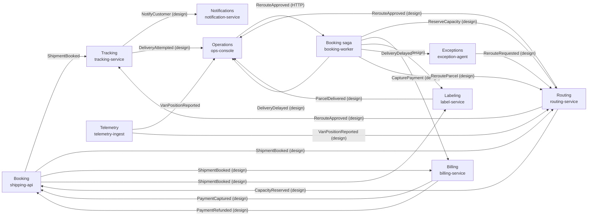

# Contoso Logistics Architecture

## Bounded Contexts

| Context | Service | Aggregates | Why it is a boundary |
| --- | --- | --- | --- |
| Booking | shipping-api, booking-worker | Shipment | The customer-facing entry point owns the shipment and its tracking number, and it scales with booking traffic. booking-worker runs the booking saga and the delivery deadline as durable orchestrations. |
| Routing | routing-service | Route | Route planning and van capacity are one consistent data set with their own optimisation logic, so no other service writes to them. |
| Billing | billing-service (design) | Payment (design) | Payment data needs stricter access control and its own store, and payment retries must not affect booking latency. |
| Labeling | label-service | Label | Label printing integrates with printer hardware and is deployed on its own schedule. |
| Tracking | tracking-service | Delivery | It serves the public tracking page from parcel scans and delivery state, a read-heavy workload that scales apart from booking. |
| Notifications | notification-service | CustomerNotification (design) | One team owns it and the volume is low, so it can start as a module in tracking-service and move out when its scaling or deployment needs differ. |
| Telemetry | telemetry-ingest | None | It receives van positions at a high, constant rate that needs its own scaling and has no shared data with other contexts. |
| Exceptions | exception-agent | None | It reacts to delivery delays and reroute requests, is a .NET worker with a Python embedding worker and ships on its own cadence. |
| Operations | ops-console | None | It is the operations user interface, owned by a frontend team and deployed as a web app that only reads and sends messages. |

## Service Map

## Flows

| Flow | Messages | Broker or HTTP | Reliability pattern | Ordering or retention |
| --- | --- | --- | --- | --- |
| Booking saga | BookShipment, ReserveCapacity, CapturePayment, PrintLabel, AssignRoute, ShipmentBooked, CapacityReserved, PaymentCaptured, LabelPrinted, PaymentRefunded | Durable Task scheduler (saga in booking-worker), Azure Service Bus (ShipmentBooked) | Saga (choreography or orchestration), Transactional outbox, Idempotent consumer | Session ID is the shipment ID (design), so the steps of one booking stay in order and no command is lost. |
| Delivery deadline | DeliveryDelayed | Azure Service Bus (parcel-events) | Idempotent consumer, Retry with exponential backoff and jitter | Durable timer per parcel in DeliveryDeadlineOrchestrator (design: scheduled message per shipment with the shipment ID as session ID). |
| Scan processing | ParcelScanned | Azure Service Bus | Idempotent consumer, Dead-lettering after the maximum delivery count | Session ID is the tracking number, so scans of one parcel stay in order, and unreadable scans move to the dead-letter queue. |
| Van telemetry | VanPositionReported | Azure Event Hubs | Idempotent consumer | Partition key is the van ID, so positions of one van stay in order, and the retention period lets several consumers replay them. |
| Proof of delivery | ProofOfDeliveryUploaded (design), ParcelDelivered | Azure Event Grid (ParcelDelivered), Azure Storage queue (proof-of-delivery blob events) | Transactional outbox, Claim check, Retry with exponential backoff and jitter | None needed, because each event announces a fact that partners subscribe to. |
| Tracking projection | ShipmentBooked, DeliveryAttempted (design), ParcelDelivered (design), RerouteApproved (design), NotifyCustomer (design) | Azure Service Bus (shipment-events) | Idempotent consumer, Dead-lettering after the maximum delivery count | Session ID is the shipment ID (design), so the tracking page applies changes in order and loses none. |
| Exception handling | DeliveryDelayed, RerouteRequested, RerouteParcel (design), RerouteApproved | Azure Service Bus (DeliveryDelayed, RerouteRequested), Durable Task scheduler (RerouteApproved) | Retry with exponential backoff and jitter, Dead-lettering after the maximum delivery count (design) | Session ID is the shipment ID (design), so a reroute follows its delay in order and no command is lost. |

The customer sends the BookShipment command to shipping-api as an HTTP POST request and receives back a 202 Accepted response with the shipment ID and tracking number while the booking saga continues.

## Saga Compensations

| Compensation | Undoes | Order |
| --- | --- | --- |
| VoidLabel | PrintLabel | 1 |
| RefundPayment | CapturePayment | 2 |
| ReleaseCapacity | ReserveCapacity | 3 |
